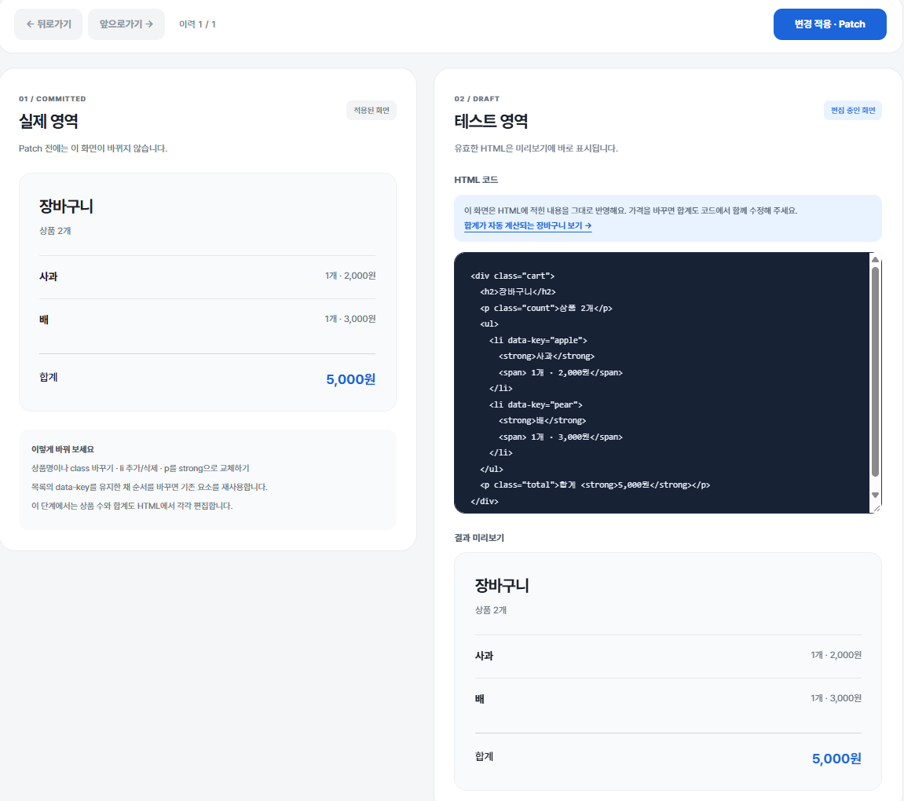
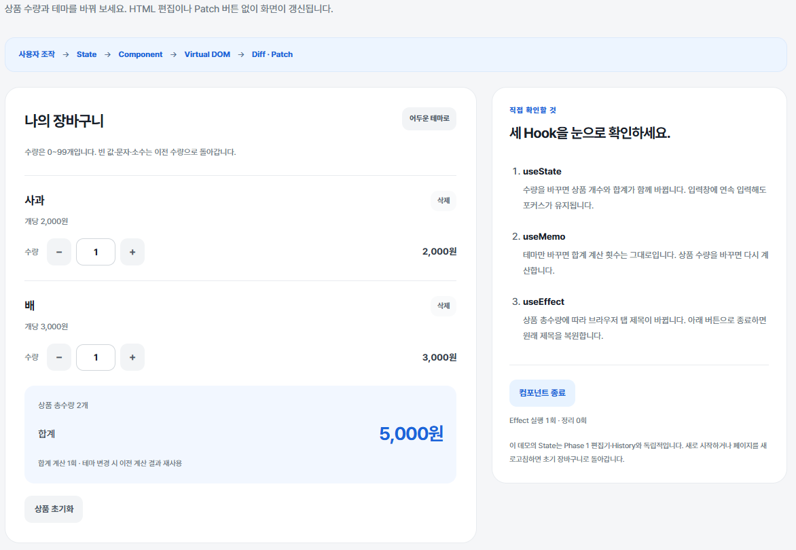
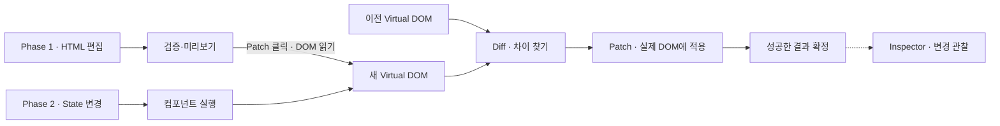
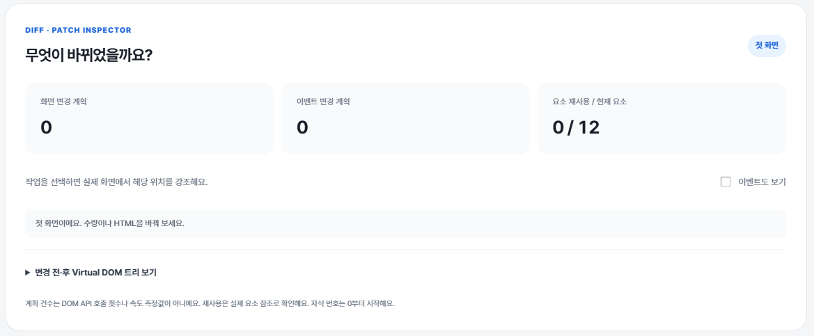

# mini-react

**화면이 바뀌는 과정을 직접 만들고, 눈으로 확인하는 미니 React.**

Vanilla JavaScript로 Virtual DOM·Diff·Patch와 함수형 컴포넌트·Hooks를 구현했습니다. HTML 편집기와 장바구니가 **하나의 갱신 엔진**을 공유하고, Diff·Patch Inspector로 변경 계획과 DOM 재사용을 관찰합니다.

`JavaScript (ES Modules)` · `HTML / CSS` · `Node.js 24+` · 외부 UI 프레임워크·런타임 패키지 없음

[실행 방법](#실행-방법) · [핵심 설계](#핵심-설계) · [검증](#검증) · [상세 문서](#상세-문서)

## 실행 화면

### Phase 1 · HTML을 편집하고 변경 사항 적용하기

코드를 수정하면 **테스트 미리보기만 갱신**됩니다. Patch를 누르면 이전·다음 트리를 비교해 실제 영역에 변경을 반영하고, 성공한 결과를 이력에 저장합니다. 뒤로가기·앞으로가기로 적용한 화면과 편집 코드를 함께 복원합니다.



> 이 단계의 상품 가격·합계는 HTML에 작성한 값입니다. 수량에 따른 자동 계산은 Phase 2에서 확인합니다.

### Phase 2 · State가 바뀌면 화면도 함께 갱신하기

수량·테마를 조작하면 루트 컴포넌트가 새 Virtual DOM을 반환하고, 같은 Diff·Patch 엔진이 필요한 DOM을 갱신합니다.

| 조작 | 확인할 동작 |
| --- | --- |
| 상품 수량 변경 | `useState`로 값을 유지하고 개수·합계를 갱신 |
| 화면 테마 변경 | `useMemo`가 의존성이 같은 합계 계산 결과를 재사용 |
| 컴포넌트 종료·다시 시작 | `useEffect` 정리와 탭 제목 복원, 초기 State로 재시작 |



## 핵심 설계

### 다른 입력, 하나의 갱신 엔진



**Diff는 차이를 찾는 단계, Patch는 찾은 차이를 실제 DOM에 적용하는 단계입니다.** Diff는 DOM을 직접 다루지 않고 두 VNode 트리를 비교해 작업 목록을 반환합니다. Patch가 그 계획을 실제 DOM에 적용합니다.

### 무엇을 선택했고, 왜 그렇게 만들었는가

| 설계 선택 | 이 방식을 선택한 이유 | 구현 |
| --- | --- | --- |
| **Diff와 Patch 분리·두 Phase에서 공유** | 차이 계산을 브라우저 없이 테스트하고, 입력 방식이 달라도 같은 화면 갱신 규칙을 사용하기 위해 | [diff.js](src/diff.js) · [dom.js](src/dom.js) |
| **키가 있으면 식별자, 없으면 같은 위치로 대응** | `data-key`로 순서가 바뀐 항목도 추적하고 기존 DOM을 재사용하기 위해. 키가 없으면 같은 자식 인덱스끼리 비교 | [diff.js](src/diff.js) |
| **전체 트리·HTML 소스를 이력에 저장** | 과거 화면과 편집 코드를 스냅샷에서 함께 복원하기 위해. 변경 명령을 역순으로 되돌리는 구조 대신 저장 공간을 사용하는 단순한 구조 선택 | [history.js](src/history.js) |
| **새 변경 시 앞으로가기 이력 제거** | 이력을 하나의 직선 경로로 관리해 앞으로가기 대상을 명확히 하기 위해. `A → B → C`에서 B로 돌아가 D를 적용하면 `A → B → D` | [history.js](src/history.js) |
| **적용 성공 후에만 이력 확정** | 저장된 화면과 실제 화면이 어긋나지 않게 하기 위해. 실패하면 이전 화면으로 복구하고 기존 이력·인덱스를 유지 | [playground.js](src/playground.js) |
| **함수는 VNode 반환, 루트 인스턴스는 State·갱신 관리** | UI 계산과 상태 보존을 나누기 위해. 루트가 Hook 배열을 유지하고 자식에는 props로 값을 전달. 루트 전용 State는 과제 제약 | [component.js](src/component.js) |
| **선택적 콜백으로 시각화 연결** | 엔진이 관찰 UI에 의존하지 않게 하기 위해. Inspector 오류가 이미 성공한 갱신을 취소하지 않도록 분리 | [inspector.js](src/inspector.js) |

키가 `A·B·C`인 목록 앞에 `D`를 추가할 때, 기존 `A·B·C`를 모두 새로 만들 필요는 없습니다. 키로 이전 항목과 대응시키고 기존 DOM 참조를 유지합니다. 위치 차이에 대한 이동 계획이 생길 수 있으며, 전역 최소 이동 횟수를 보장하는 알고리즘은 아닙니다.

<details>
<summary>State와 Hooks의 선택 이유 더 보기</summary>

| 선택 | 이유 |
| --- | --- |
| setter가 컴포넌트 실행·Diff·Patch를 연결 | 상태만 바꾸고 화면 갱신을 빠뜨리지 않도록, 변경 요청에서 갱신까지 한 경로로 처리 |
| Hook 정보를 인스턴스 배열에 보관 | 함수가 다시 실행되어도 State·Memo 결과·Effect 정리 함수를 유지 |
| Hook 호출 순서·종류·개수 검사 | 배열 위치로 저장 공간을 찾으므로, 조건부 호출로 다른 Hook의 값을 사용하는 오류를 방지 |
| `useMemo`에 계산 결과와 의존성 저장 | 테마처럼 계산과 관계없는 값이 바뀔 때 동일한 합계 계산을 반복하지 않도록 재사용 |
| DOM 반영 성공 후 Effect 실행 | 실패한 화면 갱신을 기준으로 탭 제목 같은 외부 작업을 실행하지 않도록 순서를 분리 |
| Effect 정리 함수 보관 | 재실행 전·컴포넌트 종료 시 이전 작업을 정리하고, 데모의 탭 제목을 복원 |

컴포넌트 재실행은 **새 화면 표현을 계산하는 것**이며, 실제 DOM 전체 교체를 뜻하지 않습니다. 변경 범위는 이후 Diff·Patch가 결정합니다. 이 구현의 Effect는 DOM 반영 후 실행하며, 브라우저의 화면 그리기 완료를 보장하지 않습니다.

</details>

## 차별화 · Diff·Patch Inspector

결과 화면뿐 아니라 **무엇이 바뀌었고 어떤 요소가 유지됐는지** 확인할 수 있도록 두 데모 하단에 관찰 도구를 구현했습니다.

- **변경 계획:** 텍스트·속성·삽입·삭제·교체·이동 작업과 이벤트 변경을 확인합니다.
- **요소 재사용:** 이전·다음 실제 DOM 참조를 비교해 유지된 요소 수를 표시합니다.
- **작업 위치 강조:** 목록에서 작업을 선택하면 실제 화면의 해당 위치를 표시합니다.
- **트리 비교:** 변경 전·후 Virtual DOM을 펼쳐 결과를 확인합니다.



> 위 캡처는 변경 적용 전 초기 상태입니다. 수량을 바꾸거나 HTML을 Patch하면 작업 목록이 나타납니다. 작업 건수는 DOM API 호출 횟수나 성능 측정값이 아닙니다.

강조 표시는 관리 DOM 밖의 오버레이로 그려, 관찰을 위해 화면 트리 자체를 수정하지 않습니다. [상세 설계](docs/design/ui-inspector.md)

## 검증

**화면이 맞게 보이는지와 기존 DOM이 유지되는지를 구분해 검증했습니다.**

| 범위 | 주요 확인 사항 | 기록된 결과 |
| --- | --- | --- |
| 순수 로직 | Diff의 변경 종류·위치·목표값, 키 대응, History 전이, HTML 입력·직렬화 | **164/164** — 2026-11-11 재실행 |
| 브라우저 | DOM 변환·부분 Patch·참조 유지, Hooks·이벤트·포커스, 컨트롤러·시각화·실패 복구 | **103/103** — 2026-11-10 검증 기록 |
| 화면 확인 | 데스크톱·320px 폭 레이아웃과 실제 데모 조작 | 2026-11-10 검증 기록 |

대표적인 경계 사례는 다음과 같습니다.

- **앞 삽입·재정렬:** 키가 같은 기존 항목의 DOM 참조 유지.
- **이력 분기:** 과거로 이동한 뒤 새 변경을 적용하면 앞으로가기 이력 제거.
- **잘못된 HTML·적용 실패:** 잘못된 입력은 Patch 차단, 적용 실패 시 복구하고 이력 오염 방지.
- **Hook 호출 규칙 위반:** 조건부 호출 등으로 순서·종류·개수가 달라지면 오류 처리.
- **관찰 중 복구:** DOM 재생성 후 Inspector가 새 참조를 기준으로 다시 관찰.

검증 환경은 Windows / Node.js v24.14.1 / Chromium 기반 인앱 브라우저입니다. 브라우저 결과는 위 날짜의 기록이며 모든 브라우저 호환성을 의미하지 않습니다. 요구사항별 사례와 검증 한계는 [검증 계획](docs/testing.md)에 정리했습니다.

## 실행 방법

Node.js **24 이상**이 필요합니다. 프로젝트 루트에서 실행합니다. 외부 패키지 설치는 필요하지 않습니다.

```sh
npm start
```

| 페이지 | 주소 |
| --- | --- |
| Phase 1 · HTML 편집기 | http://localhost:5173/ |
| Phase 2 · 장바구니 | http://localhost:5173/phase2.html |
| 브라우저 테스트 | http://localhost:5173/test/browser/index.html |

브라우저 테스트 페이지를 열면 테스트가 실행되고 결과가 표시됩니다. 서버 종료는 실행한 터미널에서 `Ctrl+C`입니다. HTML 파일을 직접 여는 대신 위 HTTP 주소로 접속합니다.

```sh
npm test
```

하위 프로세스 생성이 차단되어 `spawn EPERM`이 발생하는 환경에서는 `npm run test:in-process`를 사용합니다. 이 명령은 파일별 테스트 격리를 끄므로 일반 실행과 구분합니다.

## 구현 범위와 한계

- 지원하는 Diff 사례는 텍스트·속성 변경, 자식 추가·삭제, 요소 교체와 키 기반 대응·이동입니다.
- State와 Hook은 **루트 컴포넌트에서만** 관리합니다. 자식은 props를 받아 VNode를 반환하는 순수 함수입니다.
- 두 데모는 별도 DOM 루트를 사용합니다. Phase 2의 State는 Phase 1 편집 코드·History와 독립적입니다.
- Phase 1 HTML은 제한 문법을 따르며, 입력 코드를 `innerHTML`로 실행하지 않습니다. 이력은 메모리에만 저장되어 새로고침하면 초기화됩니다.
- 실제 React의 전체 API를 복제하지 않습니다. JSX·Fiber·동시 렌더링·자동 Batching은 구현 범위에 포함하지 않았습니다.
- 부분 갱신과 노드 재사용을 검증했으며, 실제 React 대비 성능 우위는 측정하지 않았습니다.

## 문서와 AI 협업

**요구사항 → 설계 → 테스트 → 구현 → 실행 검증**을 연결해, AI가 생성한 결과를 설명하고 검토할 수 있도록 문서를 구성했습니다.

팀원 각자가 문서와 구현을 작성하고 PR로 서로 비교·리뷰했습니다. 이 저장소는 그중 개인 구현 결과입니다. 사용자는 기대 동작·주요 설계 선택·결과 채택을 판단했고, AI는 문서·코드·테스트 작성과 검토를 지원했습니다. AI의 검토 의견과 실제 실행 결과는 구분해 기록했습니다.

### 상세 문서

| 문서 | 확인할 내용 |
| --- | --- |
| [요구사항 명세서](docs/requirements.md) | 기능 ID별 기대 동작·인수 조건·제약 |
| [전체 설계](docs/design.md) | 모듈 책임·의존성·데이터 흐름 |
| [HTML 입력](docs/design/html-input.md) · [Virtual DOM](docs/design/virtual-dom.md) | 입력 검증·트리 표현·변환 |
| [Diff·Patch](docs/design/diff-patch.md) · [History](docs/design/history.md) | 키 대응·변경 적용·복구·이력 정책 |
| [컴포넌트·Hooks](docs/design/component-hooks.md) | State 소유권·Hook 저장·갱신·정리 |
| [UI·시각화](docs/design/ui-inspector.md) | 관찰 콜백·참조 재사용·오버레이 |
| [검증 계획](docs/testing.md) | 요구사항별 정상·경계·실패 사례와 실행 기록 |
| [AI 작업 규칙](AGENTS.md) | 작업 경계·문서 책임·검증·보고 규칙 |
| [요구사항 작성 가이드](docs/guides/requirements-specification.md) | 명세 항목 양식과 검토 기준 |

[과제 원문](https://github.com/WEEK11-12/mini-react/blob/main/docs/assignment.md) · [팀 Discussion](https://github.com/orgs/WEEK11-12/discussions) · [팀 Wiki](https://github.com/WEEK11-12/mini-react/wiki)

## 라이선스

현재 LICENSE 파일은 없습니다. 공개 재사용 조건은 팀이 결정한 뒤 명시합니다.
