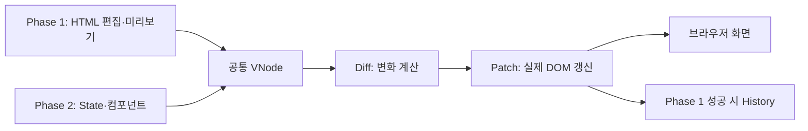

# mini-react

Virtual DOM부터 Hooks까지 직접 구현하며, **데이터 변경 → 새 UI 계산 → 차이 확인 → 필요한 DOM 갱신**의 흐름을 탐구하는 프로젝트입니다. 최종 결과물은 사용자의 입력·클릭에 따라 부분적으로 갱신되는 웹 페이지입니다.

이 저장소는 과제의 필수 동작을 먼저 충족하고, 구현 선택의 이유와 검증 근거를 함께 남깁니다. 실제 React의 전체 API나 내부 구현을 복제하는 것이 목표는 아닙니다.

## 구현 범위

| 단계 | 필수 내용 |
| --- | --- |
| Phase 1 | DOM 읽기·Virtual DOM·Diff·Patch, 실제/테스트 영역 편집 데모, Patch와 State History 이동 |
| Phase 2 | 함수형 컴포넌트, 루트 State, `useState`·`useEffect`·`useMemo`, Phase 1 갱신 경로 재사용 |
| 검증 | 핵심 모듈의 단위 테스트와 브라우저 기능 테스트 |

기본 Diff 검증 사례는 **텍스트 변경·속성 변경·자식 추가·자식 삭제·요소 교체**입니다. Batching과 다른 차별화 기능은 필수 범위를 완료한 뒤 검토할 선택 후보입니다.

**기술 제약:** HTML·CSS·Vanilla JavaScript를 사용합니다. React·Vue 같은 외부 UI 프레임워크는 사용하지 않습니다. State와 Hook은 루트 컴포넌트에서만 관리하고, 자식 컴포넌트는 props를 받는 순수 함수로 둡니다.

## 문서 읽는 순서

| 문서 | 읽는 이유 |
| --- | --- |
| [과제 원문](https://github.com/WEEK11-12/mini-react/blob/main/docs/assignment.md) | 출발점이 되는 필수 기능과 기술 제약 확인 |
| [요구사항 명세서](docs/requirements.md) | **무엇을 구현하고 어떤 결과면 완료인지** 확인. 이 Markdown 파일이 SRS 본문 |
| [설계 문서](docs/design.md) | 전체 흐름·모듈 경계·선택 이유 확인 |
| [HTML 입력](docs/design/html-input.md) | Phase 1 코드 문법, 검증, 오류·미리보기 경계 |
| [Virtual DOM](docs/design/virtual-dom.md) | DOM과 VNode의 변환·표현·렌더링 |
| [Diff·Patch](docs/design/diff-patch.md) | 키/위치 대응, 변경 계획, DOM 반영·복구 |
| [History](docs/design/history.md) | Patch 저장, 뒤로·앞으로, 미래 이력 삭제 |
| [컴포넌트·Hooks](docs/design/component-hooks.md) | 루트 State, 세 Hook, 이벤트·Effect |
| [검증 계획](docs/testing.md) | FR별 테스트 ID, 정상·실패·엣지 케이스 |
| [AI 작업 규칙](AGENTS.md) | AI가 읽을 문서, 결정 상태 처리, 변경·검증·보고 규칙 확인 |
| [요구사항 작성 가이드](docs/guides/requirements-specification.md) | ID별 항목 양식과 PR 검토 기준 확인 |
| [팀 Wiki](https://github.com/WEEK11-12/mini-react/wiki) | React 개념 학습 자료 확인 |

요구사항은 **기대 동작**, 설계는 **해결 방법**, 검증 계획은 **그 동작을 확인할 사례**를 기록합니다. 요구사항의 기본 양식은 **ID · 요구 동작 · 출처 · 우선순위 · 인수 조건**입니다. 과제 조건·사용자가 정한 방향은 “확정”, 설계 초안이 채운 세부 정책은 “제안”으로 구분합니다. 제안은 팀 리뷰 대상입니다.

## 현재 상태와 실행

현재 저장소는 문서화 단계입니다. 실행 가능한 미니 React 코드·데모·테스트 결과는 아직 없습니다. [검증 계획](docs/testing.md)의 도구·사례는 예정 사항이며 통과 기록이 아닙니다. 실제로 검증된 실행·테스트 명령이 생기면 이 절에 환경과 명령을 추가합니다.

## 협업 방식

팀원 각자가 요구사항·설계 문서의 구조와 내용을 작성해 PR로 제안하고, 서로 검토해 채택합니다. [이슈](https://github.com/WEEK11-12/mini-react/issues)와 [프로젝트 보드](https://github.com/orgs/WEEK11-12/projects/1)는 작업 현황을, [Discussion](https://github.com/orgs/WEEK11-12/discussions)은 학습·결정 공유를 다룹니다.

AI는 문서·코드·테스트 작성과 검토를 도울 수 있습니다. 기대 동작, 설계 선택, 결과 채택은 팀이 판단하며, 실행 결과와 AI 검토 의견은 구분해 기록합니다.

## 라이선스

현재 LICENSE 파일은 없습니다. 공개 재사용 조건은 팀이 결정한 뒤 명시합니다.
