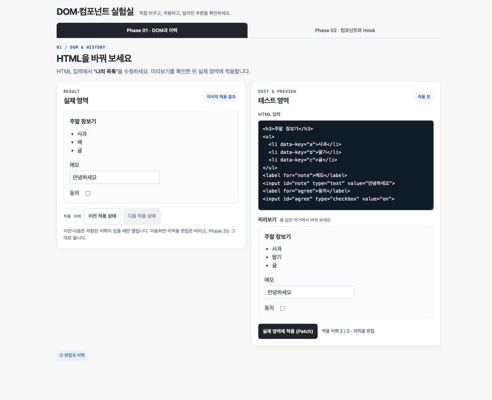
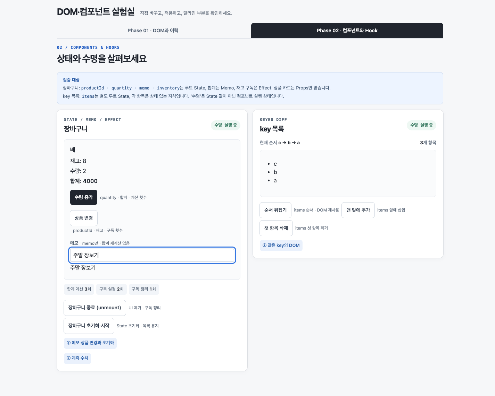
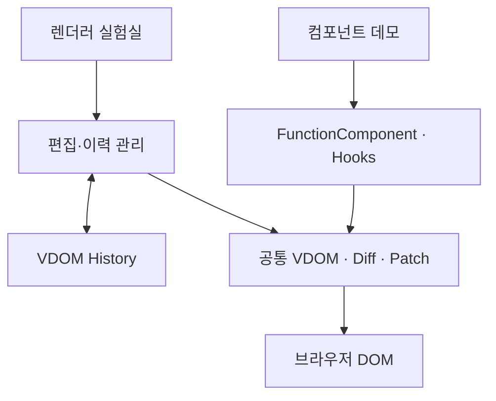

# mini-react

React 없이 Virtual DOM과 Hook을 구현하고, 상태 변경이 DOM 갱신으로 이어지는 과정을 확인하는 프로젝트다.

## 기본 스펙

| 구분 | 상세 |
| --- | --- |
| 언어·화면 | TypeScript, Vanilla HTML/CSS |
| 구현 | VDOM·Diff·Patch, 함수형 컴포넌트, `useState`·`useEffect`·`useMemo` |
| 시연 | HTML 편집·적용·이력 이동, 장바구니와 key 기반 목록 갱신 |
| 도구 | Vite, Vitest/jsdom, Playwright |

## 서비스 프리뷰

### 렌더러 실험실



### 컴포넌트 데모



## 서비스 구조



- 두 시연은 공통 렌더러를 사용하되, VDOM 이력과 컴포넌트 State는 별도로 관리한다.
- [상세 설계](docs/design/architecture.md) · [설계 목차](docs/design/README.md)

## 팀과 AI 활용

### 팀원과 진행 기간

| 팀원 | GitHub |
| --- | --- |
| 이현지 | [szlovelee](https://github.com/szlovelee) |
| 지영은 | [jye-1123](https://github.com/jye-1123) |

- 진행 기간: 2026.11.05 ~ 2026.11.11

### 팀 목표

- 두 팀원 모두 AI를 활용한 개발 전체 과정을 경험한다.
- AI 활용 방법론과 개발 과정에서 사람의 역할을 탐색한다.
- 각자 구현을 진행하되, 서로의 작업물을 꼼꼼히 읽고 고민과 피드백을 나눈다.

### 협업 방식

- GitHub Issues·Discussions·Wiki로 소통하고 서로의 PR에 리뷰를 작성했다.
- 개발자는 학습·이해를 바탕으로 진행 관리와 의사결정에 참여하고, AI는 구현·검토를 지원했다.
- [팀 위키](https://github.com/WEEK11-12/mini-react/wiki) · [협업 과정과 AI 검증 방식](docs/collaboration.md)

## 실행

프로젝트 루트에서 실행한다. 테스트 환경은 Node.js 24 이상을 요구한다.

```sh
npm ci
npm run dev
```

- 빌드: `npm run build`
- 테스트 실행·검증 범위: [테스트 안내](tests/README.md)

## 더 읽기

| 문서 | 내용 |
| --- | --- |
| [기술적 선택과 문제 해결](docs/technical-notes.md) | 중점 구현, 수정 사례, React와의 동작 차이 |
| [협업과 AI 활용](docs/collaboration.md) | 팀 작업 방식, 상호 리뷰, 사람과 AI의 역할 |
| [후기](docs/retrospective.md) | 팀원별 경험과 회고 |
| [과제 원문](docs/assignment.md) · [요구사항](docs/requirements.md) | 프로젝트 기준과 구현 범위 |
| [단계별 구현·검증 기록](docs/technical-notes.md#단계별-구현검증-기록) | 단계별 변경과 검증 근거 |
