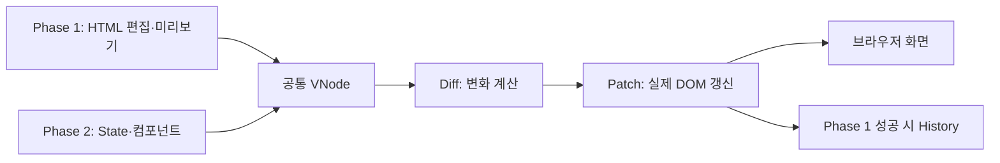

# mini-react

Virtual DOM부터 Hooks까지 직접 구현하며, **데이터 변경 → 새 UI 계산 → 차이 확인 → 필요한 DOM 갱신**의 흐름을 탐구하는 프로젝트입니다. 최종 결과물은 사용자의 입력·클릭에 따라 부분적으로 갱신되는 웹 페이지입니다.

이 저장소는 과제의 필수 동작을 먼저 충족하고, 구현 선택의 이유와 검증 근거를 함께 남깁니다. 실제 React의 전체 API나 내부 구현을 복제하는 것이 목표는 아닙니다.

## 구현 범위

| 단계 | 필수 내용 |
| --- | --- |
| Phase 1 | DOM 읽기·Virtual DOM·Diff·Patch, 실제/테스트 영역 편집 데모, Patch와 State History 이동 |
| Phase 2 | 함수형 컴포넌트, 루트 State, `useState`·`useEffect`·`useMemo`, Phase 1 갱신 경로 재사용 |
| 검증 | 핵심 모듈의 단위 테스트와 브라우저 기능 테스트 |

기본 Diff 검증 사례는 **텍스트 변경·속성 변경·자식 추가·자식 삭제·요소 교체**입니다. Batching과 다른 차별화 기능은 필수 범위를 완료한 뒤 검토할 선택 후보입니다.

**기술 제약:** HTML·CSS·Vanilla JavaScript를 사용합니다. React·Vue 같은 외부 UI 프레임워크는 사용하지 않습니다. State와 Hook은 루트 컴포넌트에서만 관리하고, 자식 컴포넌트는 props를 받는 순수 함수로 둡니다.



## 문서 읽는 순서

| 문서 | 읽는 이유 |
| --- | --- |
| [과제 원문](https://github.com/WEEK11-12/mini-react/blob/main/docs/assignment.md) | 출발점이 되는 필수 기능과 기술 제약 확인 |
| [요구사항 명세서](docs/requirements.md) | **무엇을 구현하고 어떤 결과면 완료인지** 확인. 이 Markdown 파일이 SRS 본문 |
| [설계 문서](docs/design.md) | 전체 흐름·모듈 경계·선택 이유 확인 |
| [HTML 입력](docs/design/html-input.md) | Phase 1 코드 문법, 검증, 오류·미리보기 경계 |
| [Virtual DOM](docs/design/virtual-dom.md) | DOM과 VNode의 변환·표현·렌더링 |
| [Diff·Patch](docs/design/diff-patch.md) | 키/위치 대응, 변경 계획, DOM 반영·복구 |
| [History](docs/design/history.md) | Patch 저장, 뒤로·앞으로, 미래 이력 삭제 |
| [컴포넌트·Hooks](docs/design/component-hooks.md) | 루트 State, 세 Hook, 이벤트·Effect |
| [UI·시각화](docs/design/ui-inspector.md) | 공통 화면 스타일과 Diff·Patch 관찰 기능의 구조·검증 기준 |
| [검증 계획](docs/testing.md) | FR별 테스트 ID, 정상·실패·엣지 케이스 |
| [AI 작업 규칙](AGENTS.md) | AI가 읽을 문서, 결정 상태 처리, 변경·검증·보고 규칙 확인 |
| [요구사항 작성 가이드](docs/guides/requirements-specification.md) | ID별 항목 양식과 PR 검토 기준 확인 |
| [팀 Wiki](https://github.com/WEEK11-12/mini-react/wiki) | React 개념 학습 자료 확인 |

요구사항은 **기대 동작**, 설계는 **해결 방법**, 검증 계획은 **그 동작을 확인할 사례**를 기록합니다. 요구사항의 기본 양식은 **ID · 요구 동작 · 출처 · 우선순위 · 인수 조건**입니다. 과제 조건·사용자가 정한 방향은 “확정”, 설계 초안이 채운 세부 정책은 “제안”으로 구분합니다. 제안은 팀 리뷰 대상입니다.

## 현재 상태와 실행

| 범위 | 현재 상태 |
| --- | --- |
| Phase 1 · FR-01~09 | DOM 변환·렌더링, Diff·부분 Patch, HTML 편집과 오류 보존, 선형 Undo/Redo 구현 |
| Phase 2 · FR-10~17 | FunctionComponent·루트 State·세 Hook, 공통 Diff/Patch와 연결한 장바구니 데모 구현 |

Node.js 24 이상이 필요합니다. 외부 패키지 설치 없이 실행합니다.

```sh
npm test
npm start
```

- 데모: [http://localhost:5173](http://localhost:5173)
- Phase 2 장바구니: [http://localhost:5173/phase2.html](http://localhost:5173/phase2.html)
- 브라우저 테스트: [http://localhost:5173/test/browser/index.html](http://localhost:5173/test/browser/index.html) — 페이지를 열면 실제 DOM·컨트롤러 테스트가 실행되고 결과를 표시합니다.
- 서버 종료: 실행 중인 터미널에서 `Ctrl+C`.

하위 프로세스 생성이 차단되어 `npm test`가 `spawn EPERM`으로 끝나는 환경에서는 `npm run test:in-process`를 사용합니다. 파일별 격리를 끄는 실행이므로 일반 실행과 구분합니다. 기본 포트는 5173이며 `PORT` 환경변수로 변경할 수 있습니다. 파일을 직접 여는 `file://` 대신 위 HTTP 주소를 사용합니다.

2026-11-10 검증: Windows / Node.js v24.14.1에서 **순수 로직 164/164**, Chromium 기반 인앱 브라우저에서 **103/103** 통과했습니다. 브라우저 사례에는 두 Phase의 필수 동작, Chrome DOM 추가 속성 호환, Diff·Patch 시각화·노드 재사용·오류 복구 후 관찰 기준 회복이 포함됩니다. 데스크톱과 320px 폭에서 화면·가로 넘침을 확인하고 실제 페이지 조작도 별도로 검증했습니다. 상세 범위와 환경 제한은 [검증 계획](docs/testing.md)에 둡니다.

## 구현을 읽는 순서

| 파일 | 책임 |
| --- | --- |
| [vnode.js](src/vnode.js) | DOM 없이 UI를 표현하는 객체, 검증·트리 동등성·키 |
| [html-policy.js](src/html-policy.js) · [html-input.js](src/html-input.js) | 허용 문법을 공유하고 HTML 문자열을 VNode로 변환, 최초 편집 소스 생성 |
| [diff.js](src/diff.js) | 이전·다음 VNode를 읽어 변경 종류·이전 경로·목표 위치 계산 |
| [dom.js](src/dom.js) | DOM 읽기·생성, 기존 노드를 재사용하는 Patch |
| [history.js](src/history.js) | 전체 트리·소스 스냅샷과 현재 인덱스. DOM 의존성 없음 |
| [playground.js](src/playground.js) · [app.js](src/app.js) | 입력·버튼을 엔진에 연결하고 성공 후 이력을 확정, 실패 시 복구 |
| [component.js](src/component.js) | 루트 인스턴스와 Hook 슬롯, State 변경·커밋·Effect 정리 |
| [cart.js](src/cart.js) | props 기반 자식과 수량·테마·합계·문서 제목 데모 |
| [inspector.js](src/inspector.js) | 성공한 커밋의 작업·트리·DOM 참조 재사용을 관찰하고 외부 오버레이 표시 |

`HTML 편집 → 검증 → 미리보기 → Patch 클릭 → 미리보기 DOM 읽기 → Diff → 실제 DOM Patch → History 확정`

지원 HTML은 설계의 제한 문법을 따릅니다. 입력 코드를 `innerHTML`로 실행하지 않으며, 이력은 메모리에만 있어 새로고침 시 초기화됩니다. 키 없는 목록은 위치를 기준으로 비교하므로 항목의 정체성은 보장하지 않습니다.

### Phase 2 확인 방법

1. 수량 입력·증감 버튼: State가 바뀌면 합계와 화면이 자동 갱신됩니다.
2. 테마 버튼: 합계 계산 횟수가 그대로면 `useMemo`의 재사용을 확인한 것입니다.
3. 컴포넌트 종료·다시 시작: Effect 정리 횟수와 탭 제목 복원을 확인합니다. 다시 시작하면 초기 State로 돌아갑니다.

두 데모는 같은 VNode·Diff·Patch를 사용하지만 별도 DOM 루트를 관리합니다. Phase 2 조작은 Phase 1의 HTML 입력창이나 History에 저장하지 않습니다. 루트 전용 Hook, 동기 갱신, 커밋 직후 Effect를 지원하며 실제 React의 Fiber·동시성·자동 Batching·JSX는 구현하지 않습니다.

## 차별화 · Diff·Patch 시각화

두 페이지 하단의 **무엇이 바뀌었을까요?**에서 최근 성공한 변경을 확인합니다.

1. Phase 1에서 HTML을 수정해 Patch하거나 Phase 2에서 수량·테마를 변경합니다.
2. 화면 변경 계획·이벤트 변경 계획·실제 요소 재사용 수를 확인합니다.
3. 작업을 선택하면 실제 화면의 해당 위치에 파란 테두리가 표시됩니다. 삭제된 요소는 이전 트리에서 확인합니다.
4. **변경 전·후 Virtual DOM 트리 보기**를 펼쳐 두 결과를 비교합니다. **이벤트도 보기**로 핸들러 교체를 확인합니다.

예: 키를 유지한 목록 `[A,B,C]` 앞에 D를 넣으면 기존 요소가 재사용됩니다. 재사용 수는 실제 DOM 참조를 비교한 값이며 작업 건수는 속도 측정값이나 DOM API 호출 횟수가 아닙니다. 트리·목록은 최대 200개 항목을 표시하고 집계는 전체를 대상으로 합니다. UI는 외부 폰트·패키지 없이 설치된 글꼴을 사용하므로 운영체제에 따라 서체가 다를 수 있습니다.

## 협업 방식

팀원 각자가 요구사항·설계 문서의 구조와 내용을 작성해 PR로 제안하고, 서로 검토해 채택합니다. [이슈](https://github.com/WEEK11-12/mini-react/issues)와 [프로젝트 보드](https://github.com/orgs/WEEK11-12/projects/1)는 작업 현황을, [Discussion](https://github.com/orgs/WEEK11-12/discussions)은 학습·결정 공유를 다룹니다.

AI는 문서·코드·테스트 작성과 검토를 도울 수 있습니다. 기대 동작, 설계 선택, 결과 채택은 팀이 판단하며, 실행 결과와 AI 검토 의견은 구분해 기록합니다.

## 라이선스

현재 LICENSE 파일은 없습니다. 공개 재사용 조건은 팀이 결정한 뒤 명시합니다.
