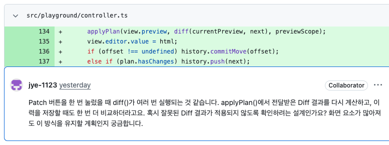
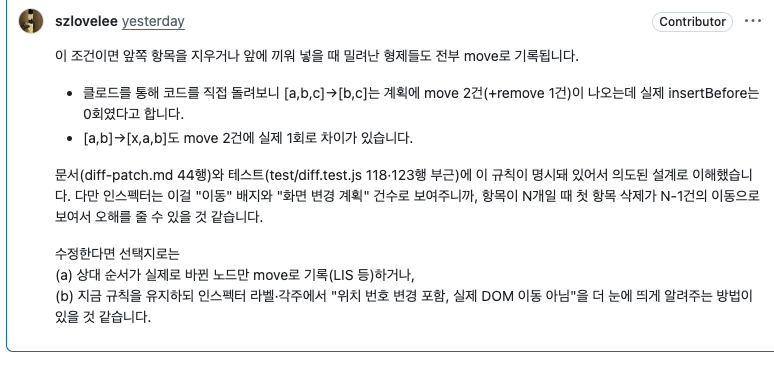

# 협업과 AI 활용

[프로젝트 소개](../README.md) · [기술적 선택과 문제 해결](technical-notes.md) · [후기](retrospective.md)

## 팀 작업 방식

- **두 사람 모두 AI를 활용한 개발 전체 과정을 경험하는 것**을 목표로 삼았다.
- 이를 위해 각자 구현을 진행하되, 서로의 작업물을 꼼꼼히 읽고 피드백을 주고받았다.
- 개발 과정에서 고민했던 내용을 공유하고, 서로의 접근 방식을 참고하며 각자의 문제를 해결하기도 했다.
- AI 활용 방법론과 그 과정에서 사람이 맡을 역할을 함께 고민했다.

## GitHub 기반 소통

- Issues·Discussions·Wiki를 통해 작업과 논의를 공유했다.
- 각자의 작업물을 PR로 올리고, 서로의 코드에 리뷰를 작성했다.

| 기록 | 용도 |
| --- | --- |
| [팀 위키](https://github.com/WEEK11-12/mini-react/wiki) | 프로젝트 자료와 팀 논의의 진입점 |
| [React 개념 정리](https://github.com/WEEK11-12/mini-react/wiki/React-개념-정리) · [전체 이해하기](https://github.com/WEEK11-12/mini-react/wiki/전체-이해하기) | 개념별 정의와 장바구니 예시를 통한 업데이트 흐름 공유 |
| [Core Time](https://github.com/orgs/WEEK11-12/discussions/categories/core-time) · [Daily Scrum](https://github.com/orgs/WEEK11-12/discussions/categories/daily-scrum) | 위키에서 연결하는 팀 논의 공간 |
| [Project 보드](https://github.com/orgs/WEEK11-12/projects/1) | 작업 현황 확인 |
| [Pull requests](https://github.com/WEEK11-12/mini-react/pulls) | 작업물 공유와 상호 코드 리뷰 |

## 사람과 AI의 역할

- 개발자는 관련 개념과 구현 원리를 학습하며, 전체 진행 과정의 관리와 의사결정에 참여했다.
- AI는 요구사항 정리, 설계안 제안, 코드·테스트 작성과 검토를 지원했다.

## 서로의 코드를 읽고 함께 공부하기

- 서로의 구현 의도와 검증 근거를 묻고, 다른 접근 방식을 비교하며 함께 공부했다.
- 세부적인 피드백으로 각자 놓친 부분을 살펴보고, 개선 방향을 제안하며 결과물의 완성도를 높였다.

### 피드백 예시

아래 캡처는 상호 리뷰 중 일부 예시다.

[리뷰 원문: 지영은 → 이현지](https://github.com/WEEK11-12/mini-react/pull/24#discussion_r4524041554)

[리뷰 원문: 이현지 → 지영은](https://github.com/WEEK11-12/mini-react/pull/25#discussion_r4524432379)

## AI 구현과 검증 역할 분리

- 구현 에이전트와 별도의 검증 에이전트가 호출 경로·경계 조건을 검토했다.
- 완료 보고만으로 승인하지 않고, 실제 테스트 결과와 검토 대상 소스를 대조했다.
- 수정 후에는 원래 실패 사례와 인접 조건을 다시 확인했다. 부분 검토 승인을 전체 통과로 취급하지 않았다.

기술적인 문제와 수정 내용은 [문제 해결 기록](technical-notes.md#검증에서-발견한-문제와-수정)에서 다룬다.
