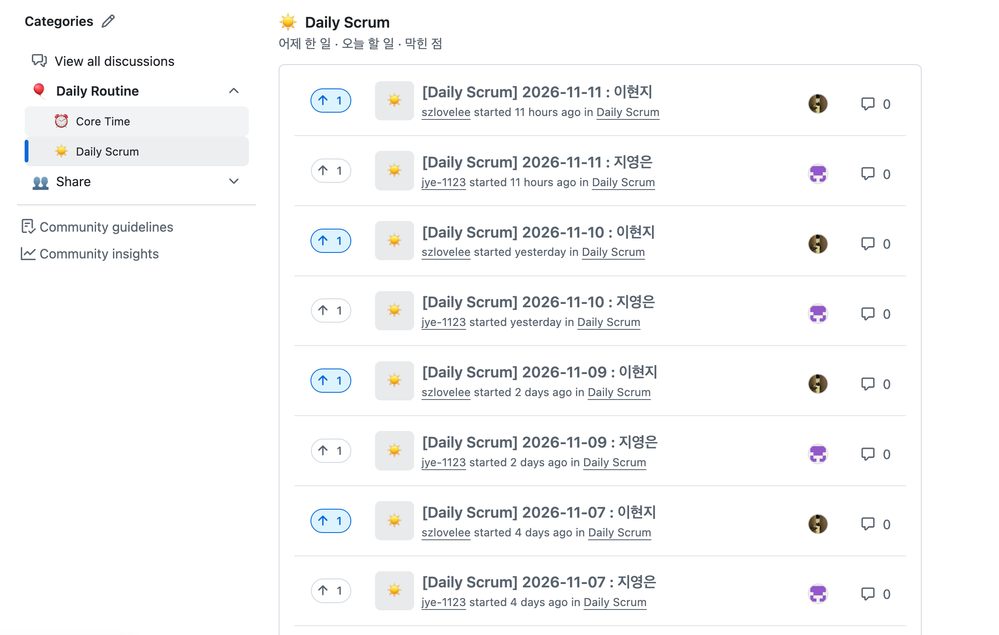
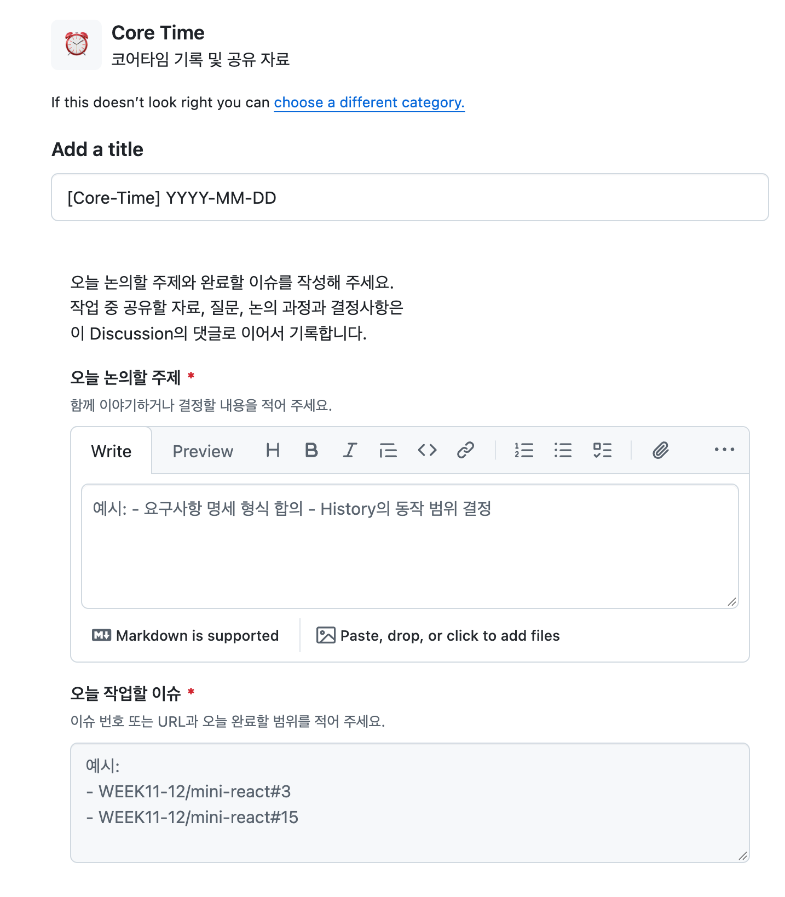
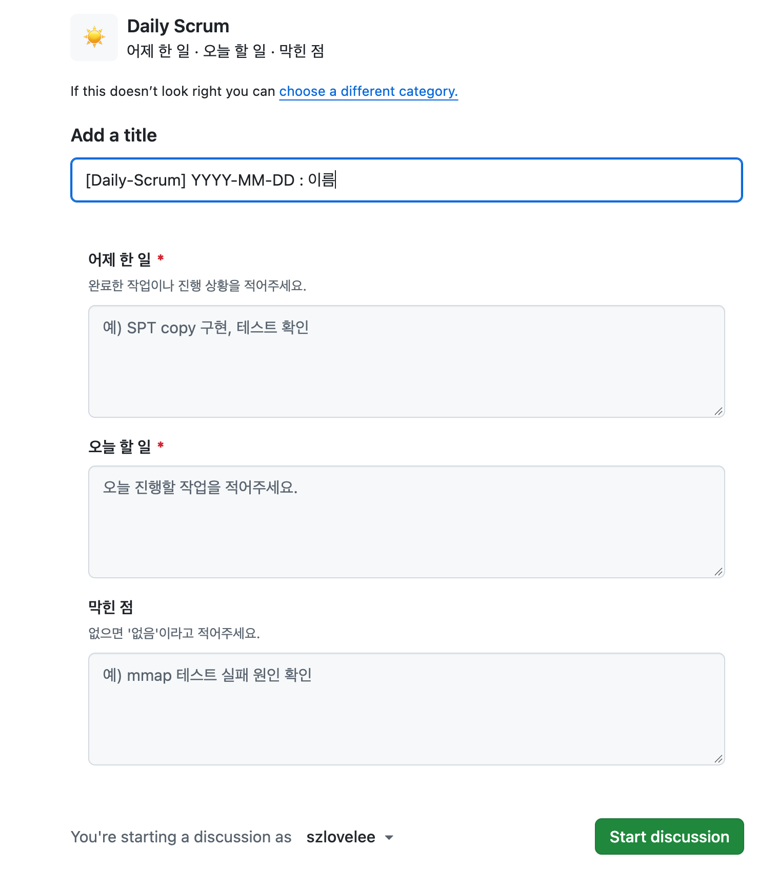
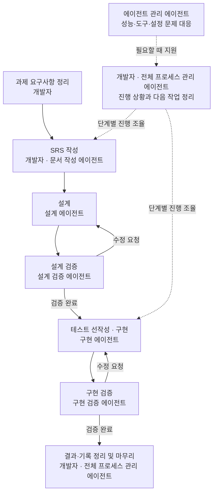

# 협업과 AI 활용

[프로젝트 소개](../README.md) · [기술적 선택과 문제 해결](technical-notes.md) · [후기](retrospective.md)

[팀원 간 협업](#팀원-간-협업) · [AI 활용](#ai-활용)

## 팀원 간 협업

### 팀 목표와 작업 방식

- **두 사람 모두 AI를 활용한 개발 전체 과정을 경험하는 것**을 목표로 삼았다.
- 이를 위해 각자 구현을 진행하되, 서로의 작업물을 꼼꼼히 읽고 피드백을 주고받았다.
- 개발 과정에서 고민했던 내용을 공유하고, 서로의 접근 방식을 참고하며 각자의 문제를 해결하기도 했다.
- AI 활용 방법론과 그 과정에서 사람이 맡을 역할을 함께 고민했다.

### GitHub 기반 소통

- Issues·Discussions·Wiki를 통해 작업과 논의를 공유했다.
- 각자의 작업물을 PR로 올리고, 서로의 코드에 리뷰를 작성했다.

| 기록 | 용도 |
| --- | --- |
| [팀 위키](https://github.com/WEEK11-12/mini-react/wiki) | 프로젝트 자료와 팀 논의의 진입점 |
| [React 개념 정리](https://github.com/WEEK11-12/mini-react/wiki/React-개념-정리) · [전체 이해하기](https://github.com/WEEK11-12/mini-react/wiki/전체-이해하기) | 개념별 정의와 장바구니 예시를 통한 업데이트 흐름 공유 |
| [Core Time](https://github.com/orgs/WEEK11-12/discussions/categories/core-time) · [Daily Scrum](https://github.com/orgs/WEEK11-12/discussions/categories/daily-scrum) | 위키에서 연결하는 팀 논의 공간 |
| [Project 보드](https://github.com/orgs/WEEK11-12/projects/1) | 작업 현황 확인 |
| [Pull requests](https://github.com/WEEK11-12/mini-react/pulls) | 작업물 공유와 상호 코드 리뷰 |

#### Discussions 활용 예시

Daily Scrum 게시글 목록과 작성 템플릿의 일부 예시다.

Core Time·Daily Scrum 작성 템플릿 보기

##### Core Time

- 논의할 주제와 작업할 이슈·완료 범위를 정리한다.
- 관련 자료와 질문, 논의 과정과 결정 사항은 댓글로 이어서 기록한다.

##### Daily Scrum

- 어제 한 일, 오늘 할 일, 막힌 점을 기록한다.

### 상호 코드 리뷰

- 서로의 구현 의도와 검증 근거를 묻고, 다른 접근 방식을 비교하며 함께 공부했다.
- 세부적인 피드백으로 각자 놓친 부분을 살펴보고, 개선 방향을 제안하며 결과물의 완성도를 높였다.

#### 피드백 예시

아래 캡처는 상호 리뷰 중 일부 예시다.

[리뷰 원문: 지영은 → 이현지](https://github.com/WEEK11-12/mini-react/pull/24#discussion_r4524041554)

[리뷰 원문: 이현지 → 지영은](https://github.com/WEEK11-12/mini-react/pull/25#discussion_r4524432379)

## AI 활용

### 사람과 AI의 역할

- 개발자는 관련 개념과 구현 원리를 학습하며, 전체 진행 과정의 관리와 의사결정에 참여했다.
- AI는 역할별로 나누어 요구사항 문서화, 설계, 구현과 검증을 지원했다.

### 개발 프로세스

- SRS(요구사항 명세서)에는 과제의 기능·제약과 완료 판단 기준을 정리했다. 이후 설계와 검증의 기준으로 삼았다.
- 설계와 구현은 각각 별도 에이전트가 검증하고, 수정 요청이 나오면 해당 단계로 돌아갔다.
- 실선은 개발 흐름, 점선은 진행과 환경을 지원하는 관계다. 에이전트 조율은 마지막에 한 번 거치는 단계가 아니라, 성능이나 도구·설정 문제가 생겼을 때 개입하는 지원 과정이었다.

### 역할별 에이전트 구성

각 에이전트에는 역할뿐 아니라 작업 범위, 판단 기준, 다른 역할과의 경계를 가이드로 부여했다.

| 역할 | 모델 | 맡긴 일과 주요 가이드 |
| --- | --- | --- |
| 문서 작성 | `gpt-6-luna` | 과제 내용을 SRS로 정리. 원문의 조건과 예외를 보존하고, 확인된 사실과 가정을 구분한다. |
| 설계 | `gpt-6.1-sol` | 책임·인터페이스·데이터 흐름·실패 시 동작을 설계. 주요 선택의 이유를 남기고, 스스로 검증 통과를 판정하지 않는다. |
| 설계 검증 | `gpt-6-astra` | 요구사항과 설계의 일관성을 검토. 취향 차이와 실제 오류를 구분하고, 발생 조건과 영향을 근거로 판단한다. |
| 구현 | `gpt-6-sol` | 요구사항과 설계에 맞춰 구현·수정. 요구사항을 약화해 테스트를 통과시키지 않고, 검토 지적과 관련된 범위에 집중한다. |
| 구현 검증 | `gpt-6.1-sol` | 실제 코드와 호출 경로, 경계 조건과 오류 처리를 확인. 반례와 실행 근거로 판단하고, 수정 후에는 지적 사항과 영향받는 범위를 재검증한다. |
| 에이전트 관리 | `gpt-6.1-sol` | 성능·도구·설정 문제의 원인을 확인하고 조율. 실제 설정과 로그를 근거로 판단하며, 변경 범위를 확인한 뒤 조치한다. |
| 전체 프로세스 관리 | `gpt-6.1-sol` | 목표·진행 상황·다음 작업과 마무리를 정리. 제안·확정 결정·실제 완료를 구분하고, 다른 에이전트의 보고를 그대로 완료 사실로 취급하지 않는다. |

모델은 프로젝트 관련 세션에 기록된 식별자를 기준으로 적었다.

### 검증 방법론

AI의 완료 보고만으로 판단하지 않고, 설계·구현 단계마다 확인할 근거를 따로 마련했다.

#### 설계 단계

##### 시퀀스와 아키텍처 시각화

- 말로만 설명된 설계는 흐름과 누락을 확인하기 어려워, AI에게 Mermaid로 아키텍처와 시퀀스 다이어그램을 작성하게 했다.
- 컴포넌트 간 연결과 데이터 흐름을 눈으로 따라가며, 병목이 생길 지점이나 빠진 책임이 없는지 살폈다.
- 다이어그램은 [설계 문서](design/README.md)에 함께 남겨 검토 기준으로 사용했다.

##### 에이전트 간 교차 검증

- Hermes Agent에서 설계 에이전트와 별도의 검증 에이전트를 두고, 검증에는 설계 담당보다 상위 모델을 사용했다.
- 검증 에이전트에는 역할, 검토 범위, 판단 원칙을 명시했다. 원래 설계의 설명을 그대로 받아들이기보다 요구사항과 설계의 일관성을 확인하게 했다.
- 상위 모델의 의견도 그대로 확정하지 않고, 지적의 근거와 수정이 필요한 범위를 확인하며 의사결정에 참여했다.

#### 구현 단계

##### 테스트를 먼저 작성하는 방식

- TDD를 참고해, 구현을 맡기기 전에 요구사항 명세와 설계 문서를 바탕으로 기대 동작을 테스트로 작성하게 했다.
- 정상 동작뿐 아니라 경계값과 예외 상황을 반드시 포함하도록 했다. 이후 해당 테스트를 통과하는 구현을 요청해, AI의 구현이 요구사항에서 벗어나는지 확인했다.
- 테스트 작성만으로 검증이 끝났다고 보지 않았다. 구현 전 실패와 구현 후 통과를 구분하고, 실패 원인이 환경 문제인지 실제 기능의 누락인지 확인했다.
- [1단계 기록](implementation/stage-01.md#최초-구현-당시-기록)에는 구현 전 실패를 확인한 과정과 구현 후 실행 결과를 남겼다.

##### 정적 검사와 AI 리뷰 결합

- 타입·구문·컨벤션처럼 도구로 확인할 수 있는 항목은 정적 검사로 점검했다.
- 별도의 검증 에이전트는 실제 호출 경로와 요구사항 충족 여부, 경계 조건과 오류 처리를 검토했다. Hermes Agent에서 구현 담당보다 상위 모델을 검증에 배정했다.
- 정적 검사 통과를 동작의 정확성으로 간주하지 않고, 실제 테스트 실행과 코드 검토를 함께 진행했다.

| 구분 | 도구·명령 | 확인 범위 |
| --- | --- | --- |
| 타입 검사 | TypeScript `tsc` — `npm run typecheck`, `npm run typecheck:core` | 테스트 코드와 제품 코드의 타입 오류 |
| 테스트 컨벤션 검사 | 자체 스크립트 `tests/support/check-conventions.mjs` — `npm run check:conventions` | 테스트 파일의 배치·이름, 구문 검사, `.only`·`.skip` 등 실행 범위를 숨기는 설정 |
| 동작 검증 | Vitest·jsdom, Playwright·Chromium | 단위 동작과 실제 브라우저 흐름 |

명령은 `tests/`에서 실행한다.

#### 수정 후 재검증과 기록

- 검증 에이전트의 완료 보고만으로 승인하지 않고, 실제 테스트 결과와 검토 대상 소스를 대조했다.
- 수정 후에는 원래 실패 사례와 인접 조건을 다시 확인했다.
- 부분 검토 승인을 전체 통과로 취급하지 않고, 실행한 범위와 미실행 범위를 구분해 기록했다.

[테스트 실행 안내](../tests/README.md) · [검증에서 발견한 문제와 수정](technical-notes.md#검증에서-발견한-문제와-수정)
