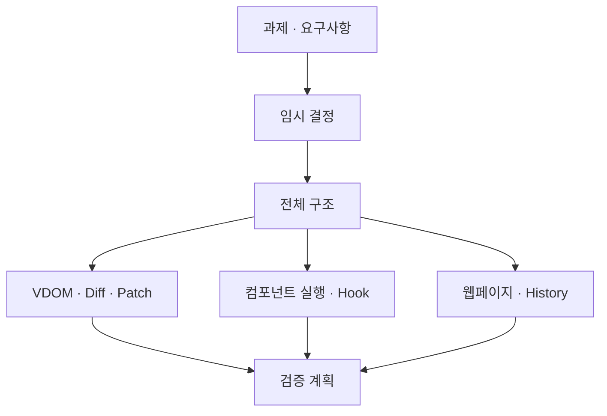

# Mini-React 설계 초안

상태: **임시 결정에 기반한 설계안** · 작성일: 2026-11-09

이 문서는 [요구사항](../requirements.md)과 [과제 원문](../assignment.md)을 바탕으로 작성했다. 요청한 경로인 `docs/desgin`을 사용한다.

미결정 사항의 정식 승인을 기다리는 동안 설계를 진행하기 위한 초안이다. 요구사항의 결정 상태를 변경하지 않으며, 구현 완료나 테스트 통과를 의미하지 않는다.

## 한눈에 보기

## 문서 구성

| 문서 | 내용 |
| --- | --- |
| [임시 결정](temporary-decisions.md) | OPEN-01~15의 가정, 이유, 영향, 변경 시 수정 위치 |
| [전체 구조](architecture.md) | 시스템 경계, 데이터 흐름, 모듈 소유권, 공개 인터페이스 |
| [VDOM·Diff·Patch](renderer.md) | 공통 VDOM 모델, DOM 변환, 비교와 반영 알고리즘 |
| [컴포넌트 실행](component-runtime.md) | FunctionComponent, mount/update/unmount, 업데이트 처리 |
| [Hook](hooks.md) | hooks 배열, useState/useEffect/useMemo, 실행 순서 |
| [웹페이지·이력](playground-history.md) | 편집·적용·이력 이동과 Phase 2 검증 화면 |
| [검증 계획](verification.md) | 요구사항별 검증 연결, 경계 사례, 구현 순서 |

## 읽는 순서

임시 결정 → 전체 구조 → 담당 시스템의 설계 → 검증 계획 순으로 확인한다.

## 설계와 요구사항의 관계

- 과제에서 지정한 `FunctionComponent`, `hooks`, `mount()`, `update()`와 루트 전용 Hook·State 조건을 유지한다.
- `Object.is`, 자료구조, HTML 편집 방식 등은 이번에 선택한 **임시 결정**이다.
- 데이터 타입과 함수 시그니처는 구현 계약의 초안이다.
- 임시 결정을 변경하면 해당 시스템 설계와 검증 사례를 함께 변경한다.
- 팀이 정책을 채택한 뒤 요구사항의 인수 조건과 결정 상태를 갱신한다. 내부 알고리즘 선택은 설계에 남긴다.

## 초기 구현 목표

1. Phase 1: DOM 읽기 → VDOM → 비교 → 부분 반영 → 이력 이동.
2. Phase 2: 루트 상태 변경 → 함수 컴포넌트 재실행 → 같은 렌더러로 부분 반영.
3. Phase 2의 Hook State와 Phase 1의 VDOM History는 서로 독립적으로 관리한다.

SSR, Fiber, 동시 렌더링, key 기반 목록 이동 최적화, 개발용 Strict Mode는 이번 설계 범위에 포함하지 않는다. 범위 확장은 별도 검토한다.
