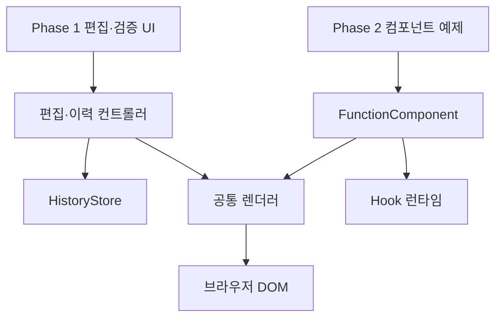
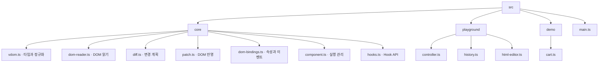

# 전체 구조

상태: 임시 설계 · 기준: [임시 결정](temporary-decisions.md)

## 시스템 경계



라이브러리는 HTML 입력창, 버튼, 오류 메시지, History를 알지 못한다. 두 단계는 공통 렌더러를 사용하지만 DOM 컨테이너와 상태는 분리한다.

## 책임과 데이터 소유권

| 모듈 | 소유 데이터 | 책임 |
| --- | --- | --- |
| vdom / dom-reader | VNode 타입과 정규화 규칙 | DOM 읽기, 함수 결과 정규화, 입력 검증 |
| diff | 변경 계획 | 두 VDOM을 비교. DOM 변경 없음 |
| patch | 임시 DOM 노드 참조 | 초기 생성, 변경 계획 적용, 속성·프로퍼티·이벤트 처리 |
| FunctionComponent | currentTree, hooks, 상태 업데이트 대기열 | 렌더 → 커밋 → Effect 실행과 제거 |
| hooks | 현재 루트·호출 문맥, 슬롯 접근 | State·Effect·Memo API 제공 |
| HistoryStore | 스냅샷 배열·cursor | Phase 1 저장과 탐색. DOM 접근 없음 |
| PlaygroundController | draft HTML, previewTree, appliedTree, 오류·busy 상태 | 화면의 편집·적용·복원 흐름 조율 |

## 계획하는 소스 구성



위 파일들은 계획이며 아직 생성하지 않는다. 테스트 도구의 버전과 설치 명령은 구현 환경을 만들 때 확정한다.

## 주요 인터페이스

```ts
readDOM(container: Element): VRoot
validateRoot(root: VRoot, mode: 'html' | 'component'): void
diff(previous: VRoot, next: VRoot): PatchPlan
mountTree(container: Element, tree: VRoot): void
applyPlan(container: Element, plan: PatchPlan): void

h(type: string | StatelessComponent, props: Props | null,
  ...children: Child[]): Child
text(value: string | number): VText

class FunctionComponent<P> {
  hooks: HookSlot[];
  mount(container: Element, props: P): void;
  update(props?: P): void;
  unmount(): void;
}
```

`VRoot`, `Props`, `PatchPlan`은 [렌더러](renderer.md), `Child`와 실행 규칙은 [컴포넌트](component-runtime.md), `HookSlot`은 [Hook](hooks.md)에서 정의한다.

컨테이너는 교체되지 않는 호스트 요소이며 VRoot에는 그 내부 노드만 담는다. 두 영역의 바깥쪽 id·제목·버튼은 VDOM의 대상에서 제외한다.

## Phase 1 흐름

1. 실제 영역의 초기 DOM을 읽어 초기 VDOM을 만든다.
2. 동일 VDOM으로 실제 영역을 정규화하고 테스트 미리보기를 생성한다.
3. 사용자는 HTML 입력 또는 미리보기 폼을 편집한다.
4. Patch 요청 시 현재 미리보기 DOM을 읽어 appliedTree와 비교한다.
5. 실제 영역 반영 성공 후 적용 기준과 이력을 함께 갱신한다.

## Phase 2 흐름

1. FunctionComponent가 루트 함수를 실행한다.
2. 자식 함수는 Props로 실행되고 루트와 자식의 결과가 같은 VDOM 모델로 정규화된다.
3. 공통 Diff·Patch가 DOM을 갱신한다.
4. 새 트리와 Hook 기록을 커밋한다.
5. 변경된 Effect의 이전 정리와 새 설정을 실행한다.

Phase 2의 DOM을 다시 읽어 State로 역변환하지 않는다. State가 UI 계산의 기준이다.

## 핵심 불변 조건

- 이전 VDOM과 History 스냅샷은 수정하지 않는다.
- 정상 커밋 완료 후 currentTree/appliedTree는 해당 DOM의 의미상 구조와 일치한다.
- 일반 Patch는 지원 대상 외의 컨테이너·형제 DOM을 건드리지 않는다.
- 입력 검증 실패는 적용 상태와 History를 변경하지 않는다.
- 루트 Hook을 자식 함수 실행 문맥에서 사용할 수 없다.
- UI 값 비교는 HTML 원문 문자열이 아니라 정규화한 구조·속성·텍스트·폼 상태를 기준으로 한다.

## 요구사항 연결

- [VDOM](../requirements.md#vdom), [DIFF](../requirements.md#diff), [PATCH](../requirements.md#patch): 렌더러
- [COMP](../requirements.md#comp), [STA](../requirements.md#sta), [EFF](../requirements.md#eff), [MEMO](../requirements.md#memo): 런타임·Hook
- [EDIT](../requirements.md#edit), [VIEW](../requirements.md#view), [HIST](../requirements.md#hist): 검증 앱
- [TECH-01](../requirements.md#tech-01)~[TECH-06](../requirements.md#tech-06): 전체 설계 제약
