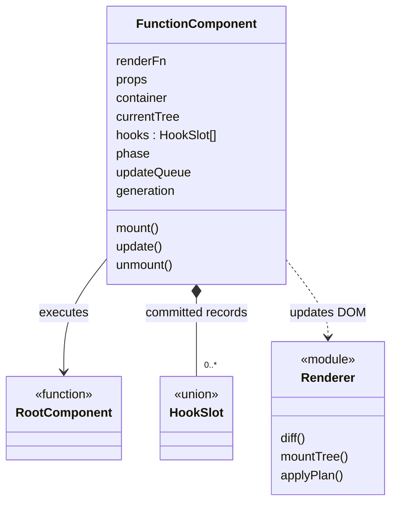

# 컴포넌트 실행 설계

관련 요구사항: [COMP](../requirements.md#comp), [TECH-03](../requirements.md#tech-03)~[TECH-06](../requirements.md#tech-06)

기준: [임시 결정](temporary-decisions.md). 실제 React의 Fiber·동시 렌더링을 복제하지 않고, 과제가 지정한 FunctionComponent로 실행을 관리한다.


## 한눈에 보기



`module`은 함수 모듈이며, 별도의 클래스를 구현한다는 뜻은 아니다.

## 컴포넌트 반환값

```ts
type Child = VNode | string | number | null | boolean | readonly Child[];
type StatelessComponent = (props: Props) => Child;
type RootComponent<P> = (props: P) => Child;
```

문자열·숫자는 Text로, 배열은 순서대로 평탄화한다. null·boolean은 표시하지 않는다. 루트 반환 결과를 VRoot.children으로 감싸므로 0개 또는 여러 노드도 표시 가능하다.

`h('p', props, ...children)`는 host VNode를 만든다. `h(ChildComponent, props, ...children)`는 자식 함수를 즉시 실행해 반환값을 정규화한다. JSX나 별도의 React element 계층은 초기 설계에 두지 않는다.

자식 함수는 여러 노드나 빈 결과도 반환할 수 있으므로 h()의 공통 반환 타입은 Child다. 자식에게 전달하는 props.children은 나머지 children 인수로 구성하며, props.children과 중복 지정하면 오류로 처리한다.

자식 호출 중에는 Hook 사용 문맥을 일시적으로 'child'로 전환한다. 루트에서 `h`의 인수로 먼저 평가되는 `useState()`는 루트 문맥이고, 자식 함수 본문에서 호출한 Hook은 오류다. 자식 컴포넌트의 직접 함수 호출은 지원 계약 밖으로 둔다.

## FunctionComponent의 기록

| 필드 | 의미 |
| --- | --- |
| renderFn, props | 루트 함수와 마지막 성공 입력 |
| container, currentTree | 관리하는 컨테이너와 마지막 성공 VDOM |
| hooks | 과제가 지정한 Hook 기록 배열 |
| phase | idle / rendering / committing / effects / unmounted / faulted |
| updateQueue | Effect 중 요청된 상태 변경과 갱신 요청 |
| generation | 재마운트 시 오래된 setter를 무효화하는 번호 |

Hook의 candidate 기록은 별도 렌더 작업에 둔다. DOM 반영이 성공한 뒤에만 hooks·currentTree·props를 새 값으로 확정한다.

## mount()

1. 이미 마운트되어 있으면 오류를 낸다.
2. 빈 hooks로 새 렌더 작업을 시작하고 generation을 갱신한다.
3. 루트 함수를 실행하고 결과·Hook 호출 개수·종류를 검증한다.
4. DOM 초기 생성을 수행한다.
5. 트리와 Hook 기록을 확정하고 Effect를 실행한다.
6. Effect가 요청한 업데이트를 대기열 순서대로 처리한다.

mount 대상은 이 인스턴스가 전용으로 관리하는 빈 컨테이너다.

## update()

1. 제거·faulted 상태에서는 오류로 처리한다.
2. 이전 hooks를 기준으로 candidate 슬롯을 만들고 해당 업데이트를 적용한다.
3. 호출 인덱스를 0으로 초기화한 뒤 루트를 실행한다.
4. 정규화·검증을 완료하고 currentTree와 비교한다.
5. 변경 계획을 DOM에 적용한다.
6. 성공 시 candidate 슬롯과 새 트리를 확정한다.
7. 변경된 Effect를 정리·설정하고 다음 대기 요청을 처리한다.

Props 갱신은 update(nextProps)로 요청한다. 자식 Props에 들어가는 콜백도 새 UI의 이벤트 함수로 반영된다.

## 업데이트 실행 규칙

- idle에서 호출한 setter는 한 번의 갱신을 동기 실행한다.
- rendering 중 setter 호출은 오류다. 렌더 중 재귀 갱신을 허용하지 않는다.
- committing/effects 중 요청은 대기열에 넣고 현재 Effect 처리가 끝난 뒤 하나씩 처리한다. 같은 요청 묶음으로 합치는 Batching은 하지 않는다.
- updater 함수는 각 요청 처리 시점의 최신 성공 State를 받는다.
- 한 요청에서 발생한 연속 갱신이 50회를 넘으면 오류로 중단한다. 이 숫자는 무한 루프 방지용 임시 설계 상수이며 제품 요구사항이 아니다.

## unmount()

1. generation을 갱신하고 새 업데이트 수락을 중단한다.
2. 저장된 Effect 정리를 슬롯 순서대로 실행한다.
3. 루트의 DOM과 이벤트 바인딩을 제거한다.
4. hooks·currentTree·대기열을 비운다.

제거 시 정리가 호출하는 setter와 과거 generation의 setter는 무효 처리한다. 이미 제거된 인스턴스의 unmount()는 아무 작업도 하지 않는다. 다시 mount()하면 초기값과 새로운 Effect로 시작한다.

## 실패 처리

| 실패 시점 | 처리 |
| --- | --- |
| 렌더·VDOM 검증 | candidate 기록과 해당 요청을 폐기하고 마지막 성공 DOM·State를 유지. active 문맥은 finally에서 해제 |
| DOM 반영 | 이전 VDOM으로 DOM을 재구성해 복구 시도. 복구도 실패하면 faulted로 전환해 제거·재시작 안내 |
| Effect 설정·정리 | 이미 성공한 DOM·State를 되돌리지 않고 오류 표시. 다른 슬롯의 처리는 계속 |
| 사용자 이벤트 핸들러 | 이벤트 경계에서 오류 표시. 그 전에 완료된 setter 갱신은 유지 |

렌더 함수와 Memo 계산은 외부 부수 효과가 없어야 한다. 이미 발생한 외부 부수 효과까지 취소하는 일반 트랜잭션은 제공하지 않는다.

## 확인할 사례

마운트 → 상태 변경 → Props 변경 → 제거 → 재마운트를 연결해서 확인한다. 자식 Hook 사용, 렌더 중 setter, 오래된 setter, Effect 안의 setter, 렌더 실패 후 재시도도 검증한다.
