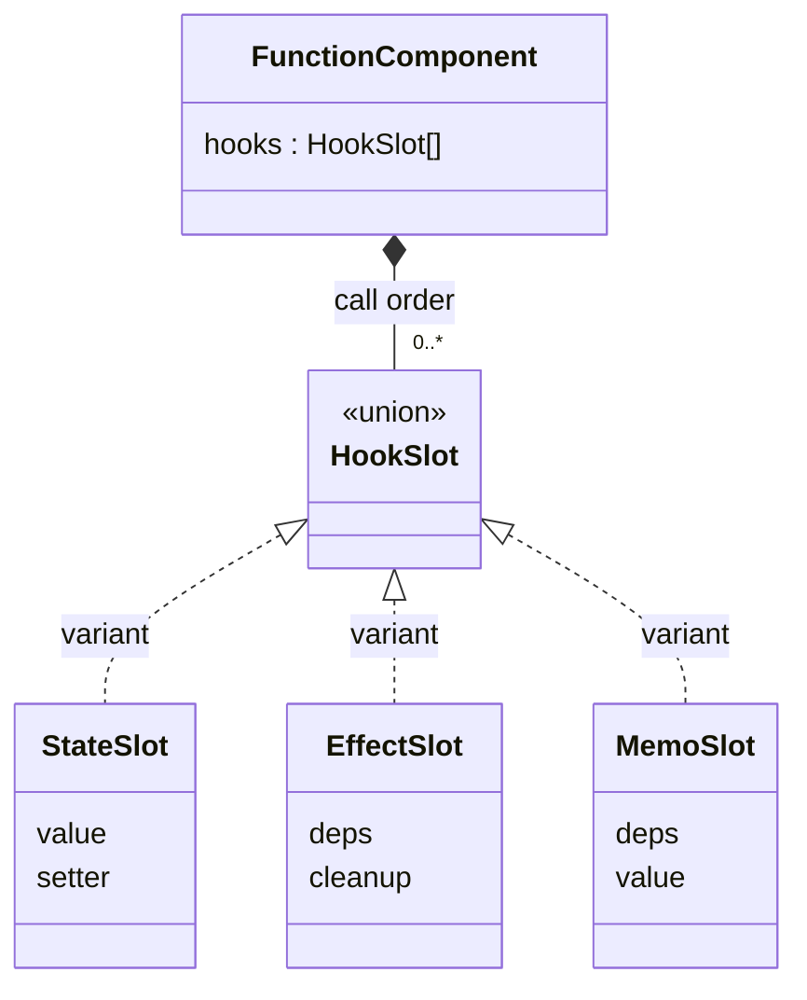
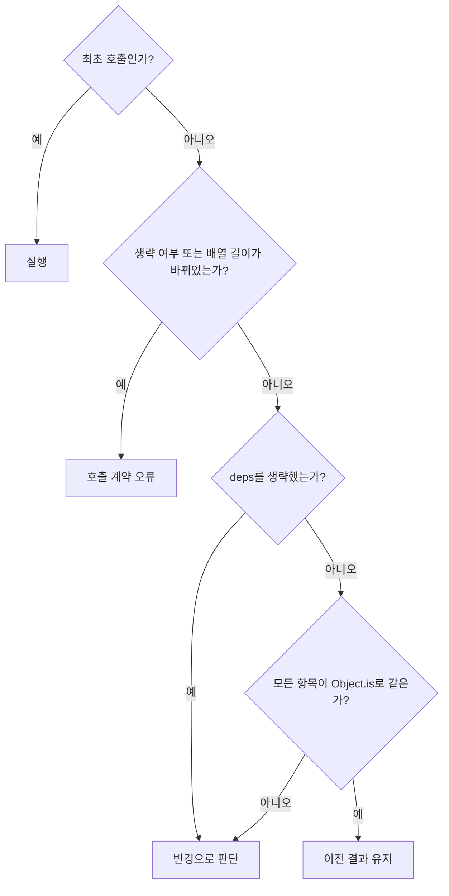

# Hook 설계

관련 요구사항: [STA](../requirements.md#sta), [EFF](../requirements.md#eff), [MEMO](../requirements.md#memo)

기준: [OPEN-07·08·11·13·15](temporary-decisions.md). 다음 API 동작은 임시 결정이며 requirements.md에 확정 반영한 것이 아니다.


## 한눈에 보기



클래스 다이어그램은 데이터 구조를 표현한다. `variant`는 유니언 타입의 구성원이며, 실제 클래스 상속을 뜻하지 않는다.

## 슬롯과 호출 문맥

```ts
type HookSlot = StateSlot | EffectSlot | MemoSlot;
type StateSlot = { kind: 'state'; value: unknown; setter: Function };
type EffectSlot = {
  kind: 'effect'; deps: readonly unknown[] | undefined;
  cleanup?: () => void;
};
type MemoSlot = { kind: 'memo'; deps: readonly unknown[]; value: unknown };
```

함수 타입은 개념 표기다. 실제 구현에서는 generic과 명시적인 호출 시그니처로 좁힌다.

- 현재 루트, root/child 문맥, 다음 슬롯 인덱스를 렌더 작업에 보관한다.
- Hook 호출마다 슬롯을 한 개 사용한다. 최초 실행은 생성, 이후 실행은 같은 인덱스를 조회한다.
- 같은 인덱스의 kind가 다르거나 최종 호출 개수가 다르면 렌더 오류다.
- Hook 기록은 렌더 candidate에 작성하고, 성공한 DOM 반영 후 확정한다.
- 조건부 호출·호출 순서 변경은 지원하지 않는다. 같은 종류끼리의 순서 교환까지 자동 검출하지는 않는다.

## 의존성 비교



- Effect는 undefined(생략), [], 고정 길이 배열을 허용한다. 같은 슬롯에서 생략과 배열을 바꾸는 사용은 오류다.
- Memo는 고정 길이 배열을 필수로 받는다.
- 배열은 얕게 복사해 보관한다. 내부 객체는 복제하지 않으므로 같은 객체 내부 변경만으로는 재실행하지 않는다.
- 초기 호출은 이전 결과가 없으므로 실행한다.

## useState

```ts
useState<T>(initial: T | (() => T)):
  [T, (next: T | ((previous: T) => T)) => void]
```

1. 최초 슬롯 생성 시 값 또는 초기화 함수의 결과를 저장한다.
2. 이후 렌더에서는 기존 상태를 제공한다.
3. setter는 루트·generation·슬롯 인덱스를 캡처하며 성공한 렌더 사이에서 같은 참조를 유지한다.
4. setter 요청을 처리할 때 새 값 또는 updater 함수의 결과를 계산한다.
5. Object.is로 같으면 갱신을 생략하고, 다르면 candidate State로 렌더를 요청한다.

함수를 State 값으로 저장할 때는 초기화/업데이트 함수로 감싸 반환한다. 객체·배열은 직접 변경하지 않고 새 값으로 전달하는 것을 사용 규칙으로 둔다.

두 상태 슬롯의 값은 독립적이다. setter에서 UI를 직접 수정하지 않고 FunctionComponent의 갱신 경로를 사용한다.

## useEffect

```ts
useEffect(setup: () => void | (() => void), deps?: readonly unknown[]): void
```

### 렌더 중

설정 함수를 실행하지 않는다. 의존성 비교 결과에 따라 candidate의 pendingEffects에 `{slotIndex, setup, nextDeps}`를 등록한다. 변경이 없으면 기존 cleanup을 유지한다.

### DOM 반영 성공 후

1. pendingEffects를 호출 순서대로 방문한다.
2. 이전 cleanup을 보관 기록에서 제거한 뒤 한 번 실행한다.
3. 새 setup을 실행한다.
4. 반환값이 함수이면 다음 정리를 위해 보관한다. undefined 외의 다른 값이나 Promise 반환은 API 사용 오류로 처리한다.

타이밍은 **DOM 반영 뒤**로 정하며, 브라우저 페인트 뒤임을 보장하지 않는다. 설정은 동기 함수지만 내부에서 비동기 작업을 시작하고 정리에서 취소할 수 있다.

### 제거 시

현재 cleanup들을 한 번씩 실행하고 슬롯을 비운다. 초기 정리·설정을 반복하는 Strict Mode 동작은 제공하지 않는다.

### 정리 또는 설정 실패

오류를 수집해 호출자에게 전달하고 다른 Effect를 계속 처리한다. 오류 UI는 검증 웹페이지가 담당한다. 실패한 setup에 대해 즉시 자동 재시도하지 않는다. 다음 실행 조건이 충족될 때 다시 실행한다. 의존성을 생략했다면 다음 성공한 렌더, 배열을 지정했다면 의존성 변경 또는 재마운트가 해당한다. cleanup이 던져도 이미 기록에서 제거했으므로 같은 정리를 중복 호출하지 않는다.

## useMemo

```ts
useMemo<T>(calculate: () => T, deps: readonly unknown[]): T
```

1. 최초 호출이면 순수 계산 함수를 실행하고 candidate에 결과와 deps를 저장한다.
2. 의존성이 같으면 직전 성공 슬롯의 값을 그대로 반환한다.
3. 의존성이 다르면 다시 계산하고 새 값을 candidate에 저장한다.
4. 렌더·커밋 실패 시 candidate를 폐기하고 직전 성공 결과를 유지한다.

객체 결과도 같은 참조를 재사용한다. 입력 A → B → A에서는 직전 B와 다르므로 마지막 A를 다시 계산한다. 모든 과거 입력의 결과를 저장하는 캐시는 아니다.

## 검증 예시

| 항목 | 관찰할 결과 |
| --- | --- |
| State 두 개 | 한 setter가 다른 슬롯의 값을 변경하지 않음 |
| 함수형 업데이트 | 요청 처리 시점의 이전 값으로 계산 |
| Effect deps 생략 | 각 성공한 렌더의 DOM 반영 뒤 실행 |
| Effect [] | 최초 setup, 일반 갱신 유지, 제거 시 cleanup |
| Effect deps 변경 | 이전 cleanup → 새 setup |
| Memo 같은 deps | 호출 횟수 유지, 같은 결과 참조 |
| 새 객체 deps | 내용이 같아도 다른 참조이면 재실행 |
| Effect 중 setter | 모든 현재 Effect 처리 후 갱신, 재귀 호출 없음 |
| 실패한 렌더 | 새 Effect가 실행되지 않고 이전 기록 유지 |
