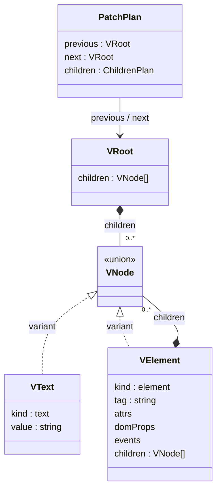

# VDOM · Diff · Patch 설계

관련 요구사항: [VDOM](../requirements.md#vdom), [DIFF](../requirements.md#diff), [PATCH](../requirements.md#patch)

기준: [OPEN-01·11 및 추가 설계 선택](temporary-decisions.md). 이 문서의 데이터 모델과 알고리즘은 임시 설계다.


## 한눈에 보기



클래스 다이어그램은 데이터 구조를 표현한다. `variant`는 유니언 타입의 구성원이며, 실제 클래스 상속을 뜻하지 않는다.

## 데이터 모델

```ts
type EventName = 'click' | 'input' | 'change';
type Handler = (event: Event) => void;
type Props = {
  attrs?: Record<string, string>;
  domProps?: { value?: string; checked?: boolean; disabled?: boolean };
  events?: Partial<Record<EventName, Handler>>;
  children?: Child[];
  [name: string]: unknown; // 사용자 정의 컴포넌트에 전달할 Props
};
type VText = { kind: 'text'; value: string };
type VElement = {
  kind: 'element';
  tag: string;
  attrs: Readonly<Record<string, string>>;
  domProps: Readonly<{ value?: string; checked?: boolean; disabled?: boolean }>;
  events: Readonly<Partial<Record<EventName, Handler>>>;
  children: readonly VNode[];
};
type VNode = VText | VElement;
type VRoot = { kind: 'root'; children: readonly VNode[] };
```

입력 Props의 `children`은 컴포넌트용이다. host element에서는 정규화된 children으로 옮기고, 알 수 없는 host 속성·프로퍼티·이벤트 키는 검증 오류로 처리한다.

- VRoot는 컨테이너 안의 0개 이상 노드를 표현한다. 실제 root DOM 노드를 만들지 않는다.
- textarea는 children 대신 domProps.value로 정규화한다. HTML text와 value가 중복 지정되면 오류다.
- input의 value/checked와 지원 요소의 disabled는 domProps에 두고 같은 이름을 attrs에 중복 저장하지 않는다.
- 초기 value가 생략되면 text input/textarea는 '', checkbox는 HTML 기본값인 'on'으로 정규화한다. checkbox의 checked=false, 지원 요소의 disabled=false를 기본값으로 사용한다. DOM을 읽을 때는 이 기본값보다 현재 프로퍼티 값을 우선한다.
- boolean 속성은 HTML에서 존재 여부로 읽는다. `disabled="false"`도 true가 된다.
- Phase 1 스냅샷의 events는 비어 있다. 컨트롤러 이벤트는 VDOM 밖에서 등록한다.

## DOM 읽기와 생성

`readDOM(container)`는 childNodes를 순서대로 방문한다. 요소는 허용 목록을 검사하고, 텍스트는 공백까지 그대로 보존한다. input/textarea에서는 속성의 초기값보다 현재 프로퍼티 값을 읽는다.

`mountTree`는 createElement/createTextNode로 트리를 만든 뒤 빈 컨테이너에 연결한다. append 전에 attrs·children을 구성하고, value/checked/disabled와 이벤트 바인딩을 적용한다.

HTML 편집 내용은 분리된 template에 파싱하고 전체 검증 후에만 미리보기에 연결한다. 브라우저 파서가 정상적으로 보정하는 HTML은 정규화해 수용하며, 미지원 태그·속성은 조용히 제거하지 않고 오류로 표시한다.

## Diff 전략

자식은 같은 인덱스로 대응시킨다. 같은 kind/tag는 재사용하고, 다른 종류 또는 다른 태그는 교체한다. 목록 중간 삽입은 뒤의 위치별 비교로 처리하므로 key 기반 정체성 보존을 제공하지 않는다.

변경 결과는 평면 DOM 경로 배열 대신 **계층형 계획**으로 표현한다.

```ts
type NodePlan =
  | { op: 'keep'; next: VNode }
  | { op: 'replace'; next: VNode }
  | { op: 'text'; next: VText }
  | { op: 'element'; next: VElement; children: ChildrenPlan };
type ChildrenPlan = {
  common: readonly NodePlan[]; // old/new 공통 길이, 이전 인덱스 기준
  removeTail: number;         // 이전 목록 끝에서 제거할 개수
  append: readonly VNode[];   // 새 목록 끝에 추가할 노드
};
type PatchPlan = { previous: VRoot; next: VRoot; children: ChildrenPlan };
```

Diff는 attrs 이름·값, 텍스트, domProps 값, 이벤트 함수 참조를 비교한다. 두 트리를 수정하지 않는다. 변경이 없으면 keep 계획을 만들며 적용 단계에서 불필요한 쓰기를 하지 않는다.

## 계획 적용 순서

각 부모에서 다음 순서로 적용한다.

1. 변경 전 childNodes의 참조를 배열로 확보한다.
2. 공통 인덱스의 계획을 확보한 노드 참조에 재귀 적용한다.
3. 이전 목록의 초과 노드를 끝에서부터 제거한다.
4. 새 목록의 초과 노드를 끝에 추가한다.

노드 참조는 적용 시작 시점에 확보하므로 앞선 교체·삭제로 인덱스가 밀려도 다른 노드를 잘못 수정하지 않는다. 타입 교체는 그 하위 트리만 새로 만들고 replaceChild한다.

## 속성·폼·이벤트

| 대상 | 반영 방식 |
| --- | --- |
| 문자열 속성 | 달라진 값만 setAttribute, 삭제된 이름은 removeAttribute |
| 텍스트 | 기존 Text.nodeValue를 변경 |
| value/checked/disabled | DOM 프로퍼티에 반영. 실제 값이 목표와 다를 때만 대입 |
| 이벤트 | 이전 함수와 다르면 removeEventListener 후 addEventListener. 삭제 시 해제 |

폼 프로퍼티는 VDOM끼리 같아도 사용자의 네이티브 조작으로 실제 값이 다를 수 있다. applyPlan의 마지막에 지원 폼 컨트롤을 순회해 **현재 DOM 값과 목표 프로퍼티를 비교**한다. 값이 같은 경우 쓰지 않아 커서와 불필요한 DOM 변경을 줄인다.

Phase 1에서는 실제 영역의 input/change 기본 이벤트 후 현재 appliedTree의 프로퍼티로 복원해, 테스트 영역만 편집 출처가 되도록 한다. 실제 영역에 컨트롤러가 소유한 이벤트를 등록하며 readDOM 대상 데이터와 분리한다.

## 오류와 복구 경계

- 전체 VDOM 검증과 새 노드 준비는 기존 DOM을 바꾸기 전에 수행한다.
- 잘못된 입력·미지원 속성은 검증 오류이며 DOM을 바꾸지 않는다.
- 예상하지 못한 적용 오류가 발생하면 호출자에게 예외를 전달한다. 렌더러 자체가 모든 DOM 작업의 원자성을 보장하지 않는다.
- 호출자는 마지막 성공 VDOM으로 복구할 수 있다. 이 오류 경로에서는 DOM 객체 정체성이 보존되지 않을 수 있으며, 정상 부분 갱신 경로와 구분한다.
- 애플리케이션 외부에서 컨테이너 구조를 임의로 바꾸는 것은 지원하지 않는다.

## 확인할 사례

- 텍스트와 속성만 변경해 부모·형제 DOM 참조가 유지되는가?
- 앞·중간·끝 삽입과 삭제, 태그 교체가 최종 목표 트리를 만드는가?
- 변경 없는 계획이 DOM 쓰기를 생략하는가?
- value/checked 변경과 이벤트 함수 교체가 DOM에 실제로 반영되는가?
- 현재 DOM을 읽어 재생성한 뒤에도 폼 상태가 같은가?
