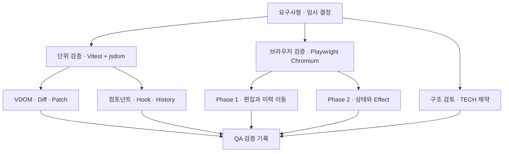
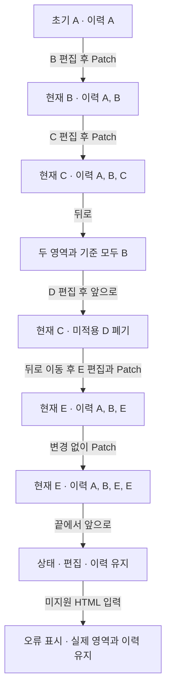
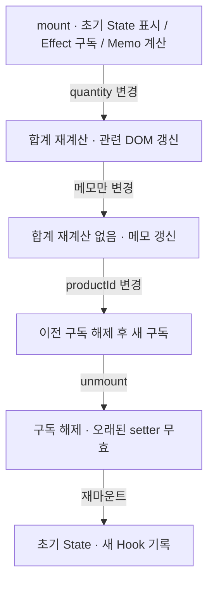
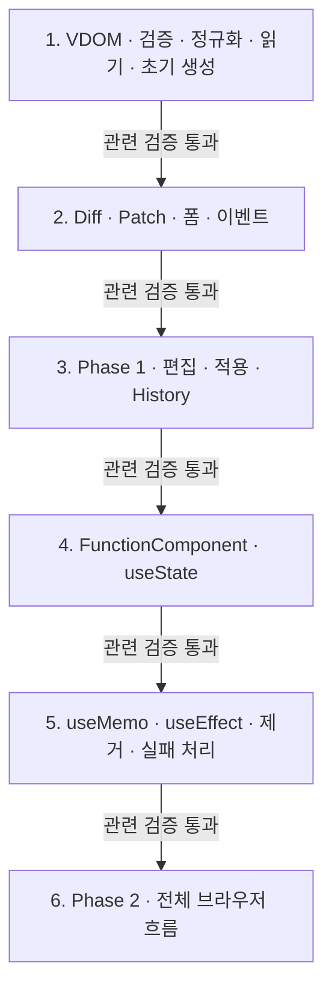

# 검증 계획과 구현 순서

상태: 설계 검증 계획. 아래 테스트는 아직 작성·실행하지 않았다.

## 한눈에 보기

## 환경

[OPEN-10 임시 결정](temporary-decisions.md)에 따라 Vitest+jsdom으로 핵심 모듈을, Playwright Chromium으로 브라우저 흐름을 검증한다. 외부 UI 프레임워크는 사용하지 않는다. 테스트 도구와 버전은 구현 착수 시 설치·기록한다.

## 요구사항과 검증 연결

| 요구사항 | 검증 대상 | 핵심 확인 |
| --- | --- | --- |
| [VDOM-01](../requirements.md#vdom-01), [VDOM-02](../requirements.md#vdom-02) | readDOM | 중첩·순서·공백·속성·현재 폼 값, 미지원 입력 |
| [DIFF-01](../requirements.md#diff-01), [DIFF-02](../requirements.md#diff-02), [DIFF-03](../requirements.md#diff-03) | diff | 추가·삭제·태그·텍스트·속성·무변경, 입력 불변 |
| [PATCH-01](../requirements.md#patch-01), [PATCH-02](../requirements.md#patch-02), [PATCH-03](../requirements.md#patch-03) | mountTree/applyPlan | 목표 DOM 일치, 형제 참조 보존, 무변경 쓰기 없음 |
| [COMP-01](../requirements.md#comp-01), [COMP-02](../requirements.md#comp-02), [COMP-03](../requirements.md#comp-03) | FunctionComponent | 초기 표시·Props 전달·State 부분 갱신 |
| [STA-01](../requirements.md#sta-01), [STA-02](../requirements.md#sta-02), [STA-03](../requirements.md#sta-03) | useState | 초기화·두 슬롯 독립·setter·함수형 업데이트·같은 값 생략 |
| [EFF-01](../requirements.md#eff-01), [EFF-02](../requirements.md#eff-02), [EFF-03](../requirements.md#eff-03), [EFF-04](../requirements.md#eff-04) | useEffect | DOM 반영 후 설정·의존성 비교·정리 순서·제거 |
| [MEMO-01](../requirements.md#memo-01), [MEMO-02](../requirements.md#memo-02), [MEMO-03](../requirements.md#memo-03) | useMemo | 최초 계산·동일 결과 재사용·새 deps 계산 |
| [EDIT-01](../requirements.md#edit-01), [EDIT-02](../requirements.md#edit-02) | 편집 컨트롤러 | HTML 편집·폼 현재 값 반영·적용 전 실제 영역 유지 |
| [VIEW-01](../requirements.md#view-01), [VIEW-02](../requirements.md#view-02), [VIEW-03](../requirements.md#view-03), [VIEW-04](../requirements.md#view-04) | 브라우저 통합 | 두 영역·버튼·초기 변환·Patch·Phase 2 사례 |
| [HIST-01](../requirements.md#hist-01), [HIST-02](../requirements.md#hist-02), [HIST-03](../requirements.md#hist-03) | HistoryStore/컨트롤러 | 스냅샷 독립·이동·동기화·분기·경계 |
| [TECH-01](../requirements.md#tech-01), [TECH-02](../requirements.md#tech-02) | 구성 검토 | TS/Vanilla 사용, 외부 UI 프레임워크 미사용 |
| [TECH-03](../requirements.md#tech-03), [TECH-04](../requirements.md#tech-04) | 클래스 검토 | FunctionComponent·hooks·mount·update 존재와 사용 |
| [TECH-05](../requirements.md#tech-05), [TECH-06](../requirements.md#tech-06) | 호출 문맥·예제 검토 | 루트 Hook, 자식 순수성, 자식 Hook 오류 |
| [QA-01](../requirements.md#qa-01), [QA-02](../requirements.md#qa-02), [QA-03](../requirements.md#qa-03), [QA-04](../requirements.md#qa-04), [QA-05](../requirements.md#qa-05) | 검증 기록 | 단위·기능·경계·부분 갱신 결과와 실행 방법 기록 |

## 반드시 연결해서 확인할 흐름

### Phase 1

### Phase 2

## 경계·오류 사례

- 중간 자식 삽입·삭제·타입 교체가 한 번에 발생하는 경우.
- input/textarea의 속성 초기값과 현재 프로퍼티가 다른 경우.
- 새 이벤트 함수 적용 후 이전 함수가 호출되지 않는지.
- Effect deps 생략·[]·동일 배열 값·새 객체·NaN·+0/-0.
- Hook 개수/종류 오류와 자식 Hook 호출.
- Effect 중 setter, 무한 갱신 차단, cleanup 예외 뒤 다른 정리 지속.
- 렌더 실패 후 마지막 성공 DOM·State·Memo 유지 및 미실행 Effect.
- 인위적인 DOM 적용 오류에서 History를 확정하지 않는지.

## 구현 순서

각 단계는 관련 검증을 통과한 뒤 다음 단계로 진행한다. 인수 조건에 영향을 주는 임시 정책이 바뀌면 그 테스트의 기대 결과도 변경한다.

## 설계 변경 시 점검

| 변경 | 함께 검토할 부분 |
| --- | --- |
| DOM 지원 확대 | reader·validator·serializer·bindings·시연 샘플 |
| 의존성 비교 변경 | Effect·Memo·객체 관련 테스트 |
| 이력 정책 변경 | HistoryStore·버튼 상태·편집 처리·오류 복원 |
| Hook 사용 범위 확대 | FunctionComponent 구조·호출 문맥·슬롯 소유권 |
| key 기반 이동 추가 | VDOM 타입·Diff 대응·Patch 계획·DOM 정체성 기대값 |
