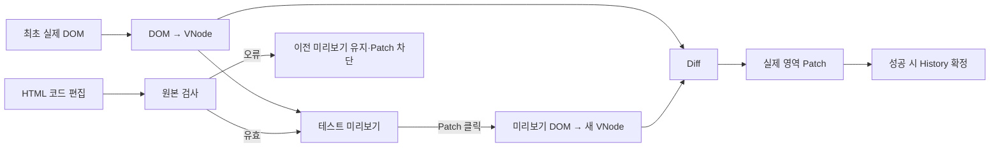
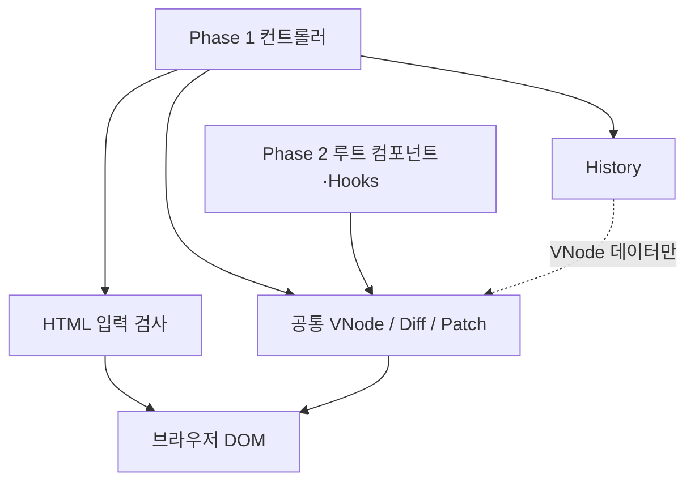

# 미니 React 설계 문서

> **상태:** 구현 가능한 1차 설계 초안·팀 검토 전. **확정**은 과제 조건 또는 사용자가 선택한 방향, **제안**은 이 문서가 채운 세부 정책을 뜻한다. 구현·테스트 완료는 아니다.
> **입력 문서:** [요구사항 명세서](requirements.md) · [과제 원문](https://github.com/WEEK11-12/mini-react/blob/main/docs/assignment.md)

## 1. 설계 목표와 경계

이 문서는 [요구사항 명세서](requirements.md)의 기대 동작을 **어떤 책임·데이터 흐름으로 구현할지, 왜 그 구조를 택할지** 기록한다. 실제 React의 내부 구현을 복제하거나 성능 우위를 주장하는 문서가 아니다.

| 기준 | 설계에 미치는 영향 | 관련 요구 |
| --- | --- | --- |
| 브라우저에서 직접 실행 | Vanilla JavaScript로 DOM 읽기·변경과 사용자 이벤트를 다룬다. | CON-01, FR-01~06 |
| 부분 갱신 | 이전·다음 UI 표현을 비교하고 필요한 DOM 변경만 적용한다. | FR-03~05, FR-16 |
| 루트 전용 State·Hook | Hook 저장소와 갱신 흐름의 소유자를 루트로 제한한다. | CON-02~03, FR-10~16 |
| 학습 가능한 구조 | 각 단계의 입력·출력과 실패 지점을 테스트로 관찰할 수 있게 한다. | Q-01~04 |

### 상세 설계 문서 지도

이 문서는 전체 흐름과 공통 결정을 관리한다. 세부 계약과 경계 사례는 담당 문서 한 곳에만 두어 설명이 어긋나지 않게 한다. 검증 ID와 기대 결과는 [검증 계획](testing.md)이 관리한다.

| 상세 문서 | 다룰 책임 | 관련 요구 |
| --- | --- | --- |
| [HTML 입력·미리보기](design/html-input.md) | Phase 1 코드 입력의 검사·오류·미리보기 | FR-01~02, FR-05~06 |
| [Virtual DOM](design/virtual-dom.md) | DOM 읽기, UI 트리 표현·렌더링 | FR-01~02, FR-05, FR-16 |
| [Diff·Patch](design/diff-patch.md) | 트리 비교, 변경 정보, 실제 DOM 반영 | FR-03~05, FR-16 |
| [History](design/history.md) | Phase 1의 편집·적용과 이력 탐색 | FR-06~09 |
| [컴포넌트·Hooks](design/component-hooks.md) | 함수형 컴포넌트, 루트 State, 세 Hook | FR-10~16 |
| [검증 계획](testing.md) | 요구 ID별 단위·브라우저 테스트와 경계 사례 | FR-01~17, Q-01~04 |

## 2. 전체 동작 흐름

### Phase 1 · 편집과 History

코드 편집 중에는 미리보기만 바뀐다. Patch 시점의 **현재 미리보기 DOM**을 읽어 Diff를 계산한다. History 이동은 대상 VNode를 Diff·Patch로 실제 영역에 반영하고 미리보기·코드 입력창을 함께 복원한다. 잘못된 입력과 적용 실패는 이력에 넣지 않는다. 세부 정책은 [HTML 입력](design/html-input.md), [VNode](design/virtual-dom.md), [History](design/history.md)에 둔다.

### Phase 2 · State와 컴포넌트

`입력·클릭 → 루트 State 갱신 요청 → 함수형 컴포넌트 실행 → 새 Virtual DOM → 이전 트리와 Diff → 실제 DOM Patch → Effect`

컴포넌트 함수는 맡은 UI를 표현한 값을 반환한다. 그 함수를 다시 호출하는 것과 실제 DOM을 전부 교체하는 것은 다르다. Phase 2는 Phase 1의 트리·Diff·Patch 경로를 재사용한다.

## 3. 책임과 인터페이스

아래는 **논리적 책임**이다. 구현 파일의 분리는 이 경계에 맞추되 필요 이상으로 파일을 늘리지 않는다.

| 책임 | 입력 | 출력·관찰 결과 | 관련 요구 |
| --- | --- | --- | --- |
| DOM 읽기 | 최초 실제 영역 또는 Patch 시점의 미리보기 DOM 루트 | 비교 가능한 UI 트리 | FR-01, FR-05 |
| 트리 렌더링 | UI 트리 | 테스트 영역 또는 새 DOM 노드 | FR-02 |
| Diff | 이전·다음 UI 트리 | 변경 지점과 종류 | FR-03 |
| Patch | 실제 영역과 변경 정보 | 필요한 DOM 변경 결과 | FR-04~05 |
| 편집·History | 버튼 동작과 적용된 트리 | 현재 위치, 양쪽 영역의 표시 | FR-06~09 |
| FunctionComponent | 루트 UI 함수와 props | hooks 저장소, mount·update 결과 | FR-10~12 |
| Hooks | 루트의 호출 문맥과 입력 | State 값·갱신 요청, Effect, Memo 결과 | FR-13~15 |

**의존성 방향:** 입력 검사기·History·Hooks는 서로 직접 가져오지 않는다. 두 UI 컨트롤러가 필요한 책임을 조합한다. Diff는 DOM을 모르고 VNode만 비교한다. Patch만 실제 DOM을 바꾼다. Phase 1의 제한된 HTML 문법과 Phase 2의 버튼·입력 이벤트는 VNode 표현을 공유하지만 입력 검증 규칙을 공유하지 않는다.

**공유 규칙:** Diff는 이전·다음 UI를 비교하는 단계, Patch는 찾은 변경을 DOM에 적용하는 단계로 구분한다. Phase 1과 Phase 2는 서로 다른 입력에서 시작하지만 같은 갱신 경로로 합류한다. Hook 저장소는 루트 수명에 속하며 자식은 props만 받아 UI를 반환한다.

### 구체적 계약을 정할 때 기록할 형식

| 항목 | 기록할 내용 |
| --- | --- |
| 관련 요구사항 ID | 어떤 FR·제약을 해결하는가 |
| 입력·출력 | 값의 형태, 유효 범위, DOM 참조 여부 |
| 불변 조건 | 변경 전후에도 지켜야 할 관계 |
| 오류 처리 | 잘못된 입력·적용 실패 시 관찰할 결과 |
| 검증 | 어떤 단위·브라우저 테스트로 확인할까 |

지원 요소·속성, 최상위 구조와 기본 문법은 [요구사항 2장](requirements.md#phase-1-테스트-html의-지원-범위)에 명시했다. VNode 필드·공백 판별·DOM 대응은 상세 설계 문서가 기준이다. 폼의 현재 값과 이벤트 처리는 Phase 1 비교 대상에서 제외한다.

## 4. 설계 결정 기록

중요한 선택은 다음 형식으로 남긴다. 과제에서 지정한 조건과 팀의 결정, AI가 제안한 후보를 같은 상태로 취급하지 않는다.

| 필드 | 의미 |
| --- | --- |
| 관련 요구사항 | 선택이 충족해야 할 요구 ID |
| 해결할 문제 | 기존 방식으로 남는 부담·제약 |
| 선택과 대안 | 채택한 방법과 검토한 다른 방법 |
| 선택 이유 | 요구와 연결되는 근거 |
| 감수할 비용·한계 | 복잡도, 지원하지 않는 동작, 재검토 조건 |
| 검증 방법 | 선택이 실제로 작동하는지 확인할 증거 |
| 상태 | 확정 / 제안 / 미정 |

| 결정 | 상태 | 근거·영향 |
| --- | --- | --- |
| D-01 · Vanilla JavaScript 중심 | 확정 | 브라우저 DOM과 이벤트를 직접 다루고 과제의 기술 제한을 따른다. Python 중심 브리지는 사용하지 않는다. CON-01 |
| D-02 · 루트만 State·Hook 소유 | 확정 | 과제의 컴포넌트 제약을 따른다. 자식은 props 기반 함수로 둔다. CON-02~03 |
| D-03 · 다섯 Diff 기본 사례 | 확정 | 사용자와 정한 장바구니의 텍스트·속성 변경, 자식 추가·삭제, 요소 교체를 검증한다. FR-03 |
| D-04 · Diff 계산과 DOM Patch 분리 | 제안 | 비교를 DOM 조작 없이 테스트하고 두 Phase에서 재사용한다. 변경 계획·적용 순서는 [Diff·Patch](design/diff-patch.md). FR-03~04 |
| D-05 · JavaScript 객체 VNode | 제안 | 요소/텍스트/속성/자식과 Phase 2 이벤트를 한 표현으로 잇는다. [VNode](design/virtual-dom.md). FR-01~03, FR-16 |
| D-06 · 선형 History | 확정 | 뒤로 간 뒤 새로 다른 트리를 Patch하면 미래 이력을 삭제한다. 세부 경계는 [History](design/history.md). FR-07~09 |
| D-07 · HTML 코드 입력과 미리보기 | 확정 | 테스트 영역에서 소스를 수정하면 미리보기만 갱신하고, Patch 때 미리보기 DOM을 읽는다. 두 영역의 전후 차이와 다섯 Diff 사례를 관찰할 수 있다. FR-02, FR-05~06 |
| D-08 · Phase 1의 기본 비교 범위 | 확정 | 요소·텍스트·HTML 속성을 표현한다. 폼의 현재 값과 이벤트 처리는 별도 범위로 둔다. 지원 목록은 요구사항 2장에 명시한다. FR-01~05 |
| D-09 · 지원 목록과 오류 처리 | 확정 | 장바구니 예시를 표현할 일곱 요소와 `class`·`title`·`data-*`만 테스트 HTML에 허용한다. 모든 요소에 명시적인 닫는 태그와 짝이 맞는 중첩을 요구한다. 그 밖의 요소·속성이나 입력 규칙 위반은 오류를 표시하고 미리보기는 마지막 유효 상태를 유지하며 Patch를 막는다. 브라우저의 자동 보정으로 이 규칙을 우회하지 않는다. FR-01~06 |
| D-10 · 입력의 최상위 구조·속성 표기 | 확정 | 최상위 요소 하나를 요구하고 빈 입력·복수 최상위 요소는 오류로 처리한다. 속성값은 작은따옴표나 큰따옴표로 감싼다. FR-01~02, FR-05~06 |
| D-11 · 주석·공백의 기본 처리 | 확정 | 주석과 들여쓰기는 제외하고 의미 있는 공백은 보존한다. 정확한 판별과 DOM 대응은 팀 검토용 제안이다. FR-01~05 |
| D-12 · 자식 식별 기준 | 확정 | `data-key`가 있으면 키 우선, 없으면 같은 위치로 대응한다. 키 중복은 오류로 다루는 제안이다. FR-03~04 |
| D-13 · Hook 슬롯·Effect 정책 | 제안 | 루트 인스턴스에 순서별 슬롯을 저장하고 커밋 후 Effect 실행·정리를 수행한다. [컴포넌트·Hooks](design/component-hooks.md). FR-10~15 |
| D-14 · 원본 HTML 선검사 | 제안 | 브라우저 자동 보정과 미지원 구문의 삽입을 막기 위해 원본을 검사한 뒤 미리보기를 만든다. [HTML 입력](design/html-input.md). FR-05~06 |

### 설계 결정 예시 · D-01

- **관련 요구사항:** CON-01, FR-01~17
- **해결할 문제:** 브라우저 DOM·이벤트와 핵심 갱신 로직을 같은 언어에서 연결해야 한다.
- **선택과 대안:** Vanilla JavaScript 중심을 선택했다. 이전 Python 중심 브리지 구상은 사용하지 않는다.
- **이유:** 과제의 기술 제한과 브라우저 실행 환경에 맞는다.
- **비용·한계:** 언어 선택만으로 구조의 정확성이나 성능이 보장되지는 않는다.
- **검증:** 실제 브라우저에서 두 Phase의 입력·클릭·부분 갱신을 확인한다.

## 5. 검증 연결

| 검증 대상 | 관련 요구 | 확인할 근거 |
| --- | --- | --- |
| DOM 읽기·초기 렌더링 | FR-01~02 | 중첩·텍스트·자식 순서가 표현되고 테스트 영역에 표시됨 |
| Diff·Patch | FR-03~05 | 다섯 사례의 변경 정보, 목표 DOM, 변경 없는 요소의 유지 |
| 편집·History | FR-06~09 | Patch 후 저장, 뒤로·앞으로 이동 시 두 영역 동기화 |
| 컴포넌트·Hooks | FR-10~15 | State 보존, props 전달, Effect·Memo의 실행 결과 |
| Phase 2 통합 | FR-16~17 | 사용자 동작에서 같은 Diff·Patch 경로로 DOM 갱신 |

각 요구와 테스트 ID의 연결, 정상·실패 경로는 [검증 계획](testing.md)에 둔다. 실행 명령·브라우저·테스트 결과는 구현 후 확인된 사실만 README와 PR에 기록한다.

## 6. 팀 검토 지점

이 초안은 구현에 필요한 동작을 제안까지 포함해 채웠다. 팀이 확정한 것으로 표현하지 않을 항목은 **원본 HTML 제한 문법·공백 규칙, VNode 필드, Diff 변경 계획, Hook 실행·오류 정책, 테스트 도구**다. 각각의 이유·한계·경계 사례는 담당 상세 문서에 있다. 팀 리뷰에서 바꾸면 [요구사항](requirements.md)의 인수 조건과 [검증 계획](testing.md)의 기대 결과도 같은 변경으로 갱신한다.

선택 기능인 Batching·차별화 기능은 필수 설계·테스트와 분리해 추후 결정한다. 현재 문서는 실제 React의 내부 구현과 동일함을 주장하지 않는다.
