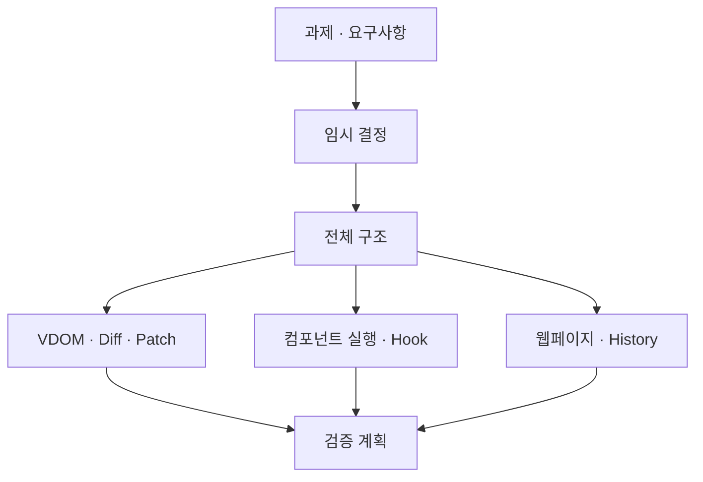

# Mini-React 설계

상태: **설계 검토 완료 / OPEN-01~15의 기존 구현 정책 채택** · 최초 작성: 2026-11-09 · 종결: 2026-11-11

이 문서는 [요구사항](../requirements.md)과 [과제 원문](../assignment.md)을 바탕으로 작성했다. 현재 설계 경로는 `docs/design`이다.

설계 당시 임시 선택으로 작성했고 key 기반 자식 대응과 무변경 Patch 이력 보존을 먼저 채택했다. 2026-11-11 [최종 설계 검토](final-review.md)와 사용자의 검증 종결 위임을 근거로 운영 에이전트가 나머지 기존 구현 정책을 채택했다. 새 기능·지원 범위를 추가하지 않았다. 실제 구현 검증과 화면 확인 결과는 [최종 검증 기록](../implementation/stage-10.md)을 따른다.

## 한눈에 보기

## 문서 구성

이 문서들의 명명·형식·다이어그램 기준은 [코드·문서 작성 규칙](../conventions.md)을 따른다.

| 문서 | 내용 |
| --- | --- |
| [결정 기록](temporary-decisions.md) | OPEN-01~15의 구현 선택·채택 여부, 이유, 영향, 변경 시 수정 위치 |
| [전체 구조](architecture.md) | 시스템 경계, 데이터 흐름, 모듈 소유권, 공개 인터페이스 |
| [VDOM·Diff·Patch](renderer.md) | 공통 VDOM 모델, DOM 변환, 비교와 반영 알고리즘 |
| [컴포넌트 실행](component-runtime.md) | FunctionComponent, mount/update/unmount, 업데이트 처리 |
| [Hook](hooks.md) | hooks 배열, useState/useEffect/useMemo, 실행 순서 |
| [웹페이지·이력](playground-history.md) | 편집·적용·이력 이동과 Phase 2 검증 화면 |
| [검증 계획](verification.md) | 요구사항별 검증 연결, 경계 사례, 구현 순서 |
| [최종 설계 검토](final-review.md) | 실제 코드 대조, OPEN 채택 인수 조건, 완료·미검증·범위 밖 분류 |

## 읽는 순서

결정 기록 → 전체 구조 → 담당 시스템의 설계 → 검증 계획 순으로 확인한다.

## 설계와 요구사항의 관계

- 과제에서 지정한 `FunctionComponent`, `hooks`, `mount()`, `update()`와 루트 전용 Hook·State 조건을 유지한다.
- Object.is·HTML 편집·오류·이력·인수 환경 등 현재 외부 정책은 요구사항에 채택 상태와 인수 조건을 반영했다. 자료구조·내부 알고리즘은 이 설계에서 관리한다.
- 데이터 타입과 함수 시그니처는 설계 계약이다. 실제 공개 인터페이스를 판단할 때는 현행 소스와 대조한다.
- 구현에 사용한 정책을 변경하면 해당 시스템 설계·요구사항의 인수 조건·검증 사례를 함께 확인한다.
- 팀이 외부 정책을 채택한 뒤 요구사항의 인수 조건과 결정 상태를 갱신한다. 내부 구조 선택은 설계에 남긴다.

## 구현 범위의 설계 기준

1. Phase 1: DOM 읽기 → VDOM → 비교 → 부분 반영 → 이력 이동.
2. Phase 2: 루트 상태 변경 → 함수 컴포넌트 재실행 → 같은 렌더러로 부분 반영.
3. Phase 2의 Hook State와 Phase 1의 VDOM History는 서로 독립적으로 관리한다.
4. 같은 부모 안의 keyed 자식은 key로 대응해 재정렬해도 호환되는 DOM을 유지한다. HTML 입력·DOM 읽기·History에서도 key를 보존한다.
5. 현재 적용 상태와 의미상 같은 Patch는 History와 앞으로가기 기록을 유지한다. 폼 값 보정·입력창 동기화는 별도로 수행한다. [상세 계약](playground-history.md#의미상-같은-상태와-무변경-patch)을 따른다.

SSR, Fiber, 동시 렌더링, keyed Fragment, 개발용 Strict Mode는 이번 설계 범위에 포함하지 않는다. key 기반 비교·DOM 재사용은 포함하지만 최소 이동 횟수 최적화는 인수 조건이 아니다.

key 정책의 기준 문서는 [렌더러](renderer.md#key와-자식-정체성)다. key와 논리 ID·DOMScope는 독립적이며, key가 루트 Hook 슬롯의 식별 방식을 바꾸지는 않는다.

## 설계 검토 피드백 반영

- [렌더러의 영역별 식별자 계약](renderer.md#영역별-식별자-계약): 논리 ID와 실제 DOM ID를 분리하고 읽기·쓰기·직렬화의 왕복을 정의한다.
- [제거 진입 조건](component-runtime.md#unmount): 실행 중 재진입 제거는 부수 효과 전에 거부한다.
- [DOM 반영 실패와 재시작](component-runtime.md#실패-처리): DOM 재구성 후 기존 Effect를 유지하지 않고 정리 후 faulted로 전환한다.
- [추가 검증 사례](verification.md#설계-검토-회귀-사례): ID 격리, 제거 재진입, DOM 참조 Effect의 복구 경로를 확인하는 기준을 둔다. 실제 통과 범위는 검증 기록에서 확인한다.

이 보완은 구현에 사용한 설계 계약이다. 정책 채택, 설계 검토, 구현 검증은 각각 별개다.
