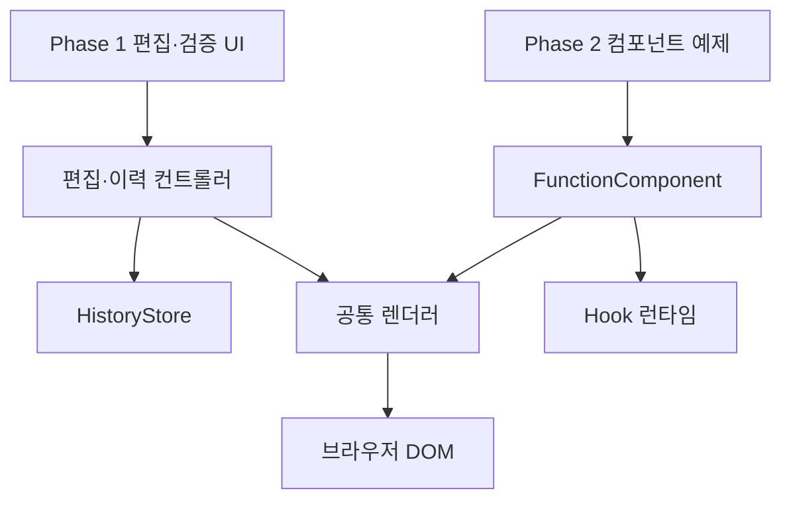
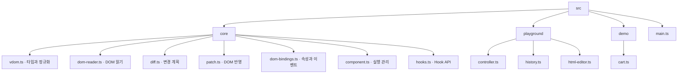

# 전체 구조

상태: key 기반 자식 대응 채택 / 나머지 정책은 임시 설계 · 기준: [결정 기록](temporary-decisions.md)

## 시스템 경계



라이브러리는 HTML 입력창, 버튼, 오류 메시지, History를 알지 못한다. 두 단계는 공통 렌더러를 사용하지만 DOM 컨테이너와 상태는 분리한다.

## 책임과 데이터 소유권

| 모듈 | 소유 데이터 | 책임 |
| --- | --- | --- |
| vdom / dom-reader | VNode 타입, key 메타데이터와 정규화 규칙 | DOM의 예약 data-key 읽기, 함수 결과 정규화, 형제 key 중복 등 입력 검증 |
| diff | key/위치 대응과 다음 순서를 포함한 변경 계획 | 두 VDOM을 비교. DOM 변경 없음 |
| patch / dom-bindings | 임시 DOM 노드 참조, DOMScope 생성·해제 규칙 | 초기 생성, 대응 노드 재사용·이동·교체·제거, 영역별 ID 변환, 속성·프로퍼티·이벤트 처리 |
| FunctionComponent | currentTree, hooks, 상태 업데이트 대기열, 루트 DOMScope | 렌더 → 커밋 → Effect 실행, 제거와 실패 시 자원 정리 |
| hooks | 현재 루트·호출 문맥, 슬롯 접근 | State·Effect·Memo API 제공 |
| HistoryStore | 스냅샷 배열·cursor | Phase 1 저장과 탐색. DOM 접근 없음 |
| PlaygroundController | draft HTML, previewTree, appliedTree, 오류·busy 상태, 두 영역의 DOMScope | 화면의 편집·적용·복원 흐름과 식별자 격리 조율 |

## 계획하는 소스 구성



위 파일들은 계획이며 아직 생성하지 않는다. 테스트 도구의 버전과 설치 명령은 구현 환경을 만들 때 확정한다.

## 주요 인터페이스

```ts
createDOMScope(container: Element): DOMScope
releaseDOMScope(scope: DOMScope): void
readDOM(container: Element | DocumentFragment, scope?: DOMScope): VRoot
validateRoot(root: VRoot, mode: 'html' | 'component'): void
diff(previous: VRoot, next: VRoot): PatchPlan
mountTree(container: Element, tree: VRoot, scope: DOMScope): void
applyPlan(container: Element, plan: PatchPlan, scope: DOMScope): void

h(type: string | StatelessComponent, props: Props | null,
  ...children: Child[]): Child
text(value: string | number): VText

class FunctionComponent<P> {
  hooks: HookSlot[];
  mount(container: Element, props: P): void;
  update(props?: P): void;
  unmount(): void;
}
```

`VRoot`, `Props`, `PatchPlan`은 [렌더러](renderer.md), `Child`와 실행 규칙은 [컴포넌트](component-runtime.md), `HookSlot`은 [Hook](hooks.md)에서 정의한다.

`DOMScope`는 특정 컨테이너에 귀속된 불투명 식별자 변환 문맥이다. 적용·복구에는 같은 문맥을 사용하고 DOM을 비운 뒤 해제한다. 연결된 관리 DOM의 readDOM에는 반드시 해당 scope를 전달한다. scope 생략은 최초 샘플과 분리된 template처럼 논리 ID를 가진 원본 DOM에만 사용한다. 구체적인 [변환·소유권 계약](renderer.md#영역별-식별자-계약)은 렌더러에 둔다.

컨테이너는 교체되지 않는 호스트 요소이며 VRoot에는 그 내부 노드만 담는다. 두 영역의 바깥쪽 id·제목·버튼은 VDOM의 대상에서 제외한다.

key는 VElement의 선택적 메타데이터로 유지한다. HTML 편집은 data-key, 컴포넌트 작성은 예약 Props.key를 사용하며 두 경로는 같은 VDOM으로 정규화된다. diff는 같은 부모의 key로 대응하고 patch는 기존 DOM 참조를 목표 순서로 배치한다. [상세 계약](renderer.md#key와-자식-정체성)은 렌더러가 기준이다.

## Phase 1 흐름

1. 실제 영역의 초기 DOM을 읽어 초기 VDOM을 만든다.
2. 실제·미리보기 컨테이너마다 다른 DOMScope를 만들고, 동일한 논리 VDOM을 각 scope로 반영한다.
3. 사용자는 HTML 입력 또는 미리보기 폼을 편집한다.
4. Patch 요청 시 현재 미리보기 DOM을 읽어 appliedTree와 비교한다.
5. 실제 영역 반영 성공 후 적용 기준과 이력을 함께 갱신한다.

## Phase 2 흐름

1. FunctionComponent가 루트 함수를 실행한다.
2. 자식 함수는 Props로 실행되고 루트와 자식의 결과가 같은 VDOM 모델로 정규화된다.
3. 공통 Diff·Patch가 DOM을 갱신한다.
4. 새 트리와 Hook 기록을 커밋한다.
5. 변경된 Effect의 이전 정리와 새 설정을 실행한다.

실행 중 unmount 재진입은 거부한다. DOM 반영 오류로 재구성이 필요하면 generation과 이벤트 진입을 무효화하고 기존 Effect를 정리한다. 복구 성공 여부와 무관하게 faulted에서 멈추며, 명시적 제거 후 재마운트해야 한다. [실패 처리](component-runtime.md#실패-처리)를 따른다.

Phase 2의 DOM을 다시 읽어 State로 역변환하지 않는다. State가 UI 계산의 기준이다.

## 핵심 불변 조건

- 이전 VDOM과 History 스냅샷은 수정하지 않는다.
- 정상 커밋 완료 후 currentTree/appliedTree는 해당 DOM의 의미상 구조와 일치한다.
- 일반 Patch는 지원 대상 외의 컨테이너·형제 DOM을 건드리지 않는다.
- 입력 검증 실패는 적용 상태와 History를 변경하지 않는다.
- 루트 Hook을 자식 함수 실행 문맥에서 사용할 수 없다.
- UI 값 비교는 HTML 원문 문자열이 아니라 정규화한 구조·속성·텍스트·폼 상태를 기준으로 한다.
- VDOM·Diff·History는 논리 ID만 다룬다. 같은 논리 트리를 다른 scope에 반영해도 읽어 얻는 지원 HTML 데이터는 같고, label·ARIA ID 참조는 자기 영역 안에서만 연결된다. readDOM은 Phase 2의 이벤트 함수나 Hook State를 복원하는 API가 아니다.
- DOM 재구성은 화면의 복구이지 Effect 수명과 컴포넌트 실행의 복구가 아니다. faulted 상태에서 기존 setter·이벤트·대기 요청은 실행되지 않는다.
- 정상 갱신에서 같은 부모·같은 key·같은 tag의 DOM은 재정렬해도 같은 객체다. key는 형제 범위이며 ID 이름공간·루트 Hook 순서와 독립적이다. key 없는 자식은 위치 fallback만 제공한다.
- History 스냅샷과 직렬화는 key를 보존한다. 중복 key 검증 실패는 마지막 성공 DOM·Hook·History를 변경하지 않는다.

## 요구사항 연결

- [VDOM](../requirements.md#vdom), [DIFF](../requirements.md#diff), [PATCH](../requirements.md#patch): 렌더러
- [COMP](../requirements.md#comp), [STA](../requirements.md#sta), [EFF](../requirements.md#eff), [MEMO](../requirements.md#memo): 런타임·Hook
- [EDIT](../requirements.md#edit), [VIEW](../requirements.md#view), [HIST](../requirements.md#hist): 검증 앱
- [TECH-01](../requirements.md#tech-01)~[TECH-06](../requirements.md#tech-06): 전체 설계 제약
