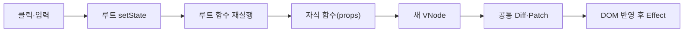

# 컴포넌트·Hooks 상세 설계

> **상태:** 구현 전 설계 초안. 루트 전용 Hook은 과제 제약이며 세부 실행 정책은 팀 검토용 제안이다.
> **관련 요구:** FR-10~16 · [요구사항](../requirements.md) · [전체 설계](../design.md)

## 1. 범위와 책임

`FunctionComponent`는 **루트 함수형 컴포넌트 하나**를 감싼다. 인스턴스가 `hooks` 배열, 현재 Hook 인덱스, 이전 VNode, 실제 DOM 루트, 렌더링 상태를 소유한다. `mount()`는 최초 트리를 만들고 DOM에 붙인다. `update()`는 루트 함수를 다시 실행해 새 VNode를 만든 후 Phase 1의 [Diff·Patch](diff-patch.md)를 사용한다.

자식 컴포넌트는 `Child(props) → VNode` 형태의 순수 함수다. 자식의 표시 값은 루트 State에서 계산해 props로 전달한다. 자식 내부 Hook 호출은 오류다.



## 2. 입력·출력 계약

| API | 입력 | 결과 |
| --- | --- | --- |
| `mount()` | 루트 함수·대상 DOM | 최초 Hook 슬롯·VNode·실제 DOM 생성, Effect 실행. 중복 mount는 오류. |
| `update()` | 저장된 루트 함수·최신 State | Hook 인덱스 0부터 재실행, 새 VNode와 이전 VNode 비교·적용, 성공 후 Effect 실행. |
| `useState(initial)` | 값 또는 초기화 함수 | `[value, setter]`. 초기화 함수는 첫 mount에만 실행. |
| `useEffect(effect, deps?)` | Effect 함수·선택적 의존성 배열 | DOM 반영 뒤 외부 작업 실행. Effect가 함수를 반환하면 정리 함수로 저장. |
| `useMemo(factory, deps?)` | 계산 함수·선택적 의존성 배열 | 계산 결과 반환; 의존성이 같으면 이전 결과 재사용. |
| `unmount()` | 없음 | Effect 정리와 등록 이벤트 해제, 루트 DOM 제거. |

`unmount()`는 과제의 필수 클래스 API는 아니지만 정리 함수를 검증하고 리소스를 누적하지 않기 위한 설계 제안이다.

## 3. 데이터 표현과 불변 조건

Hook은 호출 순서의 슬롯으로 찾는다. 렌더 시작에 `hookIndex = 0`으로 되돌리고 각 Hook 호출이 하나씩 증가시킨다.

```js
hooks[0] = { kind: "state", value: 2 };
hooks[1] = { kind: "memo", value: 4000, deps: [items] };
hooks[2] = { kind: "effect", deps: [count], cleanup: () => {} };
```

처음 렌더에서 슬롯 종류·개수를 정한다. 다음 렌더에서 같은 위치의 Hook 종류가 다르거나 호출 수가 달라지면 오류로 중단한다. 따라서 조건문·반복문·중첩 함수 안에서 Hook을 호출하지 않는다. 루트 함수 실행 문맥 밖의 Hook 호출도 오류다. 자식 함수를 실행할 때는 Hook 사용을 금지한다.

의존성 배열은 이전·다음 길이가 같고 각 항목이 `Object.is`로 같을 때만 같다. 생략하면 매 렌더마다 실행/재계산, 빈 배열이면 mount에서 한 번만 실행/계산한다. `deps`에 배열 아닌 값이 오면 오류다. 객체를 제자리에서 변경하면 참조가 같아 변화가 감지되지 않으므로 State는 새 객체/배열로 만든다.

## 4. 처리 흐름과 다이어그램

1. `useState`의 setter는 값 또는 `prev => next` 함수를 받는다. `Object.is(prev, next)`이면 갱신을 생략한다.
2. 값이 달라지면 루트 State 슬롯에 다음 값을 임시로 두고 `update()`를 실행한다. 이벤트 핸들러의 여러 setter는 **각각 갱신**한다. 자동 Batching은 필수 범위에서 제외한다.
3. `update()`는 Hook 인덱스를 초기화하고 루트 함수를 실행한다. 렌더 도중 setter 호출은 오류다.
4. State·Memo·Effect 슬롯의 다음 값은 커밋된 `hooks`와 분리한 임시 슬롯에서 계산한다. 렌더·계산·검증·Diff가 실패하면 임시 슬롯을 버리고 DOM을 바꾸지 않는다. Patch가 실패하면 임시 슬롯·새 VNode를 확정하지 않고 [Diff·Patch 복구 계약](diff-patch.md#5-경계-사례와-오류-처리)에 따라 이전 VNode의 화면 내용 복구를 시도한다. State 객체를 제자리에서 바꾸는 사용은 이 복구 계약 밖이다.
5. DOM Patch에 성공하면 새 Hook 슬롯·VNode를 확정한다. 그 뒤 변경된 Effect의 이전 정리 함수를 먼저 실행하고 새 Effect를 실행한다. Effect 또는 정리 함수가 실패해도 이미 커밋된 State·VNode·DOM은 되돌리지 않고 오류를 표시한다. Effect 안의 setter는 재진입을 막기 위해 현재 커밋 후 microtask에 후속 update를 예약한다.

`useMemo`는 렌더 중에 계산한다. 동일한 의존성이면 저장한 값을 돌려주며 DOM 변경 여부와 무관하다. `useEffect`는 외부 작업용이므로 렌더 중 실행하지 않는다.

이벤트 핸들러는 Phase 2 VNode의 `events`에 넣고 Patch가 실제 DOM에 연결·교체·해제한다. 입력창의 현재 값은 `domProps.value`로 맞춘다. 이벤트 핸들러에서 입력 값을 읽어 루트 State에 저장한 뒤 새 props를 자식에 전달한다. Phase 1 HTML 편집기의 허용 태그·속성 정책과 별개다.

## 5. 경계 사례와 오류 처리

| 경우 | 기대 결과 |
| --- | --- |
| 첫 State 값이 `0`·`false`·빈 문자열 | 유효한 초기값으로 보존. truthy 검사로 초기화하지 않음. |
| 같은 값으로 setter 호출 | 렌더·Diff·Effect 재실행 없음. |
| setter 함수 형태 | 직전 State를 받아 다음 값을 계산. 연속 호출이 오래된 클로저 값을 덮어쓰지 않음. |
| 조건부 Hook·Hook 순서 변경·자식 Hook | 오류. 이전 커밋 화면 보존. |
| deps 생략·빈 배열·변경·동일 | 각 규칙에 맞는 Effect·Memo 실행 횟수. |
| Effect 재실행·unmount | 이전 정리 함수 1회 실행. 이벤트 핸들러도 남지 않음. |
| 렌더·Memo·검증·Diff 예외 | 임시 Hook 슬롯을 버리고 이전 커밋 State·VNode·DOM 유지. Effect 실행 없음. |
| DOM Patch 예외 | 새 State·VNode를 확정하지 않고 이전 화면 내용 복구 시도. 복구 실패 시 후속 갱신 중단. 노드 참조·포커스 복구는 보장하지 않음. |
| Effect·정리 함수 예외 | 이미 커밋된 State·VNode·DOM 유지, 오류 표시. 외부 작업의 부작용이나 이전 정리 함수 실행을 되돌린다고 보장하지 않음. |
| 입력창 연속 입력 | State·`domProps.value`·화면이 동기화되고 포커스가 불필요하게 교체되지 않음. |

## 6. 선택·대안·한계

Hook 슬롯을 루트 인스턴스에 두면 매번 새로 실행되는 함수와 지속되는 State를 분리해 설명하기 쉽다. 자식별 Hook 상태, 실제 React의 Fiber·동시성·스케줄러·자동 Batching은 구현하지 않는다. `useEffect`의 실행 시점은 이 미니 구현에서 **DOM 커밋 직후**이며 실제 React의 비동기 실행·브라우저 페인트 시점과 동일하다고 주장하지 않는다.

데모는 장바구니를 사용한다. 루트가 상품·선택 수량·테마를 State로 관리하고, 자식은 props로 목록·합계를 표시한다. `useMemo`는 상품 합계 계산을 캐시하고 테마만 바뀔 때 재계산하지 않는다. `useEffect`는 장바구니 개수에 맞춰 문서 제목을 바꾸고 정리 시 이전 제목을 복원한다.

## 7. 검증 사례

`count=1 → 클릭 → count=2`에서 루트가 재실행되고 자식 props가 바뀌며 관련 DOM만 갱신되는지 확인한다. 상품 수량이 같고 테마만 바뀌면 합계 계산 횟수는 늘지 않아야 한다. Effect는 mount/의존성 변경/unmount에서 각각 정해진 횟수로 실행·정리되어야 한다. Hook 순서 오류, 같은 값 setter, 함수형 setter, 입력창 포커스 유지, 상태 갱신 중 예외를 별도 검사한다. 요구 ID와 테스트 ID는 [검증 계획](../testing.md)을 따른다.
