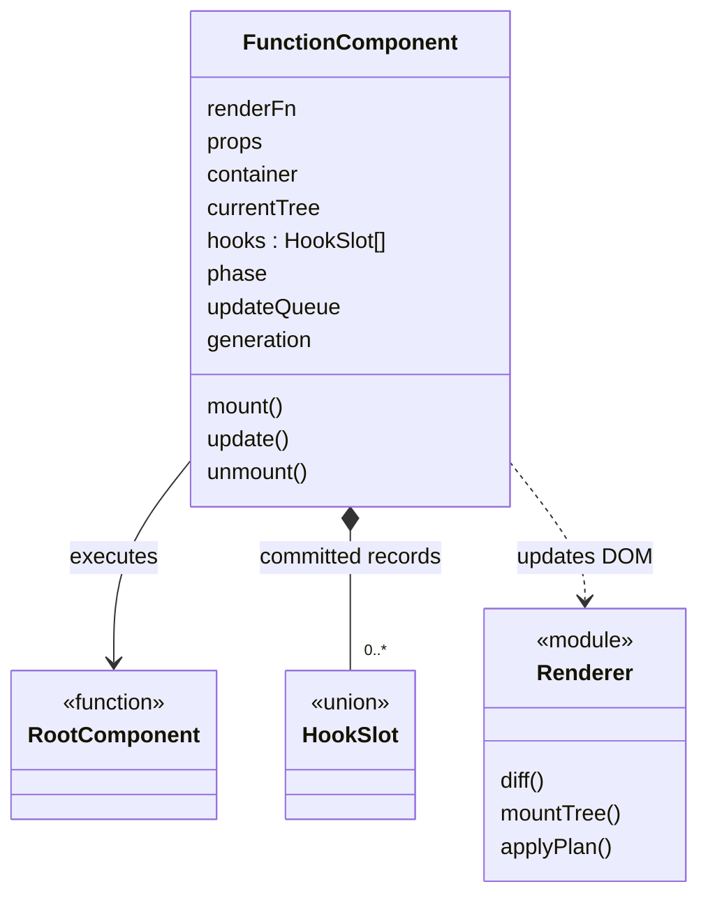

# 컴포넌트 실행 설계

관련 요구사항: [COMP](../requirements.md#comp), [TECH-03](../requirements.md#tech-03)~[TECH-06](../requirements.md#tech-06)

기준: [임시 결정](temporary-decisions.md). 실제 React의 Fiber·동시 렌더링을 복제하지 않고, 과제가 지정한 FunctionComponent로 실행을 관리한다.


## 한눈에 보기



`module`은 함수 모듈이며, 별도의 클래스를 구현한다는 뜻은 아니다.

## 컴포넌트 반환값

```ts
type Child = VNode | string | number | null | boolean | readonly Child[];
type StatelessComponent = (props: Props) => Child;
type RootComponent<P> = (props: P) => Child;
```

문자열·숫자는 Text로, 배열은 순서대로 평탄화한다. null·boolean은 표시하지 않는다. 루트 반환 결과를 VRoot.children으로 감싸므로 0개 또는 여러 노드도 표시 가능하다.

`h('p', props, ...children)`는 host VNode를 만든다. `h(ChildComponent, props, ...children)`는 자식 함수를 즉시 실행해 반환값을 정규화한다. JSX나 별도의 React element 계층은 초기 설계에 두지 않는다.

자식 함수는 여러 노드나 빈 결과도 반환할 수 있으므로 h()의 공통 반환 타입은 Child다. 자식에게 전달하는 props.children은 나머지 children 인수로 구성하며, props.children과 중복 지정하면 오류로 처리한다.

### key 전달 경계

- `h('li', { key: itemId }, ...)`의 key는 host VElement.key로 정규화한다. attrs.key·attrs.data-key는 허용하지 않는다.
- `h(ChildComponent, { key: itemId, ...props }, ...)`는 예약 key를 자식 Props에서 제외하고 자식 함수를 실행한다. 일반 값으로도 itemId가 필요하면 별도 Props 필드로 전달한다.
- key가 지정된 자식 함수의 정규화 결과는 정확히 하나의 VElement여야 한다. 반환 요소를 복사해 외부 key를 부여하며 반환된 원본 VNode는 수정하지 않는다. 반환 요소에 이미 key가 있으면 같은 값만 허용하고 다른 값은 오류다. 빈 결과·텍스트만의 결과·복수 노드 결과에 외부 key를 지정하면 렌더 검증 오류다.
- 외부 key가 없는 자식 함수는 기존처럼 빈 결과·배열·텍스트를 반환할 수 있다. 반환 요소들의 key는 평탄화 후 실제 부모의 형제 목록에서 검증한다. 다중 노드 항목을 묶어 재정렬하려면 명시적인 keyed host wrapper를 사용한다.

현재 구조는 자식 함수를 즉시 실행해 host VDOM으로 정규화하므로 별도 자식 인스턴스 수명이 없다. key는 최종 VElement의 DOM 대응에 적용되며 자식 함수 타입의 변경만으로 재마운트하지 않는다. 자식 key 변경·삭제·이동은 루트 generation·State·Hook 슬롯을 초기화하지 않는다. 루트 인스턴스의 수명은 mount/unmount가 결정한다. [렌더러의 key 계약](renderer.md#key와-자식-정체성)을 따른다.

자식 호출 중에는 Hook 사용 문맥을 일시적으로 'child'로 전환한다. 루트에서 `h`의 인수로 먼저 평가되는 `useState()`는 루트 문맥이고, 자식 함수 본문에서 호출한 Hook은 오류다. 자식 컴포넌트의 직접 함수 호출은 지원 계약 밖으로 둔다.

## FunctionComponent의 기록

| 필드 | 의미 |
| --- | --- |
| renderFn, props | 루트 함수와 마지막 성공 입력 |
| container, currentTree, domScope | 관리하는 컨테이너, 마지막 성공 VDOM, 이 루트가 소유한 DOMScope |
| hooks | 과제가 지정한 Hook 기록 배열 |
| phase | idle / rendering / committing / effects / recovering / unmounting / unmounted / faulted |
| updateQueue | Effect 중 요청된 상태 변경과 갱신 요청 |
| generation | 제거·복구 시작과 새 mount에서 오래된 setter·이벤트 진입을 무효화하는 번호 |

Hook의 candidate 기록은 별도 렌더 작업에 둔다. DOM 반영이 성공한 뒤에만 hooks·currentTree·props를 새 값으로 확정한다.

## mount()

1. unmounted에서만 시작한다. 이미 마운트되었거나 faulted·실행 중이면 오류를 낸다.
2. 빈 hooks로 새 렌더 작업을 시작하고 generation을 갱신한다. 전용 컨테이너에 새 DOMScope를 생성한다.
3. 루트 함수를 실행하고 결과·Hook 호출 개수·종류를 검증한다.
4. DOM 초기 생성을 수행한다.
5. 트리와 Hook 기록을 확정하고 Effect를 실행한다.
6. Effect가 요청한 업데이트를 대기열 순서대로 처리한다.

mount 대상은 이 인스턴스가 전용으로 관리하는 빈 컨테이너다. 생성 직후 phase는 unmounted다. DOM 변경 전 최초 렌더가 실패하면 새 scope와 candidate를 폐기하고 unmounted로 돌아간다. 최초 DOM 반영 중 실패는 아래 복구 절차를 따르며 자동 mount 재시도하지 않는다.

## update()

1. 제거·faulted 상태에서는 오류로 처리한다.
2. 이전 hooks를 기준으로 candidate 슬롯을 만들고 해당 업데이트를 적용한다.
3. 호출 인덱스를 0으로 초기화한 뒤 루트를 실행한다.
4. 정규화·검증을 완료하고 currentTree와 비교한다.
5. 변경 계획을 DOM에 적용한다.
6. 성공 시 candidate 슬롯과 새 트리를 확정한다.
7. 변경된 Effect를 정리·설정하고 다음 대기 요청을 처리한다.

Props 갱신은 update(nextProps)로 요청한다. 자식 Props에 들어가는 콜백도 새 UI의 이벤트 함수로 반영된다.

key 기반 재정렬도 동일한 update·Diff·Patch 경로로 처리한다. 같은 key·같은 tag의 노드 이동 자체는 루트 Effect의 정리·재설정을 유발하지 않으며 Effect는 기존 의존성 규칙을 따른다. key 변경으로 DOM이 교체되는 경우에도 루트 Effect가 그 노드의 수명을 자동 추적하지 않는다. DOM을 참조하는 Effect는 노드 생성을 바꾸는 입력을 의존성에 포함하거나 수명 동안 유지되는 노드만 참조해야 한다.

## 업데이트 실행 규칙

- idle에서 호출한 setter는 한 번의 갱신을 동기 실행한다.
- rendering 중 setter 호출은 오류다. 렌더 중 재귀 갱신을 허용하지 않는다.
- committing/effects 중 요청은 대기열에 넣고 현재 Effect 처리가 끝난 뒤 하나씩 처리한다. 같은 요청 묶음으로 합치는 Batching은 하지 않는다.
- updater 함수는 각 요청 처리 시점의 최신 성공 State를 받는다.
- 한 요청에서 발생한 연속 갱신이 50회를 넘으면 오류로 중단한다. 이 숫자는 무한 루프 방지용 임시 설계 상수이며 제품 요구사항이 아니다.
- 위 실행 규칙은 setter와 직접 update 요청 모두에 적용한다. recovering/unmounting/unmounted/faulted의 setter는 무효 처리하고, 직접 update는 오류로 거부한다.
- 요청 처리 중 updater·렌더·검증 실패 또는 연속 갱신 상한 초과가 발생하면 실패 요청과 남은 대기열을 폐기한다. 이미 성공한 커밋은 되돌리지 않는다. DOM 재구성이 없었다면 idle에서 다음 독립 요청을 받을 수 있다. 일반 Effect 오류는 다른 Effect와 대기 요청을 처리한 뒤 모아 보고하며, 같은 연속 갱신 한도를 공유한다. 대기열 폐기를 이전 성공 State의 롤백이나 자동 재시도로 해석하지 않는다.

## unmount()

진입 검사를 자원·generation·슬롯을 변경하기 전에 수행한다.

- idle/faulted: 아래 제거 절차를 시작한다.
- unmounted: 아무 작업도 하지 않는다.
- rendering/committing/effects/recovering/unmounting: 동기 오류로 거부한다. 요청을 보류하거나 현재 작업을 취소하지 않는다. setup·cleanup의 동기 콜백에서 호출한 경우도 동일하다.

1. phase를 unmounting으로 전환하고 generation을 갱신한다. 대기열을 비우고 새 setter·이벤트 진입을 무효화한다.
2. 저장된 Effect cleanup을 슬롯 순서대로, 기록에서 먼저 제거한 뒤 한 번씩 실행한다. 오류는 모으되 나머지 정리와 제거를 계속한다.
3. 루트와 준비 중 생성한 노드의 이벤트 바인딩을 해제하고 DOM을 비운다.
4. DOM 제거 성공 후 DOMScope를 해제하고 hooks·currentTree·props·컨테이너 참조를 비워 unmounted로 전환한다. 정리 오류는 상태 전이 완료 후 보고한다.

제거 중 cleanup이 호출하는 setter는 무효다. 재진입 unmount는 거부하며 다른 cleanup은 계속한다. DOM 제거 자체가 실패하면 실행을 재개하지 않고 faulted로 남겨 오류를 보고한다. 이후 제거 재시도에서도 이미 시도한 cleanup을 중복 실행하지 않는다. scope는 DOM을 비울 때까지 보유한다.

제거 완료 후 다시 mount()하면 초기값·새 generation·새 DOMScope·새 Effect로 시작한다. faulted에서 mount()를 바로 호출할 수 없으며 먼저 unmount()를 완료해야 한다.

### 실행 중 제거 거부와 자원 소유권

setup이 자원을 확보한 뒤 unmount()를 호출하면 해당 호출이 오류를 던진다. 이를 setup이 잡고 cleanup을 반환하면 정상적으로 cleanup을 보관하며, 현재 Effect 순회를 계속한다. 제거가 실제로 수락된 것은 아니므로 후속 setup도 실행된다. idle에서 명시적으로 제거할 때 저장한 자원을 정리한다.

setup이 예외로 끝나 cleanup을 반환하지 못한 경우 런타임이 그 자원을 알 수 없다. setup은 자원 확보 후 예외가 나면 자체적으로 해제해야 한다. cleanup도 오류가 발생하더라도 소유 자원 해제를 끝내도록 작성해야 한다. 재진입 거부만으로 사용자 함수의 자원 누수까지 방지한다고 보장하지 않는다.

## 실패 처리

| 실패 시점 | 처리 |
| --- | --- |
| 렌더·VDOM 검증 | candidate 기록과 해당 요청을 폐기하고 마지막 성공 DOM·State를 유지. active 문맥은 finally에서 해제 |
| DOM 반영 | 기존 DOM이 변경되기 전 준비 단계의 실패임을 보장할 수 있으면 candidate만 폐기. 부분 변경 가능성이 있으면 아래 재구성 절차를 수행하고, 복구 성공 여부와 관계없이 faulted로 전환 |
| Effect 설정·정리 | 이미 성공한 DOM·State를 되돌리지 않고 오류 표시. 다른 슬롯의 처리는 계속 |
| 사용자 이벤트 핸들러 | 이벤트 경계에서 오류 표시. 그 전에 완료된 setter 갱신은 유지 |

렌더 함수와 Memo 계산은 외부 부수 효과가 없어야 한다. 이미 발생한 외부 부수 효과까지 취소하는 일반 트랜잭션은 제공하지 않는다.

### DOM 재구성이 필요한 실패

1. recovering으로 전환하고 generation을 갱신한다. 해당 candidate·pendingEffects·대기 요청을 폐기하고 기존·신규 준비 노드의 이벤트 진입을 무효화한다. 새 candidate의 setup은 실행하지 않는다.
2. 마지막 성공 hooks의 모든 cleanup을 기록에서 제거한 뒤 슬롯 순서대로 한 번씩 시도한다. DOM 재구성 전에 실행하지만 실패한 Patch가 이미 일부 노드를 바꿨을 수 있으므로 cleanup은 이전에 캡처한 노드·자원 참조를 사용해야 한다. 정리 오류가 나도 나머지를 계속한다.
3. 이벤트 바인딩을 모두 해제하고 같은 DOMScope로 마지막 성공 VDOM의 표시용 DOM을 재구성한다. 표시용 트리는 모든 events를 비운 별도 파생 값이며 원본 currentTree는 수정하지 않는다. 최초 mount 실패로 성공 트리가 없으면 빈 DOM으로 복구한다.
4. 화면 재구성 성공·실패와 cleanup 오류를 구분해 보고하고 항상 faulted로 종료한다. 복구 화면은 실행 가능한 컴포넌트가 아니므로 컨테이너의 사용자 조작도 호스트에서 차단한다. 컨테이너 밖 제거·재시작 UI는 사용할 수 있다.

faulted에서는 마지막 성공 State·Memo·Props·currentTree를 진단 기준으로만 남긴다. cleanup은 이미 소비되었으며 같은 deps나 []라는 이유로 Effect를 유지·재실행하지 않는다. update·새 mount는 거부하고 기존 setter는 무효다. unmount 완료 후 명시적 mount만 새 수명을 시작한다. 정리 함수가 실패한 외부 자원의 실제 해제까지 런타임이 보장할 수는 없으며 해당 실패도 사용자에게 보고한다.

DOMScope와 컨테이너는 faulted에서도 표시용 DOM을 제거할 때까지 인스턴스가 소유한다. Phase 1의 이력 복구는 Hook이 없는 별도 컨트롤러 정책이며 이 중단 정책을 적용하지 않는다.

## 확인할 사례

마운트 → 상태 변경 → Props 변경 → 제거 → 재마운트를 연결해서 확인한다. 자식 Hook 사용, 렌더 중 setter, 오래된 setter, Effect 안의 setter, 렌더 실패 후 재시도도 검증한다.

setup·갱신 cleanup·제거 cleanup에서의 unmount 재진입 거부와 자원 소유권, DOM 노드를 참조하는 [] Effect가 있는 상태의 Patch 실패·정리·faulted·명시적 재마운트도 확인한다. 구체적인 관찰값은 [회귀 사례](verification.md#설계-검토-회귀-사례)를 따른다.
