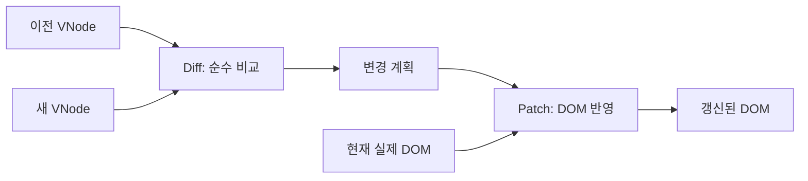
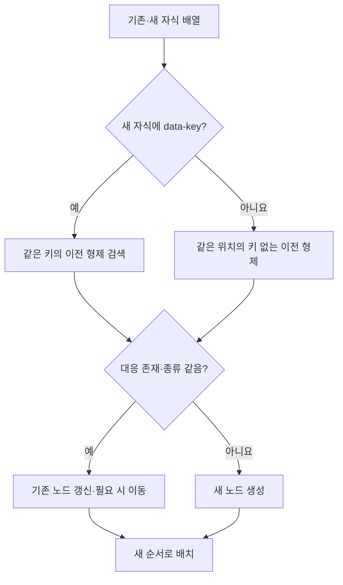

# Diff·Patch 상세 설계

> **상태:** 구현 전 설계 초안. 자식 식별 기준은 사용자 결정, 실행 세부 계약은 팀 검토용 제안이다.
> **관련 요구:** FR-03~05, FR-16 · [요구사항](../requirements.md) · [전체 설계](../design.md)

## 1. 범위와 책임

`diff(oldTree, newTree)`는 두 VNode만 읽고 변경 계획을 만든다. DOM을 읽거나 바꾸지 않는다. `patch(root, plan)`는 그 계획을 실제 DOM에 적용하고 변경된 루트 DOM을 돌려준다. Phase 1의 Patch 버튼과 Phase 2의 State 변경이 이 두 함수를 공유한다.

## 2. 입력·출력 계약

| 단계 | 입력 | 출력 / 실패 |
| --- | --- | --- |
| Diff | 이전·새 VNode | 변경 계획. 같은 트리면 빈 계획. 형제의 중복 `data-key` 등 잘못된 트리는 적용 전에 오류. |
| Patch | 현재 실제 DOM 루트, 이전 트리와 맞는 변경 계획 | 새 실제 DOM 루트. 계획과 실제 DOM이 어긋나면 오류. |
| 컨트롤러 | 새 트리와 현재 트리 | Diff → Patch 성공 후에만 현재 트리·History 갱신. 실패 시 이전 상태 복구. |

변경 계획은 `text`·`attrs`·`events`·`domProps`의 갱신, 자식의 `insert`·`remove`·`move`·`replace`·`update`를 표현한다. 자식 작업에는 **이전/새 인덱스와 형제 식별 정보**를 담는다. DOM 노드 참조를 Diff 계획에 넣지 않는다. 같은 태그의 같은 정체성은 제자리 갱신하며, 태그나 키가 달라지면 교체한다.

## 3. 데이터 표현과 불변 조건

[Virtual DOM 설계](virtual-dom.md)는 줄바꿈 들여쓰기와 주석을 UI 트리에서 제외한다. Patch는 이전 VNode를 읽었을 때와 같은 규칙으로 부모의 DOM 자식 목록을 필터링해 `oldIndex → 기존 DOM 노드` 대응표를 먼저 만든다. 따라서 원래 DOM에 들여쓰기용 텍스트 노드가 있어도 `childNodes[index]`를 그대로 믿지 않는다. 무시된 노드는 비교와 노드 식별에서 제외하며, 필요한 경우 관리 대상 노드의 위치만 이동한다.

같은 부모의 `data-key`가 있는 새 자식은 같은 키의 이전 자식과 우선 대응한다. 키가 없는 새 자식은 **같은 인덱스의 키 없는 이전 자식**과만 대응한다. 대응이 없으면 새 노드를 만든다. 키 중복은 오류다. 키가 같아도 태그 종류가 달라지면 교체한다. 서로 다른 부모 사이의 이동은 지원하지 않고 제거+삽입으로 다룬다.

이 규칙은 위치가 바뀌는 키 없는 목록의 노드 정체성을 보장하지 않는다. 자주 재정렬되는 목록에는 `data-key`를 제공한다.

## 4. 처리 흐름과 다이어그램

1. Diff가 VNode 구조·키 유효성을 확인하고, 요소 종류/텍스트/속성/이벤트/DOM 프로퍼티/자식을 재귀 비교한다.
2. Patch가 **작업 전** 이전 DOM 자식 대응표를 만든다. 갱신할 노드와 제거할 노드를 기존 DOM 참조로 확정한다.
3. 유지되는 노드는 텍스트·속성·이벤트·프로퍼티를 제자리 갱신한다. `domProps.value`가 같으면 다시 대입하지 않아 입력 커서가 불필요하게 움직이지 않도록 한다. 없어지는 노드를 제거하고 새 노드를 렌더링한다.
4. 새 자식 순서에 맞춰 기존 노드는 `insertBefore`로 이동하고 새 노드는 삽입한다. 루트 교체가 필요하면 새 루트로 교체한다.
5. 모든 단계가 성공해야 컨트롤러가 현재 VNode와 History를 확정한다.

## 5. 경계 사례와 오류 처리

| 경우 | 기대 결과 |
| --- | --- |
| 두 트리가 같음 | 빈 계획·DOM 작업 없음. 기존 노드 참조 유지. |
| 텍스트·속성 변경 | 대상 텍스트/속성만 갱신. 추가·삭제된 속성도 정확히 반영. |
| 앞·중간·끝의 자식 추가/삭제 | 최종 순서와 개수가 목표 트리와 같다. 키 있는 무관한 형제의 DOM 참조는 유지한다. 키 없는 목록은 위치 대응으로 인해 항목 정체성 보장이 없다. |
| 같은 키의 재정렬 | 기존 요소 노드를 이동해 참조와 입력 상태를 유지. |
| 키 변경·태그 변경 | 기존 요소를 제거하고 새 요소로 교체. |
| 키 있는 자식과 없는 자식 혼합 | 키 있는 자식은 키로, 없는 자식은 같은 위치에서만 대응. |
| 중복 형제 키 | 미리보기 입력 또는 Phase 2 새 트리 검증에서 오류. 실제 DOM·현재 트리·History 유지. |
| 기존 DOM이 이전 VNode와 다름 | 적용을 중단하고 이전 VNode로 실제 영역을 복구한 뒤 오류 표시. 실패 경로의 DOM 노드 참조 보존은 보장하지 않음. |
| Patch 도중 예기치 않은 예외 | 새 트리/History를 확정하지 않고 이전 트리로 실제 영역을 복구. 복구마저 실패하면 조작을 중단하고 오류를 명시. |

외부 스크립트가 관리 영역을 임의로 바꾸는 것은 정상 동작 범위가 아니다. 적용 전 불일치를 감지·복구하는 경로를 검증한다. 변경 없는 DOM 노드 참조 보장은 **성공한 Patch**에 한한다.

## 6. 선택·대안·한계

전체 영역을 `innerHTML`로 다시 쓰면 코드는 짧지만 변경 없는 노드도 사라져 FR-04·16의 부분 갱신을 증명할 수 없다. DOM 참조를 담지 않는 변경 계획은 순수 Diff 테스트와 Phase 1/2 재사용에 유리하다. 대신 형제 대응, DOM 적용 순서, 오류 복구를 분명하게 구현해야 한다.

키 우선+위치 대체는 사용자가 선택했다. React의 실제 재조정 알고리즘이나 최소 편집 거리 계산을 복제하지 않는다. `data-key`는 프로젝트의 형제 식별 약속이며 모든 재배치가 최소 DOM 작업 횟수라는 뜻은 아니다.

## 7. 검증 사례

기본 다섯 사례는 [FR-03 표](../requirements.md#32-diffpatch)를 따른다. 각 사례에서 **Diff 계획**, **최종 DOM 내용**, **무관한 노드 참조 동일성**을 따로 확인한다. 추가로 속성 추가/삭제, 앞·중간·끝 삽입/삭제, 루트 교체, 키 재정렬/중복, 공백 노드가 섞인 실제 DOM, 이벤트 교체와 `input.value` 갱신을 검사한다. 상세 매핑은 [검증 계획](../testing.md)에서 관리한다.
