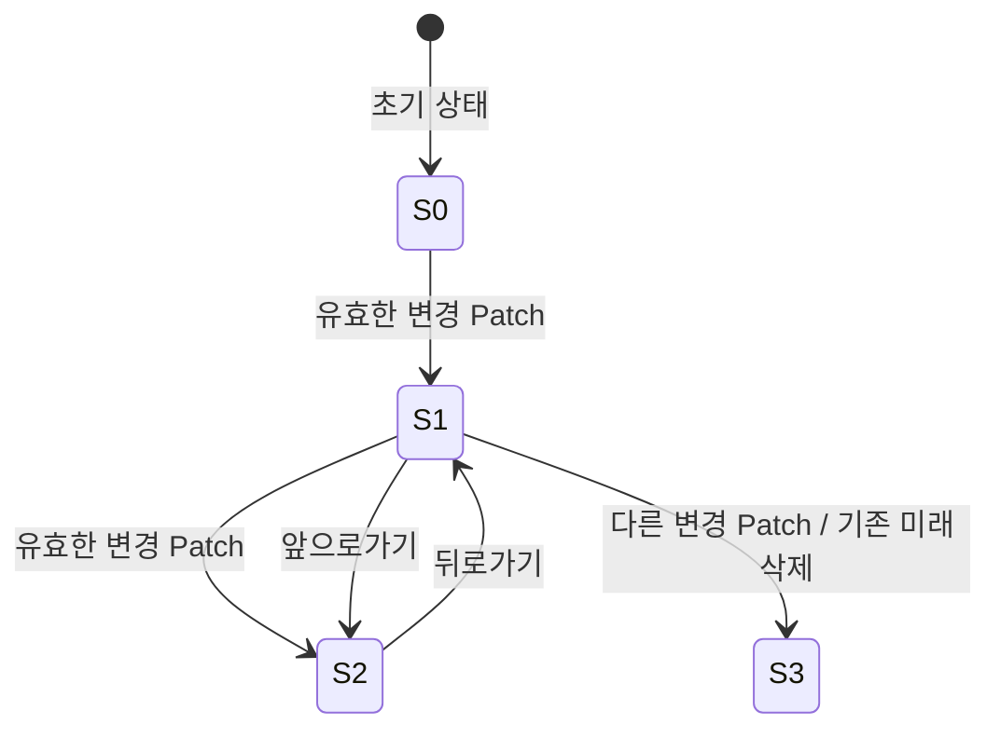

# History 상세 설계

> **상태:** Phase 1 로컬 구현·브라우저 검증 완료. 뒤로 간 뒤 새 Patch에서 미래 이력을 삭제하는 정책은 사용자 결정이며, 세부 정책의 팀 공통 채택 여부는 별개다.
> **관련 요구:** FR-06~09 · [요구사항](../requirements.md) · [전체 설계](../design.md)

## 1. 범위와 책임

History는 **Phase 1에서 성공적으로 적용한 화면 상태**를 저장한다. 편집 중인 HTML 코드는 초안이고, 유효한 미리보기도 Patch 전에는 History가 아니다. History는 DOM을 직접 조작하지 않으며 컨트롤러가 [Diff·Patch](diff-patch.md)와 [VNode 렌더러](virtual-dom.md)를 호출한다.

## 2. 입력·출력 계약

| 행동 | 선행 조건 | 결과 |
| --- | --- | --- |
| 초기화 | 최초 실제 DOM을 VNode로 읽음 | 초기 스냅샷 1개, 위치 0. 코드 입력창·미리보기·실제 영역 동기화. |
| Patch | 유효한 미리보기, Diff·Patch 성공 | 새 트리가 다르면 새 스냅샷을 현재 위치 다음에 저장하고 이동. |
| 뒤로/앞으로 | 대상 인덱스 존재 | 대상 트리를 두 영역에 표시하고 코드 입력창도 저장된 소스로 복원. |
| 경계 버튼 | 대상 인덱스 없음 | 비활성화. 호출되어도 상태 변화 없음. |
| 잘못된 입력·Patch 실패 | 검사 또는 적용 실패 | 현재 위치·스냅샷을 확정하지 않음. 적용 전 실패는 실제 영역 유지, 적용 중 실패는 [Diff·Patch 복구 계약](diff-patch.md#5-경계-사례와-오류-처리)에 따라 내용 복구 시도. |

스냅샷은 `{ tree, source }`다. `tree`는 데이터만 담긴 Phase 1 VNode이고 `source`는 성공 시 코드 입력창의 문자열이다. `entries` 배열과 `index`가 현재 위치를 표현한다. `tree`는 저장 뒤 변경하지 않는다.

최초 `source`는 실제 영역의 단일 샘플 루트를 `readDom`으로 읽은 뒤 `serializeHTML(tree)`로 생성한다. 브라우저의 `outerHTML`은 지원하지 않는 `&nbsp;`를 생성하거나 인접 텍스트 경계를 잃을 수 있으므로 그대로 사용하지 않는다. 직렬화기는 프로젝트의 다섯 문자 참조만 사용하고 인접 텍스트 사이에 무해한 주석을 넣어 경계를 보존한다. 요소만 있는 자식 목록은 들여쓰기로 표시한다. 초기 소스를 다시 파싱한 결과와 실제 트리가 일치할 때만 스냅샷을 저장한다. 이후 사용자가 편집한 소스는 성공한 Patch 시 원문 그대로 저장한다.

### 로컬 테스트용 API·소유권 계약

공개 상태는 `{ entries, index }`, snapshot은 `{ tree, source }`다. `createHistory(snapshot)`는 초기 상태, `commitHistory(history, snapshot)`는 저장 결과, `moveHistory(history, direction)`은 direction=-1/+1의 이동 결과를 반환한다. 세 함수는 입력을 변경하지 않으며 DOM·Diff·Patch를 가져오지 않는다.

초기화·커밋은 전달된 스냅샷을 트리·속성·자식까지 복사해 보관한다. 호출자가 나중에 입력을 수정해도 저장된 이력은 보존한다. 반환된 상태는 호출자가 읽기 전용으로 사용한다. 미변경 이력의 내부 공유나 freeze는 강제하지 않는다.

트리 비교는 종류·태그·속성 이름/값·텍스트·자식 순서를 포함하고 속성 나열 순서는 무시한다. 첫 텍스트만 비교하거나 JSON 문자열 순서에 의존하지 않는다. 같은 트리의 소스 변경은 과거 위치에서도 미래 이력을 보존한다.

빈 `entries`, 범위 밖/정수 아닌 `index`, 문자열 아닌 `source`, -1/+1 이외 `direction`은 `ERR_INVALID_HISTORY`다. VNode 자체 오류는 공통 `ERR_INVALID_VNODE`/`ERR_DUPLICATE_KEY`다. `source`는 빈 문자열을 포함한 문자열 그대로 보관한다. 실제 HTML 입력의 유효성과 tree/source 일치는 컨트롤러 책임이며 History에서 HTML을 파싱하지 않는다. 컨트롤러는 화면 적용 성공 후에만 반환 상태를 채택한다.

## 3. 데이터 표현과 불변 조건

- `0 <= index < entries.length`이며 초기화 뒤 이력은 비어 있지 않다.
- 정상 동작 중 현재 실제 영역의 관리 대상 내용은 `entries[index].tree`와 같다. 복구까지 실패한 오류 상태에서는 이 일치를 보장하지 않고 후속 작업을 중단한다. 유효한 편집 중 미리보기는 현재 이력과 달라도 된다.
- 현재 소스에 문법 오류가 있으면 미리보기는 마지막 유효 모습이고 Patch는 비활성화한다.
- 뒤로 간 뒤 **새로 다른 트리를 Patch하면** `entries.slice(0, index + 1)` 뒤에 새 스냅샷을 붙인다. 이전 앞으로가기 이력은 삭제한다.
- 트리가 같은 Patch는 새 이력을 만들지 않는다. 주석·들여쓰기만 바뀌고 [VNode 텍스트 경계](virtual-dom.md#8-공통-vnode-구현-계약)도 같다면 현재 스냅샷의 `source`만 새 문자열로 교체한다. 실제 DOM은 변경하지 않는다.

`source`를 저장하는 이유는 뒤로·앞으로 이동 시 편집창도 같은 상태를 보여주기 위해서다. 동일 트리에서 소스만 바뀌는 경우에는 현재 스냅샷 객체를 새 객체로 바꿔 트리 불변성을 유지한다.

## 4. 처리 흐름과 다이어그램

Patch는 **미리보기 DOM 읽기 → 중복 키 등 검증 → Diff → 실제 DOM Patch → 이력 확정** 순서다. 이력 변경을 실제 DOM 적용보다 먼저 하지 않는다. 이동은 **대상 인덱스 확인 → 대상 미리보기 준비 → 현재 트리에서 대상 트리로 Diff·Patch → 미리보기와 코드 입력창 복원 → 인덱스 확정** 순서다. 성공하면 오류를 지운다. 이동이 실패하면 인덱스를 확정하지 않는다. 실제 영역이 이미 바뀌었다면 이전 커밋 VNode의 화면 내용 복구를 시도하고, 미리보기·코드 입력창은 이동 전 표시와 초안으로 되돌리도록 시도한다. 복구까지 실패하면 후속 이동·Patch를 중단한다.

미리보기를 대상 VNode에서 새로 만들되, 코드 입력창은 저장한 `source`로 복원한다. 이동 전에 Patch하지 않은 편집 초안은 버린다. 그 사실을 버튼 설명이나 UI 문구로 알린다.

## 5. 경계 사례와 오류 처리

| 사례 | 기대 결과 |
| --- | --- |
| 초기 상태에서 뒤로, 최신 상태에서 앞으로 | 버튼 비활성화, 이력·화면 유지. |
| 같은 트리 Patch | 이력 길이·DOM 노드 참조 유지. 소스만 달라졌으면 현재 스냅샷의 소스 갱신. |
| 뒤로 간 뒤 다른 트리 Patch | 기존 미래 삭제, 새 상태만 앞으로가기에 나타남. |
| 뒤로 간 뒤 **같은** 트리 Patch | 새로운 분기가 아니므로 기존 미래 보존. |
| 잘못된 HTML 또는 중복 형제 키 | 미리보기·실제 영역·이력 유지, Patch 차단. |
| Patch하지 않은 유효/무효 초안에서 이동 | 대상 스냅샷의 소스·미리보기·실제 영역으로 복원. |
| DOM 적용·이동 중 화면 복원 실패 | 인덱스·이력은 이전 값. [Diff·Patch의 복구 계약](diff-patch.md#5-경계-사례와-오류-처리)에 따라 이전 커밋 화면의 내용 복구를 시도하고, 이동 전 미리보기·코드 입력도 복원하도록 시도한다. 복구에도 실패하면 후속 이동·Patch를 중단하고 오류를 표시한다. |

## 6. 선택·대안·한계

브라우저 History API 대신 페이지 내부 `entries/index`를 사용한다. 과제의 State History는 미니 React UI 상태 탐색이며 URL 탐색이 아니다. 미래 이력을 보존하는 분기 그래프보다 선형 Undo/Redo가 버튼 의미와 구현·검증에 맞다. 새 분기에서 삭제된 미래는 복구되지 않는다.

## 7. 검증 사례

`A → B → C → 뒤로(B) → 앞으로(C)`와 `A → B → C → 뒤로(B) → D`를 모두 확인한다. 두 번째 경로에서는 C가 앞으로가기에 남지 않는다. 각 이동에서 실제 영역·미리보기·코드 입력창·버튼 활성 상태·인덱스를 함께 검사한다. 추가 사례와 요구 ID는 [검증 계획](../testing.md)에 둔다.
