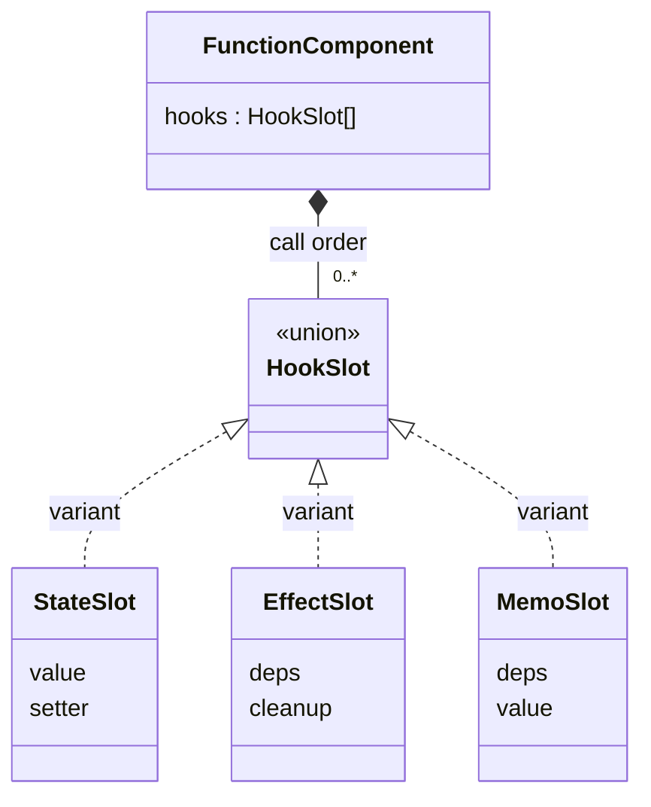
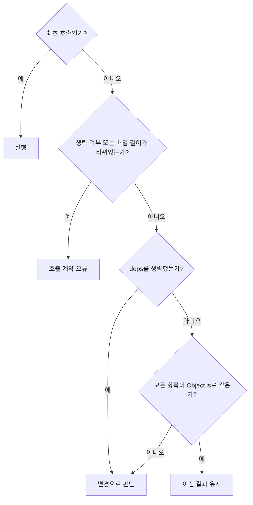

# Hook 설계

관련 요구사항: [STA](../requirements.md#sta), [EFF](../requirements.md#eff), [MEMO](../requirements.md#memo)

기준: [OPEN-07·08·11·13·15](temporary-decisions.md). 다음 API 동작은 2026-11-11 기존 선택을 채택하고 requirements.md의 인수 조건에 반영했다.


## 한눈에 보기



클래스 다이어그램은 데이터 구조를 표현한다. `variant`는 유니언 타입의 구성원이며, 실제 클래스 상속을 뜻하지 않는다.

## 슬롯과 호출 문맥

```ts
type HookSlot = StateSlot | EffectSlot | MemoSlot;
type StateSlot = { kind: 'state'; value: unknown; setter: Function };
type EffectSlot = {
  kind: 'effect'; deps: readonly unknown[] | undefined;
  cleanup?: () => void;
};
type MemoSlot = { kind: 'memo'; deps: readonly unknown[]; value: unknown };
```

함수 타입은 개념 표기다. 실제 구현에서는 generic과 명시적인 호출 시그니처로 좁힌다.

- 현재 루트, root/child 문맥, 다음 슬롯 인덱스를 렌더 작업에 보관한다.
- Hook 호출마다 슬롯을 한 개 사용한다. 최초 실행은 생성, 이후 실행은 같은 인덱스를 조회한다.
- 같은 인덱스의 kind가 다르거나 최종 호출 개수가 다르면 렌더 오류다.
- Hook 기록은 렌더 candidate에 작성하고, 성공한 DOM 반영 후 확정한다.
- 조건부 호출·호출 순서 변경은 지원하지 않는다. 같은 종류끼리의 순서 교환까지 자동 검출하지는 않는다.

VDOM 자식의 key와 Hook 슬롯 식별은 서로 다른 계약이다. key 기반 DOM 재정렬은 루트의 hooks 인덱스·setter 참조·generation을 바꾸지 않는다. key를 통해 자식에 State·Effect 슬롯을 만들거나 루트 Hook 호출 순서를 재배열하지 않는다. 자식은 계속 상태 없는 순수 함수다.

## 의존성 비교



- Effect는 undefined(생략), [], 고정 길이 배열을 허용한다. 같은 슬롯에서 생략과 배열을 바꾸는 사용은 오류다.
- Memo는 고정 길이 배열을 필수로 받는다.
- 배열은 얕게 복사해 보관한다. 내부 객체는 복제하지 않으므로 같은 객체 내부 변경만으로는 재실행하지 않는다.
- 초기 호출은 이전 결과가 없으므로 실행한다.

## useState

```ts
useState<T>(initial: T | (() => T)):
  [T, (next: T | ((previous: T) => T)) => void]
```

1. 최초 슬롯 생성 시 값 또는 초기화 함수의 결과를 저장한다.
2. 이후 렌더에서는 기존 상태를 제공한다.
3. setter는 루트·generation·슬롯 인덱스를 캡처하며 성공한 렌더 사이에서 같은 참조를 유지한다.
4. setter 요청을 처리할 때 새 값 또는 updater 함수의 결과를 계산한다.
5. Object.is로 같으면 갱신을 생략하고, 다르면 candidate State로 렌더를 요청한다.

함수를 State 값으로 저장할 때는 초기화/업데이트 함수로 감싸 반환한다. 객체·배열은 직접 변경하지 않고 새 값으로 전달하는 것을 사용 규칙으로 둔다.

두 상태 슬롯의 값은 독립적이다. setter에서 UI를 직접 수정하지 않고 FunctionComponent의 갱신 경로를 사용한다.

## useEffect

```ts
useEffect(setup: () => void | (() => void), deps?: readonly unknown[]): void
```

### 렌더 중

설정 함수를 실행하지 않는다. 의존성 비교 결과에 따라 candidate의 pendingEffects에 `{slotIndex, setup, nextDeps}`를 등록한다. 변경이 없으면 기존 cleanup을 유지한다.

### DOM 반영 성공 후

1. pendingEffects를 호출 순서대로 방문한다.
2. 이전 cleanup을 보관 기록에서 제거한 뒤 한 번 실행한다.
3. 새 setup을 실행한다.
4. 반환값이 함수이면 다음 정리를 위해 보관한다. undefined 외의 다른 값이나 Promise 반환은 API 사용 오류로 처리한다.

이 순회 전체는 effects phase다. setup·cleanup 또는 그 동기 콜백에서 unmount()를 호출하면 상태 변경 전에 오류로 거부한다. 제거 보류나 실행 중인 setup의 취소는 하지 않는다. 오류를 잡고 setup이 정상 반환한 cleanup만 런타임에 소유권이 이전된다. 예외·잘못된 반환으로 cleanup이 전달되지 않은 자원은 setup이 직접 회수해야 한다.

타이밍은 **DOM 반영 뒤**로 정하며, 브라우저 페인트 뒤임을 보장하지 않는다. 설정은 동기 함수지만 내부에서 비동기 작업을 시작하고 정리에서 취소할 수 있다.

key로 재사용된 DOM의 단순 이동은 Effect 재실행 조건이 아니다. 반대로 key 변경·tag 변경·부모 교체로 DOM이 새로 만들어져도 루트 Effect가 자동 재실행되는 것은 아니다. DOM 참조 Effect는 노드의 생성을 바꾸는 입력을 deps로 관리해야 한다. [] Effect로 특정 노드를 참조하려면 정상 갱신 동안 해당 노드가 유지되는 조건을 사용 측에서 보장한다. 예기치 않은 Patch 실패의 전체 정리·faulted 정책은 별도로 유지한다.

### 제거 시

idle/faulted에서 수락된 unmount만 unmounting phase로 전환한다. 현재 cleanup을 기록에서 먼저 제거한 뒤 한 번씩 실행하고 슬롯을 비운다. cleanup 중 setter는 무효, 재진입 unmount는 오류다. cleanup 오류에도 나머지 정리·DOM 제거를 계속한다. 초기 정리·설정을 반복하는 Strict Mode 동작은 제공하지 않는다.

### 정리 또는 설정 실패

오류를 수집해 호출자에게 전달하고 다른 Effect를 계속 처리한다. 오류 UI는 검증 웹페이지가 담당한다. 실패한 setup에 대해 즉시 자동 재시도하지 않는다. 다음 실행 조건이 충족될 때 다시 실행한다. 의존성을 생략했다면 다음 성공한 렌더, 배열을 지정했다면 의존성 변경 또는 재마운트가 해당한다. cleanup이 던져도 이미 기록에서 제거했으므로 같은 정리를 중복 호출하지 않는다.

위의 계속 처리 규칙은 일반 Effect 실행에 적용한다. unmount를 시도하다 오류가 났어도 제거가 수락된 것은 아니므로 후속 setup이 실행될 수 있다. 자원 확보 후 setup이 던진 오류나 cleanup의 해제 실패는 사용자 함수가 처리해야 하며, 런타임은 오류 보고 외에 알 수 없는 자원을 대신 해제할 수 없다.

### DOM 재구성 실패 경로의 수명

DOM 반영 실패로 노드 재구성이 필요하면 deps 비교 결과와 관계없이 **마지막 성공 Effect 전체를 정리**한다. [] Effect도 예외가 아니다. candidate의 setup은 실행하지 않으며 기존 setup을 저장·재실행하는 자동 복구는 제공하지 않는다. [런타임의 복구 절차](component-runtime.md#실패-처리)에 따라 faulted에서 멈춘다.

cleanup은 설정 당시 확보한 DOM 노드·리스너·관찰자 등을 참조해 해제해야 한다. 복구 DOM에서 같은 논리 ID로 다시 조회해 이전 자원을 정리하려 해서는 안 된다. 명시적 제거 후 재마운트에서 초기 State와 새 DOM에 setup을 한 번 실행한다. 일반 성공 갱신에서의 동일 deps 유지 규칙과 이 실패 경로를 구분한다.

## useMemo

```ts
useMemo<T>(calculate: () => T, deps: readonly unknown[]): T
```

1. 최초 호출이면 순수 계산 함수를 실행하고 candidate에 결과와 deps를 저장한다.
2. 의존성이 같으면 직전 성공 슬롯의 값을 그대로 반환한다.
3. 의존성이 다르면 다시 계산하고 새 값을 candidate에 저장한다.
4. 렌더·커밋 실패 시 candidate를 폐기한다. DOM 변경 전 실패는 직전 성공 결과로 계속 사용할 수 있지만, DOM 재구성이 필요했던 실패는 직전 결과를 진단용으로만 남기고 faulted에서 멈춘다. 재마운트는 캐시를 재사용하지 않는다.

객체 결과도 같은 참조를 재사용한다. 입력 A → B → A에서는 직전 B와 다르므로 마지막 A를 다시 계산한다. 모든 과거 입력의 결과를 저장하는 캐시는 아니다.

## 검증 예시

| 항목 | 관찰할 결과 |
| --- | --- |
| State 두 개 | 한 setter가 다른 슬롯의 값을 변경하지 않음 |
| 함수형 업데이트 | 요청 처리 시점의 이전 값으로 계산 |
| Effect deps 생략 | 각 성공한 렌더의 DOM 반영 뒤 실행 |
| Effect [] | 최초 setup, 일반 갱신 유지, 제거 시 cleanup |
| Effect deps 변경 | 이전 cleanup → 새 setup |
| Memo 같은 deps | 호출 횟수 유지, 같은 결과 참조 |
| 새 객체 deps | 내용이 같아도 다른 참조이면 재실행 |
| Effect 중 setter | 모든 현재 Effect 처리 후 갱신, 재귀 호출 없음 |
| 실패한 렌더 | 새 Effect가 실행되지 않고 이전 기록 유지 |
| 실행 중 unmount | 상태 변경 전 거부, 정상 반환한 cleanup은 보관, idle 제거에서 해제 |
| DOM 재구성 | 기존 [] Effect도 정리, 새 setup 미실행, faulted 이후 명시적 재마운트만 허용 |
| keyed 자식 재정렬 | 대응 DOM 유지, 루트 State·setter·Hook 순서 유지, 동일 deps Effect는 재실행하지 않음 |
