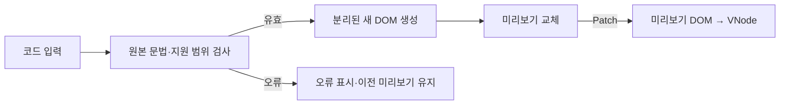

# Phase 1 HTML 입력·미리보기 설계

> **상태:** 구현 전 설계 초안. 지원 목록·오류 처리·단일 루트는 사용자 결정이다. 세부 문법은 팀 검토용 제안이다.
> **관련 요구:** [FR-01·02·05·06](../requirements.md) · [공통 VNode](virtual-dom.md) · [검증 계획](../testing.md)

## 1. 책임

테스트 영역은 **HTML 코드 입력창 + 결과 미리보기**다. 코드를 수정하면 원본을 검사하고 유효할 때만 미리보기 DOM을 바꾼다. 실제 영역과 History는 Patch 전까지 그대로 둔다. Patch는 편집 문자열이 아니라 **현재 미리보기 DOM**을 [공통 VNode 읽기](virtual-dom.md)로 변환한다.

브라우저가 `innerHTML`을 자동 보정한 결과는 검사의 근거로 쓰지 않는다. 입력의 실제 구문 오류를 숨길 수 있기 때문이다. 원본 문자열을 작은 토큰 검사기·태그 스택으로 먼저 검사하고, 성공한 토큰만 `createElement`·`createTextNode`·`setAttribute`로 DOM에 조립한다. 사용자 문자열을 `innerHTML`로 직접 삽입하지 않는다.

## 2. 지원 문법

| 항목 | 계약 |
| --- | --- |
| 요소 | `div`, `h2`, `p`, `strong`, `ul`, `li`, `span`. 소문자만 허용. |
| 속성 | `class`, `title`, `data-[a-z][a-z0-9-]*`. 속성값은 작은/큰따옴표로 감싼다. 같은 요소의 중복 속성은 오류. |
| 루트·중첩 | 정확히 하나의 바깥 요소. 모든 시작 태그에 맞는 닫는 태그가 있고 스택 순서가 일치한다. 빈 입력·두 루트는 오류. |
| 텍스트 | 태그 안의 일반 문자를 허용. `<`를 글자로 표시하려면 `&lt;`를 쓴다. |
| 문자 참조 | `&amp;`·`&lt;`·`&gt;`·`&quot;`·`&apos;`만 지원. 그 밖의 이름, 숫자 참조, 맨 `&`는 오류. |
| 주석 | `<!-- ... -->` 형식만 허용하고 출력·VNode에서는 무시. 닫히지 않은 주석은 오류. |
| 공백 | 공백만 있는 텍스트 노드에 줄바꿈이 있으면 들여쓰기로 버린다. 같은 줄의 공백만 있는 노드와 글자가 있는 텍스트의 공백은 보존한다. |
| 기타 | DOCTYPE, 처리 명령, 자체 닫기, 이벤트 속성, `script`·`style` 등은 지원하지 않는다. |

위 표의 문자 참조·공백·중복 속성 규칙은 팀 검토용 제안이다. `white-space: pre`나 일반 HTML 전체의 의미론적 중첩 규칙까지 지원하지 않는다. 예를 들어 이 미니 검사기는 허용 태그끼리 짝이 맞게 중첩되었는지를 확인하지만, HTML 표준의 모든 콘텐츠 모델을 검증하지는 않는다.

`<strong>사과</strong> 배` 사이의 한 칸은 남는다. 여러 줄로 쓰면서 요소 앞뒤에 둔 줄바꿈·들여쓰기는 VNode에 담지 않는다. 이 규칙은 초기 실제 DOM 읽기와 Patch 시 미리보기 DOM 읽기에도 동일하게 적용한다.

## 3. 오류와 상태 보존

| 실패 | 기대 결과 |
| --- | --- |
| `
상품`, `
<strong>x
</strong>` | 닫는 태그/중첩 오류. |
| `
x
`, 중복 `class` | 속성 오류. |
| `<script>...`, `onclick="..."` | 미지원 입력. 실행·삽입하지 않음. |
| 빈 입력, 두 루트, 중복 형제 `data-key` | 오류, Patch 차단. |
| `&nbsp;`, 맨 `&`, `&#65;` | 지원하지 않는 문자 참조 오류. |
| `<!--` | 닫히지 않은 주석 오류. |

모든 실패에서 오류를 표시하고 **마지막 유효 미리보기·실제 영역·History**를 유지한다. Patch 버튼은 오류가 해결될 때까지 비활성화한다. 키 입력 중 유효한 코드로 돌아오면 오류를 지우고 미리보기를 갱신한다. 미리보기가 유효해도 Patch 전에는 실제 영역과 History가 바뀌지 않는다.

입력창과 버튼에는 보이는 이름을 붙이고, 오류 문구는 `role="alert"`로 알린다. 뒤로·앞으로·Patch의 비활성 상태는 실제 `disabled` 속성으로 표현해 키보드 조작과 화면 표시가 일치하게 한다.

## 4. 검증 경계

원본 입력 검사 단위 테스트는 토큰·스택·문자 참조·공백 판별을 다룬다. 브라우저 기능 테스트는 미리보기 교체와 실제 영역 유지, 잘못된 입력에서의 차단, 다시 유효해진 입력의 회복을 확인한다. 구체적인 테스트 ID는 [검증 계획](../testing.md)의 V-02~05를 따른다.
