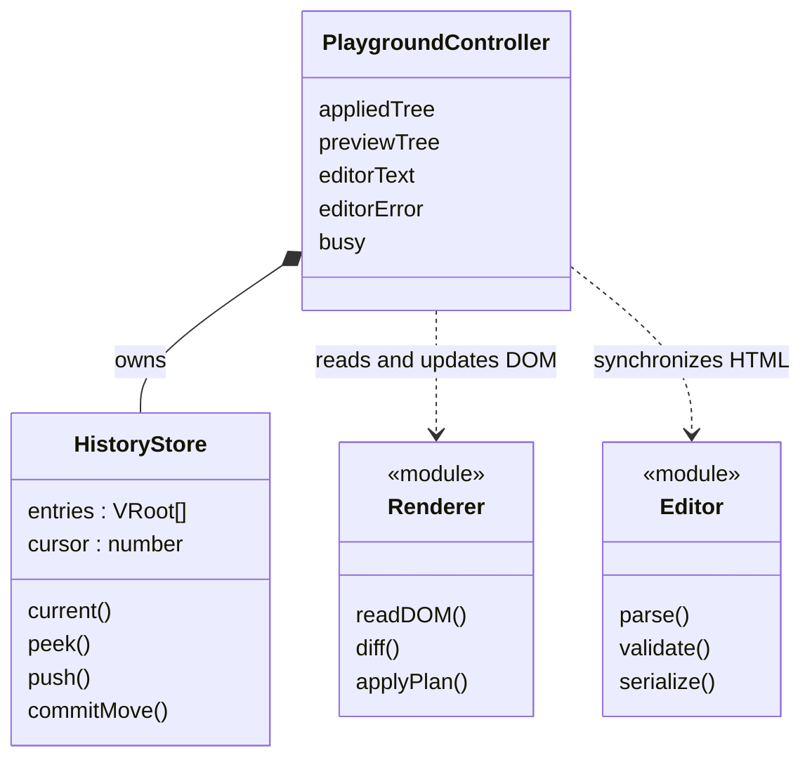
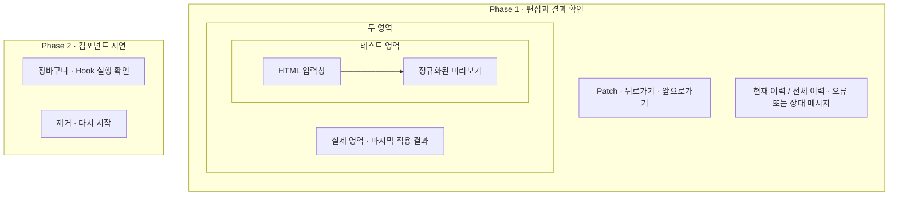

# 실습·검증 웹페이지와 이력 설계

관련 요구사항: [EDIT](../requirements.md#edit), [VIEW](../requirements.md#view), [HIST](../requirements.md#hist)

기준: [결정 기록](temporary-decisions.md). 현재 적용 상태와 의미상 같은 Patch는 History를 변경하지 않는 정책을 사용자 요청으로 채택했다. 나머지 정책도 2026-11-11 기존 구현 선택을 완료 기준으로 채택했다. Phase 1 검증과 Phase 2 시연은 같은 페이지의 서로 다른 섹션으로 제공한다.


## 한눈에 보기



`module`은 함수 모듈이며, 별도의 클래스를 구현한다는 뜻은 아니다.

## 화면 구성



컨트롤 UI는 Vanilla DOM 이벤트로 구성한다. 실제·미리보기 컨테이너의 바깥 요소는 라이브러리 렌더링 대상에서 제외한다.

## 사용성과 가시성 계약

사용자 요청으로 실습 화면의 행동 안내와 결과 가시성을 보강한다. 이 절은 웹페이지의 표현·조작 계약이며 라이브러리의 Hook·History 정책을 변경하지 않는다. 구현 상세와 시각 스타일은 구현에 위임한다.

### 시작점과 Phase 1

- 페이지 제목은 두 Phase를 포괄한다. 각 Phase는 목적, 처음 할 행동, 관찰할 결과를 화면 안에서 설명한다. 최초 방문자가 문서를 열지 않고 시작할 수 있어야 한다.
- Phase 1은 `HTML 편집 → 미리보기 확인 → 실제 영역에 적용(Patch) → 적용 이력 이동` 순서를 제공한다. 처음 할 실습으로 샘플 제목 변경을 안내한다.
- 실제 영역은 마지막 적용 결과이며 편집 위치가 아님을 명시한다. 테스트 영역 안의 HTML 입력과 미리보기에는 서로 다른 제목을 붙인다. 폼 실습은 미리보기에서 수행하도록 안내한다.
- Patch는 `실제 영역에 적용 (Patch)`, 이력 이동은 `이전 적용 상태`·`다음 적용 상태`처럼 대상과 결과를 드러낸다. 이력 위치는 `적용 이력 현재 / 전체`로 표시한다.
- 미적용 편집, 적용 완료, 변경 없음, 입력 오류, 복구 실패를 구분한다. 이력 이동은 미적용 편집을 버린다는 기존 정책과 Phase 2에는 영향을 주지 않는다는 경계를 조작부 근처에 항상 설명한다.
- 입력 오류 시 마지막 유효 미리보기가 남아 있음을 알리고 입력 수정 방법을 제공한다. 이동 불가 버튼의 이유는 이력 경계 안내로 설명한다.

### Phase 2의 실습과 관찰

장바구니와 key 목록은 독립된 실습 카드로 구분한다. 각 카드의 제목·안내·컨트롤·결과를 함께 배치한다.

| 실습 | 행동 | 사용자가 확인할 결과 |
| --- | --- | --- |
| State와 Memo | 수량 증가 | 수량·합계와 합계 계산 횟수가 증가한다. |
| Memo 재사용 | 메모 입력 | 메모만 바뀌고 합계 계산 횟수는 유지된다. |
| Effect 교체 | 상품 변경 | 상품·재고가 바뀌고 이전 구독 정리와 새 구독 설정 횟수가 증가한다. 재고는 외부 연결이 아닌 로컬 모의 값이다. |
| 컴포넌트 수명 | 장바구니 종료 (unmount) | 장바구니 UI가 사라지고 재고 구독이 정리된다. 상품이나 key 목록 항목을 삭제하는 동작이 아니다. |
| 새 수명 | 장바구니 초기화·시작 | 실행 중이면 먼저 종료한 뒤, 종료 상태이면 바로 새로 시작한다. 상품은 사과, 수량은 1, 메모는 빈 값으로 시작한다. 이전 입력은 복원하지 않는다. |
| key 목록 | 순서 뒤집기·맨 앞에 추가·첫 항목 삭제 | 현재 순서와 항목 수가 표시된다. 순서가 바뀌어도 남은 같은 key의 DOM은 재사용한다. 순서 표시 자체는 DOM 정체성 보존의 증거가 아니며 참조 동일성은 브라우저 테스트로 확인한다. |

계측은 `합계 계산`·`구독 설정`·`구독 정리`로 표시하고 페이지를 연 뒤 누적된 실행 시도 횟수임을 명시한다. 실패한 렌더의 계산이나 실패한 설정·정리 시도도 포함될 수 있어 성공 횟수나 활성 구독 수·자원 해제 완료의 증거로 사용하지 않는다. 장바구니 재시작은 이 계측을 0으로 되돌리지 않는다. 장바구니 초기화는 정상 key 목록의 순서·항목과 Phase 1 편집·이력을 보존한다. key 목록이 비면 빈 상태와 추가 방법을 안내하고 삭제·역순 버튼을 비활성화한다.

### 상태·실패·접근성

- 장바구니의 `실행 중`·`종료됨`·`오류로 중단됨`을 항상 텍스트로 표시한다. 성공 상태와 오류 메시지는 분리하며, 다른 실습의 성공으로 기존 오류를 지우지 않는다.
- 종료 시 안내는 관리 컨테이너 밖에 표시해 렌더러 소유 DOM을 오염시키지 않는다. 종료 완료 후 종료 버튼은 비활성화하고, 시작 버튼과 초기값·입력 폐기 안내는 유지한다.
- 수명 표시와 카드별 작업 오류를 분리한다. 수명은 실제 phase에서 도출하지만 오류는 faulted 여부만으로 지우지 않는다. idle에서 Effect 설정·정리 오류가 보고되면 `실행 중 + 작업 오류`로 표시하며 강제로 오류 중단 상태로 바꾸지 않는다. 다른 카드의 성공은 오류를 해제하지 않는다.
- 오류로 중단된 컨테이너는 inert로 유지하고 성공한 새 mount 후에만 해제한다. 종료/재시작 실패를 성공으로 표시하거나 실패한 자원 정리까지 완료했다고 안내하지 않는다. 오류 중에도 컨테이너 밖 복구 조작은 접근 가능하다.
- 초기화·시작 요청의 unmount가 예외를 보고하면 같은 요청에서는 mount를 수행하지 않는다. 실제 phase가 unmounted이면 `화면 종료됨 / 정리 오류 / 새 시작 미실행`을 함께 안내하고 다음 명시적 시작을 허용한다. DOM 제거 실패로 faulted이면 차단을 유지하고 제거부터 재시도한다. 새 mount 실패는 실제 phase와 시작 실패를 표시하고 복구 조작을 유지한다.
- 같은 카드의 성공한 명시적 초기화·시작만 현재 작업 오류를 해제한다. 일반 입력·목록 조작 성공은 기존 오류를 지우지 않는다. 실패한 자원 정리에 대한 경고는 별도로 페이지 수명 동안 유지하며, 새 시작 성공은 이전 실패 자원을 정리하거나 정리를 재시도·보증한 뜻이 아님을 함께 안내한다. 오류 문구는 원인·남은 상태·다음 행동을 포함한다.
- 목록 오류는 목록 전용 상태와 `목록 초기화·시작` 복구 동작으로 처리한다. 이 동작은 목록을 a·b·c로 시작하며 장바구니에는 영향을 주지 않는다. 기존 장바구니 재시작이 오류 목록까지 암묵적으로 복구하던 결합은 제거한다. 정상 상태에서 불필요한 추가 초기화 조작은 노출하지 않아도 된다.
- 제거 대상 내부에 포커스가 있던 경우, 프로그램에 의한 종료·오류 차단 이후에도 포커스가 숨겨진 곳에 남지 않도록 컨테이너 밖 복구 조작으로 옮긴다. 버튼을 눌러 정상 종료한 경우 해당 버튼이 비활성화되면 시작 버튼으로 포커스를 이동한다. 일반 State 갱신마다 포커스를 이동하지 않는다.
- 목록 복구 버튼이 성공 후 숨겨지며 포커스를 갖고 있었다면 활성화된 `맨 앞에 추가` 버튼으로 포커스를 옮긴다. 목록 복구 안내에는 a·b·c 초기값과 기존 목록 폐기를 표시한다. Phase 2 첫 행동은 수량 증가 하나를 먼저 제시하고 Memo·Effect 관찰은 짧은 별도 행으로 분리한다.
- 모든 조작은 키보드로 가능하고 포커스 표시가 있어야 한다. 동적 상태는 적절한 live region으로 안내하되 중복 낭독을 피한다. 오류·상태는 색상만으로 구분하지 않는다. 모바일 폭에서도 설명·버튼·입력창이 잘리지 않아야 한다.

### 책임과 선택 근거

페이지의 정적 설명·레이아웃은 화면 셸이, 실행 상태·버튼 가용성·관찰 계측·포커스 복구는 각 실습 컨트롤러가 소유한다. 런타임 phase를 별도 진실 값으로 복제하지 않고 성공/실패 처리 후 실제 phase에서 표시를 도출한다. 컨트롤러 종료 시 새 UI 리스너도 함께 해제한다. 계측용 외부 DOM 쓰기를 Memo 계산 안으로 이동하지 않는다.

버튼 이름만 변경하는 대안은 작지만 종료 후 빈 화면·누적 계측·오류 복구의 오해를 해결하지 못해 선택하지 않는다. 별도 단계별 마법사 대안은 안내를 강제할 수 있지만 자유로운 실험과 기존 한 페이지 비교를 방해하므로, 상시 보이는 짧은 실습 지침과 상태 표시를 선택한다. 새로운 전역 상태 저장소나 계측 대시보드는 추가하지 않는다.

## 상태 모델

| 값 | 내용 |
| --- | --- |
| appliedTree | 실제 영역의 마지막 성공 VDOM. 항상 history.current()와 같은 상태 |
| previewTree | 마지막 유효한 테스트 미리보기 |
| editorText | 사용자가 편집 중인 HTML 문자열. 오류가 있는 문자열도 유지 가능 |
| editorError | 현재 입력의 미지원 요소·속성 등의 오류 |
| busy | 적용·이동 중 중복 요청 차단 |
| HistoryStore | VDOM 스냅샷 배열과 cursor |
| actualScope, previewScope | 각 컨테이너에 귀속된 서로 다른 DOMScope. 적용·이력 이동·복구에서 유지 |

입력 문자열과 VDOM은 다르다. HTML 파서가 공백·속성·태그를 정규화할 수 있으므로 적용 결과의 검증은 문자열 일치로 하지 않는다.

형제 항목의 정체성은 [렌더러 key 계약](renderer.md#key와-자식-정체성)을 따른다. 재정렬을 확인하는 샘플은 안정적인 data-key를 부여한다. key는 previewTree·appliedTree·History에 보존하며 actualScope/previewScope의 실제 ID 변환에는 포함하지 않는다.

## 초기 로드

1. 최초 샘플은 scope 없이 읽어 논리 ID를 가진 initialTree로 검증한다. 아직 미리보기는 연결하지 않는다.
2. 실제·미리보기 컨테이너의 서로 다른 DOMScope를 만든다. 원본 샘플을 비운 뒤 폼 기본값을 포함한 initialTree를 actualScope로 실제 영역에 생성한다.
3. 같은 논리 VDOM을 previewScope로 테스트 미리보기에 생성하고, 논리 VDOM을 HTML 입력창으로 직렬화한다.
4. 초기 스냅샷을 이력 0번에 저장한다.
5. 뒤로·앞으로 버튼을 비활성화한다.

컨트롤러가 종료될 때 자체 input/change 리스너와 렌더러 바인딩을 해제하고 두 컨테이너를 비운 뒤 scope를 해제한다. scope는 이력에 저장하거나 일반 Patch마다 새로 만들지 않는다.

## 편집과 Patch

### HTML 입력

- 입력마다 분리된 template에서 파싱하고 content를 scope 없이 읽어 검증한다. 유효하면 previewScope로 테스트 미리보기만 갱신한다. 문자열을 미리보기의 innerHTML에 직접 대입하지 않는다.
- 미지원 내용이면 editorText와 오류를 남기고 마지막 유효 미리보기를 유지한다. Patch는 비활성화한다.
- 자동 보정 가능한 HTML은 브라우저 파싱 결과로 수용한다. 소스 문법을 완전히 검사하는 별도 HTML parser는 만들지 않는다.
- 실제 영역과 History는 입력 중 변경하지 않는다.

### 미리보기 폼 조작

input/change 이벤트에서 `readDOM(previewContainer, previewScope)`로 현재 미리보기를 읽어 논리 previewTree와 editorText를 갱신한다. 현재 입력 오류가 있으면 폼 조작을 막아 잘못된 editorText를 덮어쓰지 않는다.

직렬화 시 input value/checked를 HTML 속성으로, textarea value를 이스케이프된 텍스트로 기록한다. ID·for·ARIA ID 참조는 논리 값을 사용한다. 연결된 DOM의 outerHTML은 직렬화 원본으로 사용하지 않는다. 이벤트 함수는 직렬화하지 않는다. 이 경로는 Phase 1에만 사용한다.

예약 data-key는 VElement.key에서 한 번만 직렬화하고 HTML 파싱·폼 조작 후 읽기에서도 같은 key를 복원한다. key를 생성 순서나 현재 배열 인덱스로 다시 발급하지 않는다. 사용자가 data-key를 변경·제거하면 다음 Patch에서 정체성 변경으로 처리한다. 중복/빈 key는 마지막 유효 미리보기와 실제 영역·History를 유지하는 입력 오류다.

실제 영역 label은 실제 영역 input에, 미리보기 label은 미리보기 input에 연결되어야 한다. 실제 영역 폼 값을 appliedTree로 복원하는 규칙은 유지하되, 그 규칙을 영역 간 ID 격리의 대안으로 사용하지 않는다. [렌더러 계약](renderer.md#영역별-식별자-계약)을 따른다.

### Patch 요청

1. busy·입력 오류를 확인한다.
2. 현재 미리보기 DOM을 previewScope로 다시 읽어 논리 VDOM으로 검증한다.
3. appliedTree와 비교 계획을 만들고 plan.hasChanges로 의미상 변경 여부를 확인한다. 입력창 동기화 문자열은 준비하되 저장용 스냅샷은 변경이 있을 때만 준비한다.
4. 실제 영역에는 actualScope, 미리보기에는 previewScope로 반영하고 논리 HTML로 입력창을 동기화한다.
5. 모든 반영이 성공한 뒤 변경이 있으면 HistoryStore.push(nextTree)를 호출하고 appliedTree를 새 현재 스냅샷으로 변경한다. 변경이 없으면 push를 호출하지 않고 entries·cursor·appliedTree와 이후 이력을 그대로 유지한다.
6. 확정된 이력을 기준으로 버튼 상태를 갱신한다. 변경이 없었던 유효 요청은 오류가 아니라 '변경 없음'으로 안내한다.

### 의미상 같은 상태와 무변경 Patch

의미상 동일성은 [렌더러의 hasChanges 계약](renderer.md#diff-전략)을 따른다. 비교 대상은 새로 정규화한 Phase 1 VDOM과 **현재 appliedTree**이며 history.current()와 일치해야 한다. HTML 원문·객체 참조·DOMScope의 실제 ID·화면의 겉모습으로 비교하지 않는다. 노드 종류·태그·key·자식 순서·공백 텍스트·지원 속성·현재 폼 프로퍼티를 포함한다. Phase 1의 events는 비어 있다.

- 수정 없이 Patch하거나 수정 후 현재 상태로 되돌린 경우에는 새 스냅샷을 저장하지 않는다. cursor를 이동하지 않고 앞으로가기 기록과 버튼의 이력상 이동 가능 여부도 유지한다.
- key 변경·형제 순서 변경·폼 값 변경은 화면이 같아 보여도 의미상 변경이다. 현재 상태와 다르면 과거 어딘가에 같은 상태가 있어도 새 적용으로 처리한다. 전체 History의 중복 제거는 하지 않는다.
- 과거 위치에서 실제 변경을 적용하는 데 성공했을 때만 기존 선형 이력 정책에 따라 이후 기록을 제거하고 새 상태를 추가한다. 이 분기 방식은 처음에는 OPEN-04의 임시 선택이었고, 2026-11-11 최종 검토에서 기존 방식 그대로 채택했다.
- hasChanges=false여도 조기 반환해 검증·폼 프로퍼티 보정·미리보기/입력창 동기화를 건너뛰지 않는다. 실제 DOM의 폼 값이 appliedTree와 일시적으로 다르면 보정하되 이 때문에 새 이력을 만들지는 않는다. previewTree와 editorText는 유효한 정규화 결과로 동기화할 수 있지만 appliedTree는 기존 스냅샷을 유지한다.
- 보정·동기화가 실패하면 '변경 없음' 성공으로 보고하지 않는다. 기존 오류 복구 정책을 적용하며 History는 변경하지 않는다. busy는 성공·실패 모두 작업 종료 시 해제한다.

## HistoryStore

```ts
class HistoryStore {
  private entries: readonly VRoot[];
  private cursor: number;
  current(): VRoot;
  canBack(): boolean;
  canForward(): boolean;
  peek(offset: -1 | 1): VRoot | undefined;
  push(tree: VRoot): void;
  commitMove(offset: -1 | 1): void;
}
```

- 생성 시 초기 상태를 넣고 cursor=0으로 둔다.
- push는 입력이 current()와 의미상 다를 때만 현재 cursor 뒤 기록을 버리고 스냅샷을 추가한다. 같으면 entries·cursor·기존 스냅샷 참조를 유지하는 무효 작업이다. 동일성은 컨트롤러와 같은 렌더러 계약을 사용하며 별도의 HTML 문자열 비교를 두지 않는다.
- 스냅샷은 DOM 참조·함수·DOMScope·실제 ID 없이 key를 포함한 논리 VDOM을 재귀 복사한다. 이후 수정하지 않는다.
- peek는 위치를 바꾸지 않는다. 컨트롤러가 DOM 복원에 성공한 뒤 commitMove로 cursor를 이동한다.
- 경계 요청은 무효이며 cursor·DOM·편집 내용을 그대로 둔다.
- 모든 기록은 메모리에만 유지한다. 새로고침하면 새 샘플 상태로 초기화한다.

## 이전·다음 이동

1. 이동 대상이 없으면 종료한다. 미적용 편집도 유지한다.
2. 대상 VDOM을 peek한다.
3. 실제 영역은 appliedTree와, 미리보기는 previewScope로 현재 DOM을 읽은 논리 트리와 각각 비교한다.
4. 실제 영역은 actualScope, 미리보기는 previewScope로 같은 논리 대상 상태를 반영한다.
5. 성공 후 cursor·appliedTree·previewTree·editorText를 동기화하고 편집 오류를 해제한다.

이동 완료 시 미적용 편집은 폐기한다. 기존 이력 스냅샷이나 Hook State를 변경하지 않는다.

재정렬 상태로 이동할 때 각 영역에 현재 존재하는 같은 부모·같은 key·같은 tag의 DOM을 이동·재사용한다. 과거 스냅샷이 과거의 DOM 객체를 보유하지는 않는다. 이미 삭제되었거나 부모가 교체된 항목은 같은 key로 되돌아와도 새 DOM을 생성한다. 복구를 위한 전체 재생성 경로의 정체성 예외는 기존과 같다.

## 오류 처리

검증 오류는 화면에 표시하고 적용 상태·이력을 유지한다. 적용·이동 중 예기치 않은 DOM 오류가 발생하면 다음을 수행한다.

- 작업 전의 두 영역 논리 VDOM과 editorText를 이용해 각각 기존 scope로 복구한다. 실제 ID를 다시 논리 ID로 취급하거나 새로운 scope를 만들지 않는다.
- History cursor·entries와 appliedTree는 변경하지 않는다.
- 복구 실패 시 적용·이동을 중단하고 재시작 안내를 표시한다.

예외 복구에서 노드를 재생성할 수 있으므로 실패 경로의 DOM 참조·포커스 보존은 보장하지 않는다. 정상 경로의 부분 갱신 요구는 유지한다.

Phase 1에는 사용자 Hook Effect가 없으므로 복구 성공 후 편집을 계속할 수 있다. 컨트롤러가 소유한 폼 관찰·복원 리스너는 컨테이너에 유지하거나 재등록해 중복 없이 동작시킨다. Phase 2의 DOM 재구성은 [별도 중단 정책](component-runtime.md#실패-처리)을 따르며 두 정책을 혼동하지 않는다.

## Phase 2 검증 사례

루트 Cart에서 quantity, productId, 메모와 재고 값을 관리한다. 자식 ProductCard는 Props와 콜백만 받는다.

- useState: 수량 증가 버튼과 메모 입력을 제공한다.
- useEffect: productId별 로컬 모의 재고 서비스를 구독한다. 서비스는 콜백을 호출하며 설정·정리 횟수를 기록한다. 외부 네트워크에 의존하지 않는다.
- useMemo: quantity에 따른 합계를 계산한다. quantity와 무관한 메모 입력에서는 계산이 재실행되지 않는지 테스트 계측으로 확인한다.
- 장바구니 종료 버튼: 루트 unmount 후 구독 정리를 확인한다. 사용자 표기는 위 사용성과 가시성 계약을 따른다.
- 장바구니 초기화·시작: 새 상태와 새 구독으로 mount하며 정상 key 목록은 보존한다.
- DOM 재구성이 필요한 실패: 화면 복구 여부와 별개로 faulted 표시, 컨테이너 조작 차단, 해당 실습 전용 초기화·시작 안내를 제공한다. 다시 시작은 unmount 완료 후 mount를 호출한다. 목록 실패는 목록 전용 복구 조작으로 처리한다.
- key 기반 비교: 별도 목록 시연에서 루트가 안정적인 항목 ID와 순서를 관리하고 keyed 자식 함수를 렌더한다. 앞 삽입·삭제·역순 버튼으로 최종 순서와 기존 항목 DOM 객체의 재사용을 확인한다. 자식 State·Hook은 추가하지 않는다.

검증 화면이 컨테이너 조작 차단을 소유한다. 복구 화면에서는 차단을 유지하고, 제거 완료 후 새 mount가 성공했을 때만 해제한다. 제거·다시 시작 컨트롤은 관리 컨테이너 밖에 둔다.

계산 횟수 관찰은 테스트 spy 또는 런타임 계측으로 수행한다. 순수해야 하는 Memo 계산에서 외부 DOM이나 State를 변경해 표시하지 않는다.
