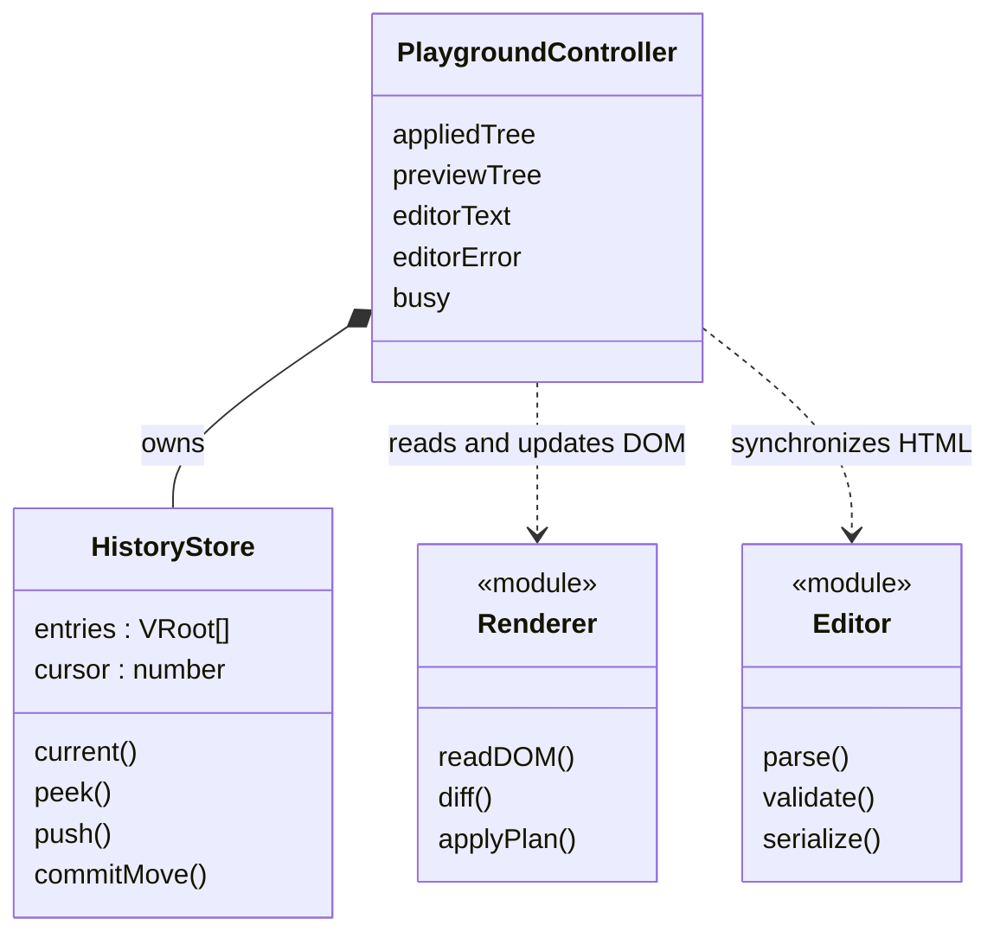
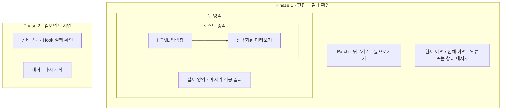

# 실습·검증 웹페이지와 이력 설계

관련 요구사항: [EDIT](../requirements.md#edit), [VIEW](../requirements.md#view), [HIST](../requirements.md#hist)

기준: [임시 결정](temporary-decisions.md). Phase 1 검증과 Phase 2 시연은 같은 페이지의 서로 다른 섹션으로 제공한다.


## 한눈에 보기



`module`은 함수 모듈이며, 별도의 클래스를 구현한다는 뜻은 아니다.

## 화면 구성



컨트롤 UI는 Vanilla DOM 이벤트로 구성한다. 실제·미리보기 컨테이너의 바깥 요소는 라이브러리 렌더링 대상에서 제외한다.

## 상태 모델

| 값 | 내용 |
| --- | --- |
| appliedTree | 실제 영역의 마지막 성공 VDOM. 항상 history.current()와 같은 상태 |
| previewTree | 마지막 유효한 테스트 미리보기 |
| editorText | 사용자가 편집 중인 HTML 문자열. 오류가 있는 문자열도 유지 가능 |
| editorError | 현재 입력의 미지원 요소·속성 등의 오류 |
| busy | 적용·이동 중 중복 요청 차단 |
| HistoryStore | VDOM 스냅샷 배열과 cursor |
| actualScope, previewScope | 각 컨테이너에 귀속된 서로 다른 DOMScope. 적용·이력 이동·복구에서 유지 |

입력 문자열과 VDOM은 다르다. HTML 파서가 공백·속성·태그를 정규화할 수 있으므로 적용 결과의 검증은 문자열 일치로 하지 않는다.

형제 항목의 정체성은 [렌더러 key 계약](renderer.md#key와-자식-정체성)을 따른다. 재정렬을 확인하는 샘플은 안정적인 data-key를 부여한다. key는 previewTree·appliedTree·History에 보존하며 actualScope/previewScope의 실제 ID 변환에는 포함하지 않는다.

## 초기 로드

1. 최초 샘플은 scope 없이 읽어 논리 ID를 가진 initialTree로 검증한다. 아직 미리보기는 연결하지 않는다.
2. 실제·미리보기 컨테이너의 서로 다른 DOMScope를 만든다. 원본 샘플을 비운 뒤 폼 기본값을 포함한 initialTree를 actualScope로 실제 영역에 생성한다.
3. 같은 논리 VDOM을 previewScope로 테스트 미리보기에 생성하고, 논리 VDOM을 HTML 입력창으로 직렬화한다.
4. 초기 스냅샷을 이력 0번에 저장한다.
5. 뒤로·앞으로 버튼을 비활성화한다.

컨트롤러가 종료될 때 자체 input/change 리스너와 렌더러 바인딩을 해제하고 두 컨테이너를 비운 뒤 scope를 해제한다. scope는 이력에 저장하거나 일반 Patch마다 새로 만들지 않는다.

## 편집과 Patch

### HTML 입력

- 입력마다 분리된 template에서 파싱하고 content를 scope 없이 읽어 검증한다. 유효하면 previewScope로 테스트 미리보기만 갱신한다. 문자열을 미리보기의 innerHTML에 직접 대입하지 않는다.
- 미지원 내용이면 editorText와 오류를 남기고 마지막 유효 미리보기를 유지한다. Patch는 비활성화한다.
- 자동 보정 가능한 HTML은 브라우저 파싱 결과로 수용한다. 소스 문법을 완전히 검사하는 별도 HTML parser는 만들지 않는다.
- 실제 영역과 History는 입력 중 변경하지 않는다.

### 미리보기 폼 조작

input/change 이벤트에서 `readDOM(previewContainer, previewScope)`로 현재 미리보기를 읽어 논리 previewTree와 editorText를 갱신한다. 현재 입력 오류가 있으면 폼 조작을 막아 잘못된 editorText를 덮어쓰지 않는다.

직렬화 시 input value/checked를 HTML 속성으로, textarea value를 이스케이프된 텍스트로 기록한다. ID·for·ARIA ID 참조는 논리 값을 사용한다. 연결된 DOM의 outerHTML은 직렬화 원본으로 사용하지 않는다. 이벤트 함수는 직렬화하지 않는다. 이 경로는 Phase 1에만 사용한다.

예약 data-key는 VElement.key에서 한 번만 직렬화하고 HTML 파싱·폼 조작 후 읽기에서도 같은 key를 복원한다. key를 생성 순서나 현재 배열 인덱스로 다시 발급하지 않는다. 사용자가 data-key를 변경·제거하면 다음 Patch에서 정체성 변경으로 처리한다. 중복/빈 key는 마지막 유효 미리보기와 실제 영역·History를 유지하는 입력 오류다.

실제 영역 label은 실제 영역 input에, 미리보기 label은 미리보기 input에 연결되어야 한다. 실제 영역 폼 값을 appliedTree로 복원하는 규칙은 유지하되, 그 규칙을 영역 간 ID 격리의 대안으로 사용하지 않는다. [렌더러 계약](renderer.md#영역별-식별자-계약)을 따른다.

### Patch 요청

1. busy·입력 오류를 확인한다.
2. 현재 미리보기 DOM을 previewScope로 다시 읽어 논리 VDOM으로 검증한다.
3. appliedTree와 비교 계획을 만들고, 저장할 스냅샷과 직렬화 문자열을 준비한다.
4. 실제 영역에는 actualScope, 미리보기에는 previewScope로 반영하고 논리 HTML로 입력창을 동기화한다.
5. 모든 반영이 성공한 뒤 HistoryStore.push(nextTree)를 호출하고 appliedTree를 그 스냅샷으로 변경한다.
6. 확정된 이력을 기준으로 버튼 상태를 갱신한다.

비교 결과가 비어 있어도 성공한 Patch 요청은 이력 한 개를 만든다. 과거 위치에서 이런 요청을 해도 이후 이력을 제거하고 새 기록을 추가한다.

## HistoryStore

```ts
class HistoryStore {
  private entries: readonly VRoot[];
  private cursor: number;
  current(): VRoot;
  canBack(): boolean;
  canForward(): boolean;
  peek(offset: -1 | 1): VRoot | undefined;
  push(tree: VRoot): void;
  commitMove(offset: -1 | 1): void;
}
```

- 생성 시 초기 상태를 넣고 cursor=0으로 둔다.
- push는 현재 cursor 뒤 기록을 버리고 스냅샷을 추가한다.
- 스냅샷은 DOM 참조·함수·DOMScope·실제 ID 없이 key를 포함한 논리 VDOM을 재귀 복사한다. 이후 수정하지 않는다.
- peek는 위치를 바꾸지 않는다. 컨트롤러가 DOM 복원에 성공한 뒤 commitMove로 cursor를 이동한다.
- 경계 요청은 무효이며 cursor·DOM·편집 내용을 그대로 둔다.
- 모든 기록은 메모리에만 유지한다. 새로고침하면 새 샘플 상태로 초기화한다.

## 이전·다음 이동

1. 이동 대상이 없으면 종료한다. 미적용 편집도 유지한다.
2. 대상 VDOM을 peek한다.
3. 실제 영역은 appliedTree와, 미리보기는 previewScope로 현재 DOM을 읽은 논리 트리와 각각 비교한다.
4. 실제 영역은 actualScope, 미리보기는 previewScope로 같은 논리 대상 상태를 반영한다.
5. 성공 후 cursor·appliedTree·previewTree·editorText를 동기화하고 편집 오류를 해제한다.

이동 완료 시 미적용 편집은 폐기한다. 기존 이력 스냅샷이나 Hook State를 변경하지 않는다.

재정렬 상태로 이동할 때 각 영역에 현재 존재하는 같은 부모·같은 key·같은 tag의 DOM을 이동·재사용한다. 과거 스냅샷이 과거의 DOM 객체를 보유하지는 않는다. 이미 삭제되었거나 부모가 교체된 항목은 같은 key로 되돌아와도 새 DOM을 생성한다. 복구를 위한 전체 재생성 경로의 정체성 예외는 기존과 같다.

## 오류 처리

검증 오류는 화면에 표시하고 적용 상태·이력을 유지한다. 적용·이동 중 예기치 않은 DOM 오류가 발생하면 다음을 수행한다.

- 작업 전의 두 영역 논리 VDOM과 editorText를 이용해 각각 기존 scope로 복구한다. 실제 ID를 다시 논리 ID로 취급하거나 새로운 scope를 만들지 않는다.
- History cursor·entries와 appliedTree는 변경하지 않는다.
- 복구 실패 시 적용·이동을 중단하고 재시작 안내를 표시한다.

예외 복구에서 노드를 재생성할 수 있으므로 실패 경로의 DOM 참조·포커스 보존은 보장하지 않는다. 정상 경로의 부분 갱신 요구는 유지한다.

Phase 1에는 사용자 Hook Effect가 없으므로 복구 성공 후 편집을 계속할 수 있다. 컨트롤러가 소유한 폼 관찰·복원 리스너는 컨테이너에 유지하거나 재등록해 중복 없이 동작시킨다. Phase 2의 DOM 재구성은 [별도 중단 정책](component-runtime.md#실패-처리)을 따르며 두 정책을 혼동하지 않는다.

## Phase 2 검증 사례

루트 Cart에서 quantity, productId, 메모와 재고 값을 관리한다. 자식 ProductCard는 Props와 콜백만 받는다.

- useState: 수량 증가 버튼과 메모 입력을 제공한다.
- useEffect: productId별 로컬 모의 재고 서비스를 구독한다. 서비스는 콜백을 호출하며 설정·정리 횟수를 기록한다. 외부 네트워크에 의존하지 않는다.
- useMemo: quantity에 따른 합계를 계산한다. quantity와 무관한 메모 입력에서는 계산이 재실행되지 않는지 테스트 계측으로 확인한다.
- 제거 버튼: 루트 unmount 후 구독 정리 확인.
- 다시 시작: 새 상태와 새 구독으로 mount.
- DOM 재구성이 필요한 실패: 화면 복구 여부와 별개로 faulted 표시, 컨테이너 조작 차단, 제거·다시 시작 안내. 다시 시작은 unmount 완료 후 mount를 호출한다.
- key 기반 비교: 별도 목록 시연에서 루트가 안정적인 항목 ID와 순서를 관리하고 keyed 자식 함수를 렌더한다. 앞 삽입·삭제·역순 버튼으로 최종 순서와 기존 항목 DOM 객체의 재사용을 확인한다. 자식 State·Hook은 추가하지 않는다.

검증 화면이 컨테이너 조작 차단을 소유한다. 복구 화면에서는 차단을 유지하고, 제거 완료 후 새 mount가 성공했을 때만 해제한다. 제거·다시 시작 컨트롤은 관리 컨테이너 밖에 둔다.

계산 횟수 관찰은 테스트 spy 또는 런타임 계측으로 수행한다. 순수해야 하는 Memo 계산에서 외부 DOM이나 State를 변경해 표시하지 않는다.
