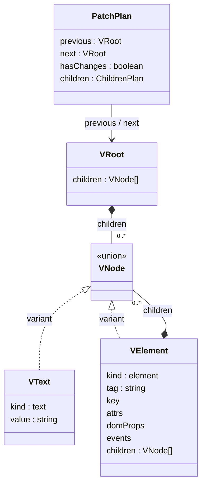

# VDOM · Diff · Patch 설계

관련 요구사항: [VDOM](../requirements.md#vdom), [DIFF](../requirements.md#diff), [PATCH](../requirements.md#patch)

기준: [OPEN-01·11 및 추가 설계 선택](temporary-decisions.md). key 기반 자식 대응은 사용자 요청으로 채택한 설계 방향이다. 지원 범위와 API 세부 정책도 2026-11-11 기존 구현 선택을 채택했다. 실제 검증 결과는 [최종 기록](../implementation/stage-10.md)을 따른다.


## 한눈에 보기



클래스 다이어그램은 데이터 구조를 표현한다. `variant`는 유니언 타입의 구성원이며, 실제 클래스 상속을 뜻하지 않는다.

## 데이터 모델

```ts
type EventName = 'click' | 'input' | 'change';
type Handler = (event: Event) => void;
type Props = {
  key?: string;
  attrs?: Record<string, string>;
  domProps?: { value?: string; checked?: boolean; disabled?: boolean };
  events?: Partial<Record<EventName, Handler>>;
  children?: Child[];
  [name: string]: unknown; // 사용자 정의 컴포넌트에 전달할 Props
};
type VText = { kind: 'text'; value: string };
type VElement = {
  kind: 'element';
  tag: string;
  key?: string;
  attrs: Readonly<Record<string, string>>;
  domProps: Readonly<{ value?: string; checked?: boolean; disabled?: boolean }>;
  events: Readonly<Partial<Record<EventName, Handler>>>;
  children: readonly VNode[];
};
type VNode = VText | VElement;
type VRoot = { kind: 'root'; children: readonly VNode[] };
```

입력 Props의 `children`은 컴포넌트용이다. host element에서는 정규화된 children으로 옮기고, 알 수 없는 host 속성·프로퍼티·이벤트 키는 검증 오류로 처리한다.

`key`는 예약된 정체성 메타데이터이며 attrs·domProps·events와 별개다. `h()`의 입력에서 VElement.key로 옮기고, 정규화된 VDOM의 attrs에 `key`나 예약 속성 `data-key`를 중복 저장하면 검증 오류다. DOM 읽기·쓰기에서만 data-key를 key로 변환한다.

- VRoot는 컨테이너 안의 0개 이상 노드를 표현한다. 실제 root DOM 노드를 만들지 않는다.
- textarea는 children 대신 domProps.value로 정규화한다. HTML text와 value가 중복 지정되면 오류다.
- input의 value/checked와 지원 요소의 disabled는 domProps에 두고 같은 이름을 attrs에 중복 저장하지 않는다.
- 초기 value가 생략되면 text input/textarea는 '', checkbox는 HTML 기본값인 'on'으로 정규화한다. checkbox의 checked=false, 지원 요소의 disabled=false를 기본값으로 사용한다. DOM을 읽을 때는 이 기본값보다 현재 프로퍼티 값을 우선한다.
- boolean 속성은 HTML에서 존재 여부로 읽는다. `disabled="false"`도 true가 된다.
- Phase 1 스냅샷의 events는 비어 있다. 컨트롤러 이벤트는 VDOM 밖에서 등록한다.

## DOM 읽기와 생성

`readDOM(container, scope?)`는 Element 또는 DocumentFragment의 childNodes를 순서대로 방문한다. 요소는 허용 목록을 검사하고, 텍스트는 공백까지 그대로 보존한다. input/textarea에서는 속성의 초기값보다 현재 프로퍼티 값을 읽는다. scope가 있으면 식별자를 논리 값으로 역변환하며, 생략하면 원본 DOM의 논리 값을 읽는다. 분리된 template은 content를 읽기 대상으로 사용한다. 네이티브 이벤트 리스너를 역변환하지 않으며 반환 events는 비어 있다.

`mountTree(container, tree, scope)`는 createElement/createTextNode로 트리를 만든 뒤 빈 컨테이너에 연결한다. append 전에 scope에 따른 실제 ID·참조 속성과 children을 구성하고, value/checked/disabled와 이벤트 바인딩을 적용한다. `applyPlan(container, plan, scope)`도 동일한 변환을 사용한다.

HTML 편집 내용은 분리된 template에 파싱하고 전체 검증 후에만 미리보기에 연결한다. 브라우저 파서가 정상적으로 보정하는 HTML은 정규화해 수용하며, 미지원 태그·속성은 조용히 제거하지 않고 오류로 표시한다.

## key와 자식 정체성

### 값·범위·HTML 왕복

- key는 선택적인 비어 있지 않은 문자열이다. 생략/undefined는 unkeyed이며 null·숫자·객체·빈 문자열은 검증 오류다. HTML 왕복으로 보존할 수 없는 U+0000과 단독 surrogate도 거부한다. 문자열을 trim하거나 숫자로 변환하지 않고 정확히 비교한다. 생성 시점이나 현재 배열 인덱스가 아니라 항목의 안정적인 식별값을 사용한다.
- key의 유일성 범위는 같은 부모의 정규화된 children이다. VRoot.children도 하나의 형제 목록이다. 다른 부모·다른 DOMScope에는 같은 key가 있어도 된다. 배열 평탄화 후 형제 중복을 검사하며 중복 key를 발견하면 DOM 변경 전에 오류로 거부한다.
- VText에는 key를 두지 않는다. 공백을 포함한 텍스트도 자식 인덱스를 차지한다. 텍스트/여러 노드를 묶어 이동해야 하면 key를 가진 지원 host 요소로 감싼다. keyed Fragment·노드 범위 이동은 추가하지 않는다.
- 원본 HTML의 예약 속성 `data-key`는 readDOM에서 VElement.key로 읽는다. mountTree/applyPlan은 key가 있으면 같은 문자열의 data-key를 기록하고 생략하면 제거한다. 직렬화도 key를 data-key로 이스케이프해 내보내며 일반 data-* attrs로 중복 취급하지 않는다. 따옴표·앰퍼샌드·개행 등도 파싱 후 같은 값으로 보존해야 한다. 원본 HTML은 브라우저 파싱 후의 속성값을 기준으로 하며, 파싱 전 소스 문자열의 바이트 동일성을 보장하지 않는다. HTML의 `key` 속성은 지원하지 않는다.
- key는 논리 id·ARIA ID 참조·DOMScope와 독립적이다. 영역별 접두어를 붙이거나 id에서 자동 추출하지 않는다. 두 영역의 같은 논리 트리는 같은 key와 서로 다른 실제 ID를 가진다.

### 대응과 재사용 계약

각 부모에서 이전/다음 형제 목록을 다음 기준으로 대응한다. 이는 관찰 가능한 대응 규칙이며 탐색 알고리즘을 지정하지 않는다.

| 다음 자식 | 이전 자식의 대응 기준 | 결과 |
| --- | --- | --- |
| key가 있는 요소 | 같은 부모의 같은 key를 가진 이전 요소. 이전 위치와 무관 | tag가 같으면 같은 DOM 객체 재사용·필요 시 이동·내용 갱신. tag가 다르면 해당 노드와 하위 트리 교체 |
| key가 없는 요소·텍스트 | 전체 children 배열의 정확히 같은 이전 인덱스에 있는 unkeyed 자식만 대응 | kind/tag가 같으면 재사용·내용 갱신, 다르면 교체. 다른 위치의 unkeyed 자식을 찾아 재사용하지 않음 |
| 대응하는 이전 자식 없음 | 없음 | 새 DOM 생성 |
| 다음 목록에서 대응되지 않은 이전 자식 | 없음 | DOM·해당 하위 트리의 이벤트 바인딩 제거 |

한쪽만 keyed이거나 key가 달라지면 같은 tag·같은 위치여도 대응하지 않는다. 각 이전 자식은 최대 한 번만 소비한다. keyed와 unkeyed가 섞여도 위 규칙을 그대로 적용하며 unkeyed 인덱스는 keyed/공백 텍스트까지 포함한 전체 목록 기준이다. 중간 삽입 시 unkeyed 항목의 논리 정체성은 보장하지 않는다.

같은 key라도 다른 부모로 옮기면 제거 + 생성이다. 부모 자체가 교체되면 그 하위 key가 같아도 기존 DOM 재사용을 보장하지 않는다. 삭제된 노드는 별도 캐시에 두지 않으므로 이후 같은 key가 재등장해도 새로 만든다. 이전 스냅샷으로 돌아갈 때도 현재 살아 있는 같은 부모·같은 key·같은 tag의 DOM만 재사용한다.

key는 DOM 재사용 기준이지 사용자 State 저장소가 아니다. 같은 노드를 이동할 때 기존 이벤트 바인딩을 이동만을 이유로 해제·중복 등록하지 않는다. 변경된 이벤트·폼 프로퍼티는 목표 VDOM대로 갱신한다. DOM 객체 보존과 달리 이동 과정의 브라우저 포커스·선택 영역 보존은 별도 보장하지 않는다.

## 영역별 식별자 계약

### 논리 값과 DOM 값

- VElement.attrs의 `id`, label의 `for`, 지원 ARIA ID 참조는 항상 논리 값이다. Diff와 HTML 직렬화에는 scope나 실제 ID를 넣지 않는다.
- `createDOMScope(container)`는 문서에서 고유한 이름공간을 가진 불투명 DOMScope를 생성한다. 논리 ID → 실제 ID 변환은 scope 안에서 안정적이고 일대일이며, 서로 다른 scope의 실제 ID 집합은 겹치지 않는다. 단순 문자열 접두어 제거로 논리 값을 추측하지 않는다.
- 호스트 UI도 생성 ID 이름공간을 예약하고 같은 실제 ID를 사용하지 않는다. 임베딩 측의 임의 DOM 변경·예약 이름공간 침범은 지원 계약 밖이다.
- 쓰기는 `id`와 모든 지원 ID 참조를 함께 변환한다. ID 목록은 HTML 공백으로 토큰화해 각 토큰을 변환하고 한 칸 공백으로 정규화한다. 원본 DOM·컴포넌트 Props의 입력 정규화에도 같은 목록 규칙을 적용한다. 읽기는 같은 scope로 각각 역변환한다. 다른 scope의 값이나 역변환할 수 없는 값은 오류이며 그대로 통과시키지 않는다.
- 논리 ID는 빈 문자열·HTML 공백을 포함할 수 없고 VRoot 안에서 유일해야 한다. 단일 참조는 정확히 한 ID, 목록 참조는 한 개 이상 ID를 가져야 한다. 모든 대상은 같은 VRoot에 있어야 한다. label의 대상은 지원하는 labelable 요소여야 한다. ID·참조 전체 검증은 연결 전 수행한다.
- 지원 ARIA 속성과 단일/목록 구분은 [OPEN-01 세부 범위](temporary-decisions.md#식별자와-aria-범위-보완)를 따른다. 일반 문자열 속성에 포함된 ID처럼 보이는 값은 변환하지 않는다.

이벤트가 없는 Phase 1 논리 트리 T를 실제 영역 scope A와 미리보기 scope B로 생성하면 실제 `id` 값은 다르지만 `readDOM(actual, A)`와 `readDOM(preview, B)`는 T와 의미상 같아야 한다. 직렬화된 HTML·History에 실제 ID가 새어 나오면 계약 위반이다. ID 변경·삭제와 참조 변경도 같은 검증·변환 규칙을 따른다.

### 소유권과 수명

- 컨트롤러는 실제·미리보기 scope를 각각 소유하고, FunctionComponent는 자기 루트 scope를 소유한다. 동일하거나 중첩된 컨테이너에 scope를 중복 생성하지 않는다. scope를 사용한 읽기·쓰기에서는 지정 컨테이너와 scope 소유 컨테이너의 동일성을 검사하고 불일치를 오류로 거부한다.
- scope는 컨테이너 수명 동안 유지하며 Patch·이력 이동·실패 복구에서 재사용한다. `releaseDOMScope(scope)`는 바인딩을 해제하고 관리 DOM을 비운 뒤 호출한다. 해제된 scope로 읽기·쓰기는 오류다.
- 최초 원본 샘플과 분리된 template은 scope 없이 읽는다. 최초 샘플은 논리 트리를 확보·검증한 후 비우고 scope를 적용해 다시 생성하며, 그 뒤 미리보기를 연결한다. 서로 다른 영역에 원본 ID를 복제한 채 연결하지 않는다.
- scope는 보안 격리가 아니라 ID 연결 격리다. 프로젝트 CSS는 class를 사용한다. scoped DOM에서 `document.getElementById(논리ID)` 조회는 지원하지 않는다. DOM을 참조하는 코드는 소유 컨테이너와 실제 노드 참조를 기준으로 작성한다.

ID 인코딩·역변환 자료구조·이름공간 발급 방법은 구현에 위임한다. 일대일성, 문서 내 고유성, 왕복 보존, 해제 후 사용 금지는 구현 방식과 무관한 불변조건이다.

## Diff 전략

자식 대응은 위 key 계약을 따른다. 같은 key·같은 tag의 요소는 위치가 바뀌어도 재사용하며, unkeyed 자식에만 위치 기반 fallback을 적용한다. key 변경도 구조·정체성 변경이므로 무변경으로 판단하지 않는다.

변경 결과는 평면 DOM 경로 배열 대신 **계층형 계획**으로 표현한다.

```ts
type NodePlan =
  | { op: 'keep'; next: VNode }
  | { op: 'text'; next: VText }
  | { op: 'element'; next: VElement; children: ChildrenPlan };
type ChildPlacement =
  | { op: 'create'; next: VNode }
  | { op: 'reuse'; oldIndex: number; patch: NodePlan }
  | { op: 'replace'; oldIndex: number; next: VNode };
type ChildrenPlan = {
  ordered: readonly ChildPlacement[]; // 다음 children과 같은 순서
  remove: readonly number[];          // 대응되지 않은 이전 인덱스
};
type PatchPlan = {
  previous: VRoot;
  next: VRoot;
  hasChanges: boolean;
  children: ChildrenPlan;
};
```

oldIndex는 이 부모의 변경 전 childNodes 인덱스다. ordered의 길이는 다음 children 길이와 같고 각 항목은 해당 다음 자식을 나타낸다. reuse/replace의 oldIndex는 중복되지 않으며 remove와도 겹치지 않는다. 이전 인덱스는 ordered에서 한 번 참조되거나 remove에 한 번 포함되어야 한다. create에는 이전 노드가 없다.

NodePlan의 keep은 재사용 노드의 내용이 같다는 뜻이며 위치까지 같다는 뜻은 아니다. 위치 변경은 ordered가 표현한다. Diff는 key 대응 후 attrs 이름·값, 텍스트, domProps 값, 이벤트 함수 참조를 비교한다. 두 트리와 History를 수정하지 않으며 DOM에 접근하지 않는다.

PatchPlan.hasChanges는 정규화된 previous와 next 사이에 의미상 변경이 있는지를 나타낸다. 노드 종류·태그·key·자식 개수/순서·공백을 포함한 텍스트·지원 attrs·domProps·이벤트 함수 참조가 모두 같을 때에만 false다. 속성 맵의 열거 순서·HTML 원문 표기·VDOM 객체 참조·영역별 실제 DOM ID는 동일성 기준이 아니다. Phase 1의 events는 비어 있으므로 비교 대상은 지원 HTML 데이터다.

이 값은 실제 DOM 쓰기 유무나 계획 배열 길이를 뜻하지 않는다. 같은 내용의 노드를 이동해야 하면 true이며 ordered에 재사용 항목이 있어도 false일 수 있다. VDOM이 같아 false인 경우에도 실제 폼 프로퍼티의 값이 달라 보정이 필요할 수 있다. 컨트롤러와 HistoryStore는 무변경 이력 판정을 이 동일성 계약에 맞추며, 비교의 세부 구현과 중복 계산 방지는 구현에 위임한다.

## 계획 적용 순서

Patch는 각 부모의 변경 전 childNodes 참조를 확보해 oldIndex를 실제 노드에 연결한다. 이후 DOM이 이동·삭제되어도 변동된 live 인덱스로 대상을 다시 찾지 않는다.

- create/replace용 새 노드는 사전 검증·준비한다. reuse 대상에는 NodePlan을 적용하고 같은 DOM 객체를 ordered가 지정한 다음 위치에 배치한다.
- remove 대상과 replace의 이전 노드는 하위 트리 바인딩을 해제하고 제거한다. 단순 이동은 제거로 취급하지 않는다.
- 적용 완료 후 childNodes의 개수·순서·각 노드의 내용이 다음 VDOM과 대응해야 한다. 재정렬만으로 컨테이너를 비우거나 재사용 노드를 복제하면 계약 위반이다.
- 이미 올바른 위치·내용의 노드는 이동하거나 다시 쓰지 않는다. 전체 무변경 입력은 폼의 실제 값 보정이 필요하지 않은 한 DOM 쓰기가 없어야 한다.

DOM 배치의 구체적인 순회 순서·anchor 계산·key 탐색 자료구조는 구현에 위임한다. 최소 이동 횟수·LIS 최적화·특정 시간복잡도는 이번 인수 조건이 아니다. 대응·노드 보존·최종 순서·무변경 쓰기 생략은 구현 방식에 관계없이 지킨다.

## 속성·폼·이벤트

| 대상 | 반영 방식 |
| --- | --- |
| 문자열 속성 | 달라진 값만 setAttribute, 삭제된 이름은 removeAttribute |
| key 메타데이터 | 예약 data-key로 반영. attrs나 DOMScope ID 변환에 포함하지 않음 |
| id·for·지원 ARIA ID 참조 | 논리 값을 scope로 변환해 반영. 원본 VDOM은 변경하지 않음 |
| 텍스트 | 기존 Text.nodeValue를 변경 |
| value/checked/disabled | DOM 프로퍼티에 반영. 실제 값이 목표와 다를 때만 대입 |
| 이벤트 | 이전 함수와 다르면 removeEventListener 후 addEventListener. 삭제 시 해제 |

폼 프로퍼티는 VDOM끼리 같아도 사용자의 네이티브 조작으로 실제 값이 다를 수 있다. applyPlan의 마지막에 지원 폼 컨트롤을 순회해 **현재 DOM 값과 목표 프로퍼티를 비교**한다. 값이 같은 경우 쓰지 않아 커서와 불필요한 DOM 변경을 줄인다.

Phase 1에서는 실제 영역의 input/change 기본 이벤트 후 현재 appliedTree의 프로퍼티로 복원해, 테스트 영역만 편집 출처가 되도록 한다. 실제 영역에 컨트롤러가 소유한 이벤트를 등록하며 readDOM 대상 데이터와 분리한다.

## 오류와 복구 경계

- 전체 VDOM 검증과 새 노드 준비는 기존 DOM을 바꾸기 전에 수행한다.
- 잘못된 입력·미지원 속성은 검증 오류이며 DOM을 바꾸지 않는다.
- 중복·잘못된 key와 잘못된 계획 인덱스는 변경 전에 거부한다. 준비 단계에서 실패하면 새 노드의 바인딩·임시 참조도 회수한다. key 검증 실패는 기존 DOM·Hook·History를 변경하지 않는다.
- 예상하지 못한 적용 오류가 발생하면 호출자에게 예외를 전달한다. 렌더러 자체가 모든 DOM 작업의 원자성을 보장하지 않는다.
- 호출자는 같은 DOMScope와 마지막 성공 VDOM으로 복구할 수 있다. 이 오류 경로에서는 DOM 객체 정체성이 보존되지 않을 수 있으며, 정상 부분 갱신 경로와 구분한다.
- 렌더러는 Effect의 소유자가 아니다. Phase 2 호출자는 [런타임 복구 절차](component-runtime.md#실패-처리)에 따라 기존 Effect·이벤트를 정리하고 재구성 결과를 비활성 화면으로만 남긴다. 복구용 생성은 이벤트가 비어 있는 표시용 트리를 사용하며 마지막 성공 VDOM 자체는 수정하지 않는다.
- 애플리케이션 외부에서 컨테이너 구조를 임의로 바꾸는 것은 지원하지 않는다.

## 확인할 사례

- 텍스트와 속성만 변경해 부모·형제 DOM 참조가 유지되는가?
- 앞·중간·끝 삽입과 삭제, 태그 교체가 최종 목표 트리를 만드는가?
- 변경 없는 계획이 DOM 쓰기를 생략하는가?
- value/checked 변경과 이벤트 함수 교체가 DOM에 실제로 반영되는가?
- 현재 DOM을 읽어 재생성한 뒤에도 폼 상태가 같은가?
- 같은 논리 ID를 가진 두 영역의 label·ARIA 연결이 자기 영역에 한정되고, 읽기·직렬화·이력 이동 후 논리 ID가 보존되는가?
- key 기반 삽입·삭제·재정렬에서 대응된 DOM 객체가 유지되고, key 변경·tag 변경·부모 변경은 지정된 교체/생성 경계를 따르는가?
- data-key와 VElement.key가 폼 조작·직렬화·History를 왕복하며 attrs나 scope와 혼동되지 않는가?
