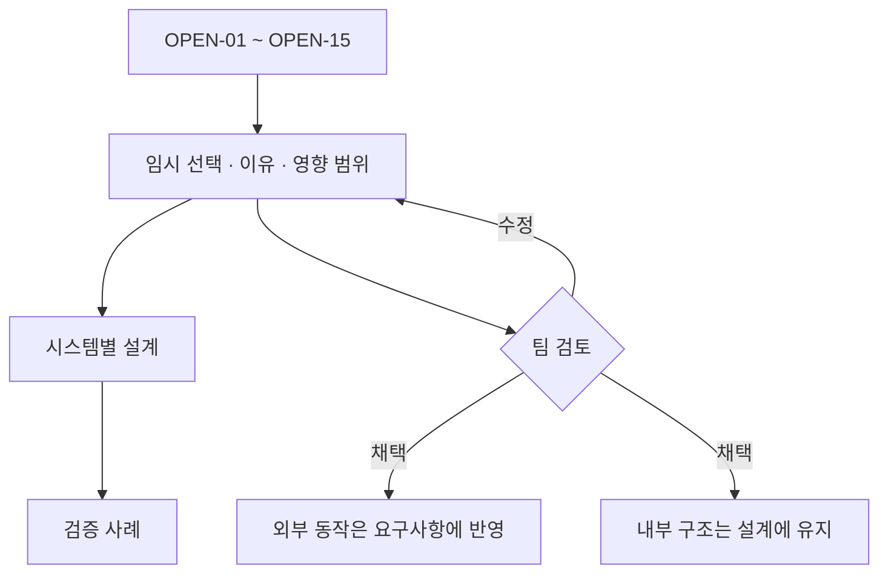

# 미결정 사항의 임시 결정

상태: **OPEN 정책은 임시 채택 / key 기반 자식 대응은 사용자 요청으로 채택** · 작성일: 2026-11-09

설계를 진행하기 위해 선택한 기준이다. 아래 결정은 과제 원문의 추가 요구가 아니며, 기존 요구사항의 미결정 상태도 그대로 유지한다.

key 기반 비교·DOM 재사용 방향은 후속 사용자 요청에 따라 인덱스 전용 비교에서 변경했다. key 값의 세부 정책·HTML 표현·unkeyed fallback·API는 그 방향을 구현하기 위한 설계 계약이며, 그 밖 OPEN 항목의 확정을 뜻하지 않는다.

## 한눈에 보기

| 원문 | 임시 결정 | 선택 이유 | 영향 문서 |
| --- | --- | --- | --- |
| [OPEN-01](../requirements.md#open-01) | 아래의 HTML·폼·이벤트 지원 목록을 적용한다. | 샘플 편집과 상호작용에 필요한 범위를 명시 | [렌더러](renderer.md), [웹페이지](playground-history.md) |
| [OPEN-02](../requirements.md#open-02) | 테스트 영역에 HTML 입력창과 미리보기를 둔다. | 태그·속성·텍스트 변경을 모두 표현 가능 | [웹페이지](playground-history.md) |
| [OPEN-03](../requirements.md#open-03) | 최초 VDOM을 이력 0번으로 저장한다. | 첫 Patch를 초기 상태까지 되돌릴 수 있음 | [이력](playground-history.md) |
| [OPEN-04](../requirements.md#open-04) | 과거에서 새 Patch가 성공하면 이후 이력을 제거하고 새 상태를 추가한다. | 단일 선형 이력으로 이동 규칙 단순화 | [이력](playground-history.md) |
| [OPEN-05](../requirements.md#open-05) | 변경 없는 Patch도 성공 요청당 이력 한 개를 저장한다. | 과제의 Patch 후 저장 동작을 그대로 적용 | [이력](playground-history.md), [검증](verification.md) |
| [OPEN-06](../requirements.md#open-06) | 현재 페이지 메모리에만 저장한다. 새로고침 시 초기화하며, 초기 구현에는 자동 삭제나 개수 제한을 두지 않는다. | 저장소 연동 없이 복원 기능에 집중 | [이력](playground-history.md) |
| [OPEN-07](../requirements.md#open-07) | 직접 값·함수형 업데이트를 지원하고, 함수형 초기값도 지원한다. Object.is로 같은 상태면 갱신을 생략한다. | 이전 값 기반 변경과 초기화 동작을 명확히 함 | [Hook](hooks.md) |
| [OPEN-08](../requirements.md#open-08) | 권장 EFF-04를 임시 채택한다. 루트에 unmount()를 추가한다. idle/faulted에서만 제거를 시작하며 실행 중 재진입은 거부한다. 제거 완료 후 mount()하면 새 상태로 시작한다. | 실행 중 setup의 cleanup 소유권을 끊지 않고 제거 경계 제공 | [런타임](component-runtime.md), [Hook](hooks.md) |
| [OPEN-09](../requirements.md#open-09) | 입력은 적용 전 검증한다. 검증 실패 시 실제 영역·적용 기준·이력을 유지하고 오류를 표시한다. 런타임 실패는 단계별로 처리한다. | 잘못된 입력이 적용 상태를 훼손하지 않도록 함 | [렌더러](renderer.md), [런타임](component-runtime.md), [웹페이지](playground-history.md) |
| [OPEN-10](../requirements.md#open-10) | TypeScript, Vite, Vitest+jsdom, Playwright를 개발 도구 후보로 사용한다. 실행 UI에는 외부 프레임워크를 사용하지 않는다. | 타입 계약과 모듈·브라우저 검증 지원 | [전체 구조](architecture.md), [검증](verification.md) |
| [OPEN-11](../requirements.md#open-11) | 의존성은 항목별 Object.is로 비교한다. Effect는 생략·빈 배열·배열을 지원한다. Memo는 배열을 필수로 받는다. | 비용과 실행 규칙이 예측 가능한 비교 | [Hook](hooks.md) |
| [OPEN-12](../requirements.md#open-12) | 이력 이동이 가능한 경우 미적용 편집을 폐기하고 선택 상태로 입력창·미리보기를 동기화한다. 경계의 무효 이동은 편집을 보존한다. | 이동 완료 후 두 영역이 같은 상태를 나타냄 | [웹페이지](playground-history.md) |
| [OPEN-13](../requirements.md#open-13) | 의존성이 같으면 Memo 결과의 같은 객체 참조를 반환한다. | 재계산과 불필요한 복사 생략 | [Hook](hooks.md) |
| [OPEN-14](../requirements.md#open-14) | 버튼당 한 단계 이동한다. 처음/끝에서는 해당 버튼을 비활성화하고 API 호출도 무효 처리한다. | 탐색 경계가 명확함 | [이력](playground-history.md) |
| [OPEN-15](../requirements.md#open-15) | 루트 본문에서 항상 같은 순서·개수로 Hook을 호출한다. 슬롯 종류·개수와 호출 문맥을 검사한다. | 배열 인덱스로 기록 연결 가능 | [런타임](component-runtime.md), [Hook](hooks.md) |

## OPEN-01 세부 범위

### HTML과 텍스트

- 노드: HTML 요소와 텍스트. 공백 텍스트는 유지한다. 주석·SVG·사용자 정의 요소는 미지원 오류로 처리한다.
- 태그: `div`, `span`, `p`, `section`, `article`, `header`, `footer`, `main`, `h1`~`h6`, `ul`, `ol`, `li`, `strong`, `em`, `br`, `label`, `button`, `input`, `textarea`.
- 공통 속성: `id`, `class`, `title`, `data-*` 및 아래에 열거한 `aria-*` 속성.
- `data-key`는 일반 data-*와 달리 VElement.key에 대응하는 예약 속성이다. HTML의 `key` 속성과 정규화 VDOM의 attrs.data-key는 허용하지 않는다. [key 계약](renderer.md#key와-자식-정체성)을 따른다.
- 추가 속성: label의 `for`; button의 `type`, `disabled`; input의 `type`, `name`, `placeholder`, `disabled`, `value`, `checked`; textarea의 `name`, `placeholder`, `disabled`.
- input은 `text`, `checkbox`만 지원한다. type 생략은 text로 정규화한다. button은 type=button만 지원하며 생략도 button으로 정규화한다.
- `style`, URL 속성, `on*` HTML 속성, script·iframe·외부 리소스 태그는 입력으로 허용하지 않는다. 화면 스타일은 프로젝트 CSS와 허용된 class로 제공한다.

이 목록은 영구 제한이 아니다. 지원 범위 변경 시 변환·검증·Patch·편집 테스트를 함께 수정한다.

### 식별자와 ARIA 범위 보완

- VDOM·HTML 입력·History에는 논리 ID를 저장하고, 연결된 DOM에는 영역별 실제 ID를 사용한다. `id`·label의 `for`·지원 ARIA ID 참조를 함께 변환한다. 읽기와 직렬화의 상세 계약은 [영역별 식별자 계약](renderer.md#영역별-식별자-계약)을 기준으로 한다.
- 비참조 ARIA 속성은 `aria-label`, `aria-hidden`, `aria-live`, `aria-expanded`, `aria-checked`, `aria-disabled`, `aria-pressed`를 지원한다.
- 단일 ID 참조는 `aria-activedescendant`, `aria-errormessage`; ID 목록 참조는 `aria-labelledby`, `aria-describedby`, `aria-controls`, `aria-owns`, `aria-flowto`를 지원한다. 그 외 ARIA 속성은 미지원 오류다. 새 ID 참조 속성은 읽기·쓰기 양방향 변환을 정의한 뒤 추가한다.
- 중복·빈 ID, 공백을 포함한 ID, 같은 VRoot 안에 대상이 없는 ID 참조는 검증 오류다. 영역 밖 요소를 참조하는 입력은 지원하지 않는다.

기존의 포괄적인 `aria-*` 표기를 명시적 지원 목록으로 보완한 임시 제안이다. 이는 OPEN-01의 지원 범위 구체화이며, 팀 채택 전까지 요구사항의 결정 상태를 바꾸지 않는다.

### 폼의 현재 값

- input text와 textarea는 현재 `value`를 보존한다.
- checkbox는 현재 `checked`와 문자열 `value`를 보존한다. 체크 여부를 단순한 속성 존재와 혼동하지 않도록 별도 필드에 둔다.
- select, radio, file, number 등은 이번 범위에서 제외한다.
- textarea의 문자열 내용은 VDOM에서 `value`로 정규화한다. HTML로 내보낼 때는 태그 내부 텍스트로 변환한다.

### UI 이벤트

- Phase 2에서 `click`, `input`, `change`의 네이티브 이벤트를 지원한다. 함수 콜백으로 등록·교체·제거한다.
- HTML 입력창의 문자열을 JavaScript 핸들러로 실행하지 않는다.
- Phase 1 미리보기의 폼 조작은 컨트롤러가 관찰해 HTML 입력창에 반영한다. 이 콜백은 사용자 VDOM의 일부가 아니다.

## 추가 설계 선택

| 선택 | 내용 | 변경 시 영향 |
| --- | --- | --- |
| 자식 대응 | 사용자 요청으로 key 기반 대응 채택. 같은 부모·같은 key·같은 tag는 DOM 재사용·이동. key 없는 자식만 같은 전체 인덱스의 unkeyed 자식에 대응 | VDOM·HTML 왕복·Diff·Patch·History·자식 API·노드 정체성 검증 |
| Phase 2 UI 작성 | h()와 text()로 VDOM 생성. 초기 구현에서 JSX 변환은 제외 | 컴포넌트 작성 API |
| 갱신 시점 | 유휴 상태의 setter는 동기 갱신. Effect 처리 중 요청은 현재 Effect 처리가 끝난 뒤 순서대로 처리 | 런타임과 Hook 테스트 |
| History 저장 | 불변 VDOM 스냅샷 배열과 cursor 사용 | History 저장·복원 |
| 검증 브라우저 | 로컬 Chrome에서 시연하고 Playwright Chromium에서 자동 검증. 실제 버전은 검증 기록에 남김 | 재현 환경 |

### 경계 정책의 선택과 대안

| 결정 | 선택 이유 | 비교한 대안과 포기한 것 |
| --- | --- | --- |
| 영역별 실제 ID + 논리 ID 왕복 | 일반 컨테이너와 공통 렌더러를 유지하면서 label·ARIA 연결을 격리 | Shadow DOM/iframe은 트리 격리가 가능하지만 호스트·스타일·이벤트 경계를 추가한다. 단순 접두어만 적용하는 방식은 읽기·이력 비교를 오염시키므로 제외 |
| 실행 중 unmount 진입 거부 | setup 반환 전 cleanup 회수와 제거 요청 보류 상태를 추가하지 않음 | 제거 보류 방식의 편의성은 포기. 실행 중 작업을 끝낸 뒤 호출자가 idle에서 제거해야 함 |
| DOM 재구성 후 정리·faulted | 이전 DOM에 연결된 Effect를 정상 실행 자원으로 재사용하지 않음 | 자동 Effect 재설정은 setup 보관·재실행 실패 정책이 필요하므로 제외. 화면 복구 후 State를 유지한 자동 재개는 제공하지 않음 |
| key 기반 대응 + unkeyed 위치 fallback | 사용자 요청의 재정렬 정체성을 보장하면서 기존 key 없는 HTML·공백 텍스트도 지원 | 인덱스 전용은 재정렬 항목의 DOM 정체성을 보존하지 못하므로 대체. 모든 자식에 key를 강제하는 방식은 텍스트·일반 HTML 편집을 불필요하게 제한하므로 제외 |

key는 비어 있지 않은 문자열만 지원하고 형제 중복은 적용 전 오류로 처리한다. HTML에는 예약 data-key로 보존한다. 최소 DOM 이동 횟수나 LIS 최적화는 요구하지 않으며 구현에 위임한다. key는 자식 DOM 정체성만 다루고 루트 Hook 슬롯·Effect 수명을 새로 정의하지 않는다.

메모리 이력은 상태 수와 DOM 크기에 비례해 증가한다. 자동 삭제 정책이 필요해지면 OPEN-06을 다시 결정한다.

## 임시 결정을 확정하는 절차

1. 팀에서 선택과 이유를 검토한다.
2. 외부 동작·지원 범위는 requirements.md의 인수 조건과 결정 상태에 반영한다.
3. 자료구조·알고리즘·파일 구성은 설계 문서에서 유지한다.
4. 변경 영향을 받는 문서와 검증 사례를 함께 갱신한다.

Hook 호출 검사는 모든 잘못된 사용을 증명하는 기능이 아니다. 같은 종류의 Hook 두 개가 위치를 바꾸는 경우처럼 슬롯 종류·개수만으로 발견하지 못하는 사용은 지원 규칙 위반으로 문서화한다.
