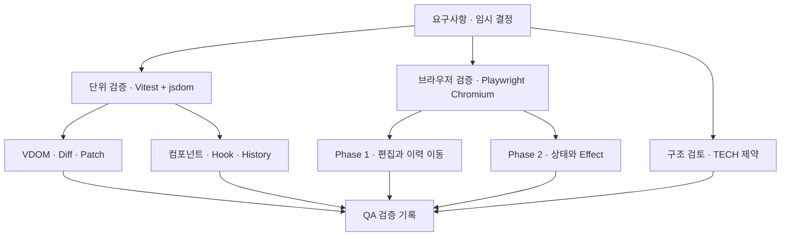
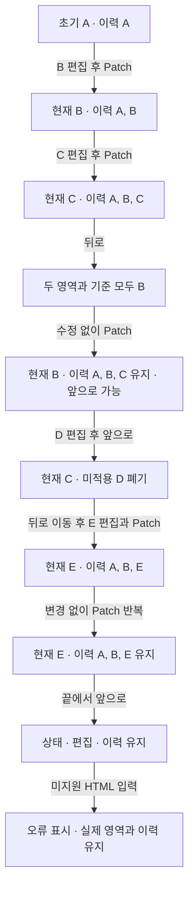
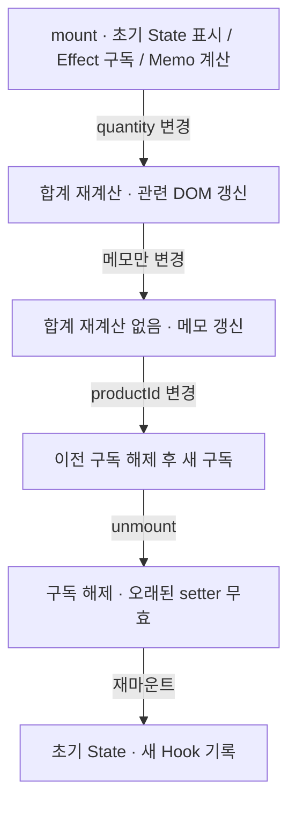
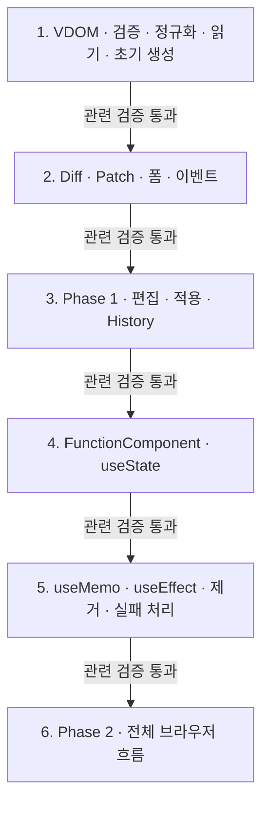

# 검증 계획과 구현 순서

상태: 설계 검증 계획. 아래 테스트는 아직 작성·실행하지 않았다.

## 한눈에 보기

## 환경

[OPEN-10 임시 결정](temporary-decisions.md)에 따라 Vitest+jsdom으로 핵심 모듈을, Playwright Chromium으로 브라우저 흐름을 검증한다. 외부 UI 프레임워크는 사용하지 않는다. 테스트 도구와 버전은 구현 착수 시 설치·기록한다.

## 요구사항과 검증 연결

| 요구사항 | 검증 대상 | 핵심 확인 |
| --- | --- | --- |
| [VDOM-01](../requirements.md#vdom-01), [VDOM-02](../requirements.md#vdom-02) | readDOM | 중첩·순서·공백·속성·key/data-key 왕복·현재 폼 값·미지원 입력 |
| [DIFF-01](../requirements.md#diff-01), [DIFF-02](../requirements.md#diff-02), [DIFF-03](../requirements.md#diff-03) | diff | key 대응·재정렬·추가·삭제·태그·텍스트·속성·무변경, 입력 불변 |
| [PATCH-01](../requirements.md#patch-01), [PATCH-02](../requirements.md#patch-02), [PATCH-03](../requirements.md#patch-03) | mountTree/applyPlan | 목표 DOM 순서·내용 일치, key 대응 DOM 참조 보존, 무변경 쓰기 없음 |
| [COMP-01](../requirements.md#comp-01), [COMP-02](../requirements.md#comp-02), [COMP-03](../requirements.md#comp-03) | FunctionComponent | 초기 표시·Props 전달·State 부분 갱신 |
| [STA-01](../requirements.md#sta-01), [STA-02](../requirements.md#sta-02), [STA-03](../requirements.md#sta-03) | useState | 초기화·두 슬롯 독립·setter·함수형 업데이트·같은 값 생략 |
| [EFF-01](../requirements.md#eff-01), [EFF-02](../requirements.md#eff-02), [EFF-03](../requirements.md#eff-03), [EFF-04](../requirements.md#eff-04) | useEffect | DOM 반영 후 설정·의존성 비교·정리 순서·제거 |
| [MEMO-01](../requirements.md#memo-01), [MEMO-02](../requirements.md#memo-02), [MEMO-03](../requirements.md#memo-03) | useMemo | 최초 계산·동일 결과 재사용·새 deps 계산 |
| [EDIT-01](../requirements.md#edit-01), [EDIT-02](../requirements.md#edit-02) | 편집 컨트롤러 | HTML 편집·폼 현재 값 반영·적용 전 실제 영역 유지 |
| [VIEW-01](../requirements.md#view-01), [VIEW-02](../requirements.md#view-02), [VIEW-03](../requirements.md#view-03), [VIEW-04](../requirements.md#view-04) | 브라우저 통합 | 두 영역·버튼·초기 변환·Patch·Phase 2 사례 |
| [HIST-01](../requirements.md#hist-01), [HIST-02](../requirements.md#hist-02), [HIST-03](../requirements.md#hist-03) | HistoryStore/컨트롤러 | 스냅샷 독립·이동·동기화·실변경 분기·무변경 이력/앞으로가기 기록 보존·경계 |
| [TECH-01](../requirements.md#tech-01), [TECH-02](../requirements.md#tech-02) | 구성 검토 | TS/Vanilla 사용, 외부 UI 프레임워크 미사용 |
| [TECH-03](../requirements.md#tech-03), [TECH-04](../requirements.md#tech-04) | 클래스 검토 | FunctionComponent·hooks·mount·update 존재와 사용 |
| [TECH-05](../requirements.md#tech-05), [TECH-06](../requirements.md#tech-06) | 호출 문맥·예제 검토 | 루트 Hook, 자식 순수성, 자식 Hook 오류 |
| [QA-01](../requirements.md#qa-01), [QA-02](../requirements.md#qa-02), [QA-03](../requirements.md#qa-03), [QA-04](../requirements.md#qa-04), [QA-05](../requirements.md#qa-05) | 검증 기록 | 단위·기능·경계·부분 갱신 결과와 실행 방법 기록 |

## 반드시 연결해서 확인할 흐름

### Phase 1

### Phase 2

## 경계·오류 사례

- 중간 자식 삽입·삭제·타입 교체가 한 번에 발생하는 경우.
- input/textarea의 속성 초기값과 현재 프로퍼티가 다른 경우.
- 새 이벤트 함수 적용 후 이전 함수가 호출되지 않는지.
- Effect deps 생략·[]·동일 배열 값·새 객체·NaN·+0/-0.
- Hook 개수/종류 오류와 자식 Hook 호출.
- Effect 중 setter, 무한 갱신 차단, cleanup 예외 뒤 다른 정리 지속.
- 렌더 실패 후 마지막 성공 DOM·State·Memo 유지 및 미실행 Effect.
- 인위적인 DOM 적용 오류에서 History를 확정하지 않는지.

## 설계 검토 회귀 사례

아래는 구현 후 실행할 검증 계약이며, 현재 통과한 테스트를 뜻하지 않는다. 브라우저의 label 기본 동작은 jsdom 검사만으로 대체하지 않고 Playwright Chromium에서 확인한다.

### 무변경 Patch의 History 보존

관련: [HIST-01](../requirements.md#hist-01), [HIST-02](../requirements.md#hist-02), [DIFF-03](../requirements.md#diff-03), 채택된 [OPEN-05](../requirements.md#open-05). 동일성 기준은 [렌더러](renderer.md#diff-전략), 처리 순서는 [컨트롤러](playground-history.md#의미상-같은-상태와-무변경-patch)를 따른다.

| 조건 | 관찰할 결과 |
| --- | --- |
| 이력 A,B,C의 중간 B에서 수정 없이 Patch | entries·cursor·appliedTree와 기존 스냅샷 참조 유지, C 제거 없음, 앞으로가기로 C 복원 가능 |
| 최신 상태 또는 최초 상태에서 무변경 Patch 반복 | 추가 스냅샷 없음, 현재 위치와 이력상 뒤로/앞으로 이동 가능 여부 유지, '변경 없음' 안내 |
| B를 수정했다가 B로 되돌려 Patch | 편집 행동이 있었어도 무변경 판정. 속성 열거 순서 등 정규화 VDOM을 바꾸지 않는 HTML 원문 차이도 동일하게 처리 |
| 서로 다른 VDOM 객체로 같은 논리 상태 구성·두 scope에서 읽기 | hasChanges=false, scope의 실제 ID나 객체 참조 차이로 이력을 추가하지 않음. ordered가 비어 있지 않아도 의미상 변경 여부는 별도 판단 |
| 화면이 같아도 key만 변경, keyed 순서 변경, 의미 있는 공백 텍스트·폼 값 변경 | hasChanges=true. 모든 화면 반영 성공 후 새 스냅샷 추가. 무변경으로 오판하지 않음 |
| B에서 E로 변경 후 Patch 성공 | 기존 임시 선형 분기 정책에 따라 이력 A,B,E로 변경. 반영 실패 시에는 C를 제거하지 않고 A,B,C와 현재 위치 B 유지 |
| B에서 과거 또는 이후 기록과 같은 값으로 실제 변경 | 비교는 현재 B와만 수행. 과거 전체를 중복 제거하거나 기존 위치로 자동 이동하지 않고 새 적용으로 저장 |
| VDOM은 B와 같지만 실제 영역 폼 프로퍼티가 일시적으로 다름 | hasChanges=false인 채 applyPlan의 프로퍼티 보정 수행, 입력창·미리보기 동기화. 실제 DOM 쓰기가 발생했어도 History는 유지 |
| 무변경 동기화 중 오류, 잘못된 HTML·중복 key 입력 | 성공 메시지를 내지 않고 오류 처리. entries·cursor·appliedTree와 이후 이력 유지, busy 해제. 복구 실패는 기존 재시작 정책 적용 |
| HistoryStore.push에 current()와 의미상 같은 트리 직접 전달 | entries·cursor·스냅샷 참조·이후 기록 모두 유지. 컨트롤러를 우회해도 잘라내거나 추가하지 않음 |

controller 테스트에서는 무변경 요청이 push를 호출하지 않는지, HistoryStore 단위 테스트에서는 같은 상태의 직접 push가 무효 작업인지 각각 확인한다. 무변경 요청에서도 검증·폼 보정·화면 동기화가 실행되는지와 실패 후 상태 보존을 별도로 확인한다. 이 검증은 Phase 1 History에 한정하며 Phase 2의 State 갱신·Effect 실행 규칙을 바꾸지 않는다.

### key 기반 대응과 DOM 재사용

관련: [VDOM-02](../requirements.md#vdom-02), [DIFF-01](../requirements.md#diff-01), [DIFF-03](../requirements.md#diff-03), [PATCH-03](../requirements.md#patch-03), [HIST-03](../requirements.md#hist-03). 대응 기준은 [렌더러](renderer.md#key와-자식-정체성)를 따른다.

| 조건 | 관찰할 결과 |
| --- | --- |
| 같은 부모의 [a,b,c] → [c,a,b], 역순·앞/중간 삽입·삭제 | 최종 순서·내용 일치, 양쪽에 남는 같은 key·같은 tag의 DOM 객체 동일. 새 항목만 생성, 삭제 항목 바인딩만 해제 |
| 같은 key의 속성·텍스트·이벤트·폼 값도 동시에 변경 | 같은 DOM 재사용 후 목표 내용 반영. 이벤트는 교체된 함수만 호출, 이동만으로 리스너 중복 등록·해제 없음 |
| 같은 tag·위치에서 key a → b, keyed ↔ unkeyed | 이전 DOM을 재사용하지 않음. key 변경을 무변경으로 판정하지 않음 |
| 같은 key의 tag 변경, key 항목의 부모 변경/부모 교체 | 해당 노드·하위 DOM 재생성. 다른 부모의 같은 key를 전역 검색해 가져오지 않음 |
| key 없는 자식만 존재하거나 keyed/텍스트와 혼합 | unkeyed는 전체 childNodes의 같은 인덱스에 있는 unkeyed에만 대응. 공백 텍스트도 인덱스에 포함. 이전 노드 중복 소비 없음 |
| 형제 key 중복, 빈/잘못된 타입 key, U+0000·단독 surrogate, attrs.data-key 중복 입력 | 기존 DOM·State·Memo·History 확정 전 오류. 마지막 유효 미리보기 유지. 다른 부모의 같은 key는 허용 |
| data-key에 공백·따옴표·개행·특수문자가 있는 유효 문자열 | 브라우저 파싱 후 정규화 VDOM의 정확한 문자열과 key 유무 보존. trim·숫자 변환 없음. HTML 이스케이프 후 왕복 동등 |
| DOM → VDOM → HTML → 원본 파싱 → 두 scope 렌더 | key 보존, attrs.data-key 중복 없음, 양쪽 data-key는 같고 실제 id는 scope마다 다름 |
| [a,b,c] → [c,a,b] Patch 후 뒤로/앞으로 | 두 영역에서 살아 있는 각 key의 DOM 객체 유지, 순서·editorText·History 일치, 스냅샷 불변 |
| b 삭제 후 b가 있는 이력으로 돌아가기 | b는 새 DOM이며 삭제 전 객체 부활 없음. 남아 있던 a/c는 대응 조건이 유지되면 기존 DOM |
| 정렬·내용·폼 값 모두 무변경 | DOM 쓰기·이동 없음. keep인 자식도 순서만 바뀌면 실제 객체 이동 가능 |
| oldIndex 중복/범위 밖/누락·remove 중복 또는 ordered와 겹침 | DOM 변경 전 계획 오류. ordered 길이와 next children 길이도 검사 |
| 이동·삽입·삭제가 섞인 적용 도중 실패 | History·candidate를 확정하지 않음. Phase 1은 기존 scope로 복구, Phase 2는 기존 Effect 정리 후 faulted. key가 실패 경로의 객체 정체성까지 보장하지 않음 |
| keyed 자식 함수가 단일 요소/복수 노드/빈 값/텍스트 반환 | 단일 요소에 외부 key 부여, 원본 VNode 불변·자식 Props에 예약 key 없음. 나머지 외부 key 지정은 렌더 오류. 반환 요소와 외부 key 충돌도 오류 |
| keyed 자식 재정렬·key 변경과 루트 Hook | 루트 State·setter·generation·Hook 순서 유지. 동일 deps Effect는 이동만으로 재실행하지 않음. DOM을 교체하는 입력을 deps로 둔 Effect는 이전 자원 정리 후 새 DOM 연결 |

DOM 결과 문자열만으로 판정하지 않고 변경 전 저장한 노드 참조와 변경 후 참조를 비교한다. 무변경 검사는 쓰기/이동 계측을 포함한다. 포커스·선택 영역의 이동 시 보존과 최소 DOM 이동 횟수는 이번 인수 조건이 아니다. key 검색 자료구조·배치 알고리즘은 테스트가 특정 구현을 강제하지 않도록 한다.

### ID 격리와 논리 값 왕복

관련: [VDOM-02](../requirements.md#vdom-02), [PATCH-01](../requirements.md#patch-01), [EDIT-01](../requirements.md#edit-01), [HIST-03](../requirements.md#hist-03), OPEN-01 임시 지원 범위.

| 조건 | 관찰할 결과 |
| --- | --- |
| 같은 논리 ID의 label·checkbox를 두 scope로 생성 | 실제 ID는 서로 다름. 각 label.control이 자기 영역 input과 동일한 DOM 객체이며 다른 영역 input을 가리키지 않음 |
| 미리보기 label 클릭 | 미리보기 checkbox만 토글, 실제 영역의 값과 DOM 객체는 유지. editorText에는 논리 ID와 새 checked 상태가 반영됨 |
| 실제 영역 label 클릭 | 연결 대상은 실제 영역 input이며 미리보기는 불변. 컨트롤러 복원 후 실제 checked는 appliedTree와 같음. 복원 전 연결 대상도 별도로 관찰 |
| 지원 단일/목록 ARIA ID 참조 생성 | 각 실제 참조 토큰의 대상은 해당 컨테이너 안에 있음. 읽기 결과는 원래 논리 ID·순서이며 목록 공백은 정규화 |
| 생성 → readDOM(scope) → 직렬화 → 원본 파싱 → 재생성 | 지원 범위의 정규화 VDOM 동등성 유지, editorText·Diff·History에는 실제 ID·scope가 없음 |
| ID와 for·ARIA 참조를 함께 변경한 뒤 Patch·뒤로·앞으로 | 같은 scope의 실제 ID 연결 유지, 같은 논리 트리를 읽은 두 영역은 동등, 이력 스냅샷은 불변 |
| 중복·빈·공백 ID, 빈 참조, 누락/영역 밖 대상, 미지원 ARIA, 부적합 label 대상 | 연결 전 검증 오류. 마지막 유효 미리보기·실제 영역·이력 유지 |
| 다른 컨테이너의 scope, 해제된 scope, 외부 scope의 실제 ID로 읽기 | 오류로 거부, 잘못된 실제 ID를 논리 값으로 저장하지 않음 |

추가로 인코딩 충돌 가능 문자열과 반복 Patch를 사용해 일대일성·안정성을 확인한다. scope 해제 후 관리 노드·바인딩이 남지 않는지도 검사한다.

### Effect 중 제거 진입 거부

관련: [EFF-04](../requirements.md#eff-04)의 임시 채택, OPEN-08·09 및 런타임 재진입 계약.

| 조건 | 관찰할 결과 |
| --- | --- |
| setup이 자원을 확보하고 unmount 오류를 잡은 뒤 cleanup 반환 | 거부 시 generation·슬롯·DOM이 변경되지 않음. cleanup 저장, 후속 setup 실행. idle에서 실제 제거하면 자원 해제 한 번, 이후 setup 없음 |
| setup이 자원 확보 후 재진입 오류를 전파하되 자체 실패 정리 수행 | setup의 자원 해제, 런타임 오류 보고, 다른 Effect 처리는 계속. 반환되지 않은 cleanup을 런타임이 호출했다고 기록하지 않음 |
| deps 변경 cleanup에서 unmount 요청 | effects phase에서 거부. 이전 cleanup 중복 호출 없음. 일반 Effect 오류 정책에 따라 후속 setup 진행 |
| 실제 제거 cleanup에서 다시 unmount·setter 호출 | unmount 재진입은 거부, setter는 무효. 다른 cleanup·DOM 제거는 계속, 제거 후 후속 setup 없음 |
| rendering/committing/recovering에서 unmount 요청 | 상태 변경 전 오류. 기존 작업을 제거 완료로 오인하거나 제거 요청을 보류하지 않음 |
| 제거 cleanup 하나가 실패 | 다른 정리·DOM 제거 시도 지속, 오류 보고. 실제 해제에 실패한 자원까지 해제됐다고 판정하지 않음 |

실행 중 제거가 **거부된** 경우와 idle에서 제거가 **수락된** 경우를 나눠 기대값을 기록한다. 전자에서 후속 setup 실행 자체를 결함으로 보지 않는다. 모든 정상 setup은 반환 cleanup을, 예외가 나는 setup은 자체 실패 정리를 검증해야 한다.

### DOM 재구성과 Effect 수명 종료

관련: [PATCH-02](../requirements.md#patch-02), [EFF-04](../requirements.md#eff-04), OPEN-09 및 런타임 실패 계약. 일반 성공 갱신의 DOM 정체성 인수 조건과 구분한다.

1. [] Effect가 소유 컨테이너의 특정 DOM 노드에 리스너·관찰자를 연결하고 그 노드 참조를 cleanup에 캡처한다.
2. 부분 DOM 변경 뒤 Patch 예외를 주입한다. 새 candidate State·Memo·pending setup이 확정되지 않고 대기 요청이 폐기되는지 확인한다.
3. 기존 cleanup이 이전 노드 참조의 자원을 한 번 정리하는지 확인한다. 다른 Effect도 정리하며 [] setup을 자동 재실행하지 않는다.
4. 같은 scope의 마지막 성공 표시용 DOM이 재구성되어도 phase는 faulted인지 확인한다. 복구 노드가 새 객체여도 허용하지만, 기존 이벤트·setter·동기/비동기 대기 콜백은 컴포넌트 갱신을 실행하면 안 된다. 컨테이너 조작도 차단한다.
5. update·직접 mount는 거부하고 명시적 unmount → mount만 허용하는지 확인한다. 기존 cleanup을 중복 실행하지 않고, 새 초기 State·Memo와 새 DOM에 setup을 한 번 실행해야 한다.
6. 재구성 자체의 실패, cleanup 예외, 최초 mount 중 Patch 실패도 주입한다. 모두 faulted로 멈추고 오류 종류를 구분하며, 제거 시 남은 DOM·바인딩·scope를 회수하는지 확인한다.

대조 사례로 DOM 변경 전 렌더·검증 실패에서는 기존 Effect를 정리하지 않고 마지막 성공 State·Memo로 재시도할 수 있어야 한다. Phase 1 복구 성공은 Hook 수명과 무관하게 두 scope·이력·컨트롤러 이벤트를 유지하고 편집 재개가 가능해야 한다.

## 구현 순서

각 단계는 관련 검증을 통과한 뒤 다음 단계로 진행한다. 인수 조건에 영향을 주는 임시 정책이 바뀌면 그 테스트의 기대 결과도 변경한다.

1단계에는 scope 생성·읽기/쓰기 왕복·ID 참조 검증을, 3단계에는 label 클릭과 이력 이동을 포함한다. 5단계에는 제거 재진입 거부와 DOM 재구성 후 faulted·재마운트 검증을 포함한다. 이 계약은 구현 착수 전 설계 검증 에이전트가 재검토한다.

key 지원은 1단계의 VDOM·data-key 왕복·형제 중복 검증에서 시작한다. 2단계에서 keyed 대응·목표 순서·노드 보존을, 3단계에서 편집·이력 왕복을, 4~6단계에서 자식 key 전달·루트 Hook 분리와 브라우저 재정렬을 확인한다.

## 설계 변경 시 점검

| 변경 | 함께 검토할 부분 |
| --- | --- |
| DOM 지원 확대 | reader·validator·serializer·bindings·시연 샘플 |
| 의존성 비교 변경 | Effect·Memo·객체 관련 테스트 |
| 이력 정책 변경 | HistoryStore·버튼 상태·편집 처리·오류 복원 |
| Hook 사용 범위 확대 | FunctionComponent 구조·호출 문맥·슬롯 소유권 |
| key 계약 변경 | VDOM·data-key 예약·자식 API·Diff 대응·Patch 계획·History·Hook 분리·DOM 정체성 기대값 |
| 식별자·ARIA 범위 변경 | DOMScope·reader·bindings·serializer·History와 브라우저 label/ARIA 연결 |
| 제거·DOM 복구 정책 변경 | phase 진입 검사·generation·대기열·Effect 소유권·이벤트와 재마운트 |
