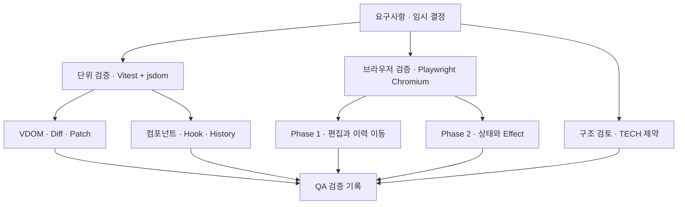
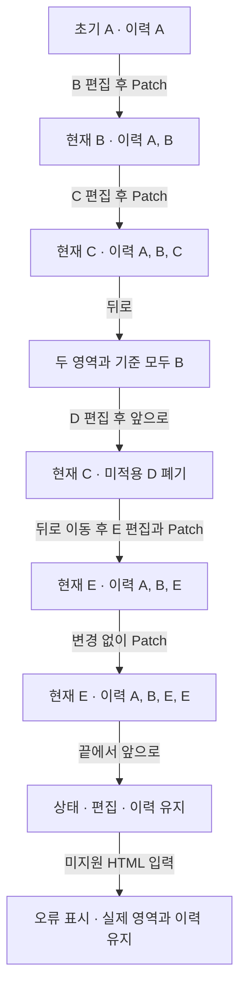
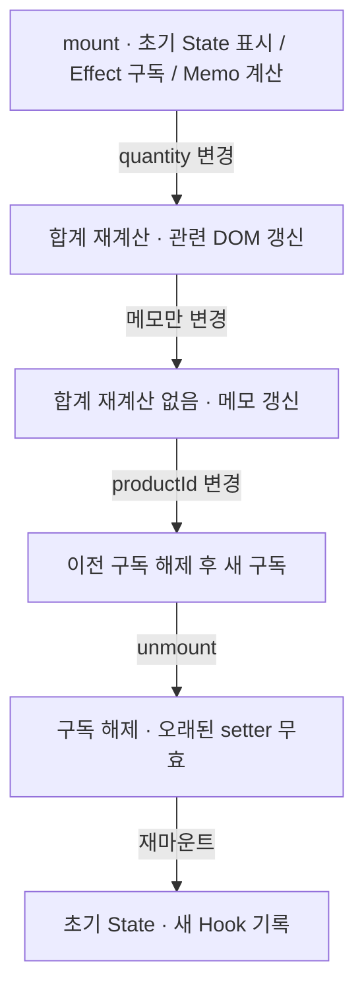
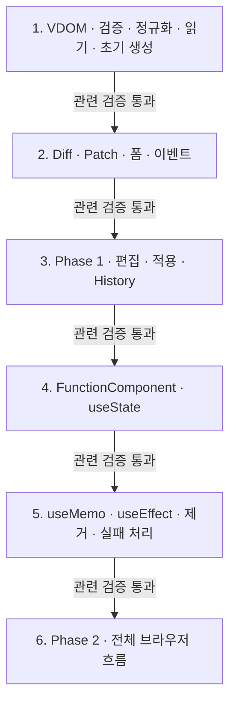

# 검증 계획과 구현 순서

상태: 설계 검증 계획. 아래 테스트는 아직 작성·실행하지 않았다.

## 한눈에 보기

## 환경

[OPEN-10 임시 결정](temporary-decisions.md)에 따라 Vitest+jsdom으로 핵심 모듈을, Playwright Chromium으로 브라우저 흐름을 검증한다. 외부 UI 프레임워크는 사용하지 않는다. 테스트 도구와 버전은 구현 착수 시 설치·기록한다.

## 요구사항과 검증 연결

| 요구사항 | 검증 대상 | 핵심 확인 |
| --- | --- | --- |
| [VDOM-01](../requirements.md#vdom-01), [VDOM-02](../requirements.md#vdom-02) | readDOM | 중첩·순서·공백·속성·현재 폼 값, 미지원 입력 |
| [DIFF-01](../requirements.md#diff-01), [DIFF-02](../requirements.md#diff-02), [DIFF-03](../requirements.md#diff-03) | diff | 추가·삭제·태그·텍스트·속성·무변경, 입력 불변 |
| [PATCH-01](../requirements.md#patch-01), [PATCH-02](../requirements.md#patch-02), [PATCH-03](../requirements.md#patch-03) | mountTree/applyPlan | 목표 DOM 일치, 형제 참조 보존, 무변경 쓰기 없음 |
| [COMP-01](../requirements.md#comp-01), [COMP-02](../requirements.md#comp-02), [COMP-03](../requirements.md#comp-03) | FunctionComponent | 초기 표시·Props 전달·State 부분 갱신 |
| [STA-01](../requirements.md#sta-01), [STA-02](../requirements.md#sta-02), [STA-03](../requirements.md#sta-03) | useState | 초기화·두 슬롯 독립·setter·함수형 업데이트·같은 값 생략 |
| [EFF-01](../requirements.md#eff-01), [EFF-02](../requirements.md#eff-02), [EFF-03](../requirements.md#eff-03), [EFF-04](../requirements.md#eff-04) | useEffect | DOM 반영 후 설정·의존성 비교·정리 순서·제거 |
| [MEMO-01](../requirements.md#memo-01), [MEMO-02](../requirements.md#memo-02), [MEMO-03](../requirements.md#memo-03) | useMemo | 최초 계산·동일 결과 재사용·새 deps 계산 |
| [EDIT-01](../requirements.md#edit-01), [EDIT-02](../requirements.md#edit-02) | 편집 컨트롤러 | HTML 편집·폼 현재 값 반영·적용 전 실제 영역 유지 |
| [VIEW-01](../requirements.md#view-01), [VIEW-02](../requirements.md#view-02), [VIEW-03](../requirements.md#view-03), [VIEW-04](../requirements.md#view-04) | 브라우저 통합 | 두 영역·버튼·초기 변환·Patch·Phase 2 사례 |
| [HIST-01](../requirements.md#hist-01), [HIST-02](../requirements.md#hist-02), [HIST-03](../requirements.md#hist-03) | HistoryStore/컨트롤러 | 스냅샷 독립·이동·동기화·분기·경계 |
| [TECH-01](../requirements.md#tech-01), [TECH-02](../requirements.md#tech-02) | 구성 검토 | TS/Vanilla 사용, 외부 UI 프레임워크 미사용 |
| [TECH-03](../requirements.md#tech-03), [TECH-04](../requirements.md#tech-04) | 클래스 검토 | FunctionComponent·hooks·mount·update 존재와 사용 |
| [TECH-05](../requirements.md#tech-05), [TECH-06](../requirements.md#tech-06) | 호출 문맥·예제 검토 | 루트 Hook, 자식 순수성, 자식 Hook 오류 |
| [QA-01](../requirements.md#qa-01), [QA-02](../requirements.md#qa-02), [QA-03](../requirements.md#qa-03), [QA-04](../requirements.md#qa-04), [QA-05](../requirements.md#qa-05) | 검증 기록 | 단위·기능·경계·부분 갱신 결과와 실행 방법 기록 |

## 반드시 연결해서 확인할 흐름

### Phase 1

### Phase 2

## 경계·오류 사례

- 중간 자식 삽입·삭제·타입 교체가 한 번에 발생하는 경우.
- input/textarea의 속성 초기값과 현재 프로퍼티가 다른 경우.
- 새 이벤트 함수 적용 후 이전 함수가 호출되지 않는지.
- Effect deps 생략·[]·동일 배열 값·새 객체·NaN·+0/-0.
- Hook 개수/종류 오류와 자식 Hook 호출.
- Effect 중 setter, 무한 갱신 차단, cleanup 예외 뒤 다른 정리 지속.
- 렌더 실패 후 마지막 성공 DOM·State·Memo 유지 및 미실행 Effect.
- 인위적인 DOM 적용 오류에서 History를 확정하지 않는지.

## 설계 검토 회귀 사례

아래는 구현 후 실행할 검증 계약이며, 현재 통과한 테스트를 뜻하지 않는다. 브라우저의 label 기본 동작은 jsdom 검사만으로 대체하지 않고 Playwright Chromium에서 확인한다.

### ID 격리와 논리 값 왕복

관련: [VDOM-02](../requirements.md#vdom-02), [PATCH-01](../requirements.md#patch-01), [EDIT-01](../requirements.md#edit-01), [HIST-03](../requirements.md#hist-03), OPEN-01 임시 지원 범위.

| 조건 | 관찰할 결과 |
| --- | --- |
| 같은 논리 ID의 label·checkbox를 두 scope로 생성 | 실제 ID는 서로 다름. 각 label.control이 자기 영역 input과 동일한 DOM 객체이며 다른 영역 input을 가리키지 않음 |
| 미리보기 label 클릭 | 미리보기 checkbox만 토글, 실제 영역의 값과 DOM 객체는 유지. editorText에는 논리 ID와 새 checked 상태가 반영됨 |
| 실제 영역 label 클릭 | 연결 대상은 실제 영역 input이며 미리보기는 불변. 컨트롤러 복원 후 실제 checked는 appliedTree와 같음. 복원 전 연결 대상도 별도로 관찰 |
| 지원 단일/목록 ARIA ID 참조 생성 | 각 실제 참조 토큰의 대상은 해당 컨테이너 안에 있음. 읽기 결과는 원래 논리 ID·순서이며 목록 공백은 정규화 |
| 생성 → readDOM(scope) → 직렬화 → 원본 파싱 → 재생성 | 지원 범위의 정규화 VDOM 동등성 유지, editorText·Diff·History에는 실제 ID·scope가 없음 |
| ID와 for·ARIA 참조를 함께 변경한 뒤 Patch·뒤로·앞으로 | 같은 scope의 실제 ID 연결 유지, 같은 논리 트리를 읽은 두 영역은 동등, 이력 스냅샷은 불변 |
| 중복·빈·공백 ID, 빈 참조, 누락/영역 밖 대상, 미지원 ARIA, 부적합 label 대상 | 연결 전 검증 오류. 마지막 유효 미리보기·실제 영역·이력 유지 |
| 다른 컨테이너의 scope, 해제된 scope, 외부 scope의 실제 ID로 읽기 | 오류로 거부, 잘못된 실제 ID를 논리 값으로 저장하지 않음 |

추가로 인코딩 충돌 가능 문자열과 반복 Patch를 사용해 일대일성·안정성을 확인한다. scope 해제 후 관리 노드·바인딩이 남지 않는지도 검사한다.

### Effect 중 제거 진입 거부

관련: [EFF-04](../requirements.md#eff-04)의 임시 채택, OPEN-08·09 및 런타임 재진입 계약.

| 조건 | 관찰할 결과 |
| --- | --- |
| setup이 자원을 확보하고 unmount 오류를 잡은 뒤 cleanup 반환 | 거부 시 generation·슬롯·DOM이 변경되지 않음. cleanup 저장, 후속 setup 실행. idle에서 실제 제거하면 자원 해제 한 번, 이후 setup 없음 |
| setup이 자원 확보 후 재진입 오류를 전파하되 자체 실패 정리 수행 | setup의 자원 해제, 런타임 오류 보고, 다른 Effect 처리는 계속. 반환되지 않은 cleanup을 런타임이 호출했다고 기록하지 않음 |
| deps 변경 cleanup에서 unmount 요청 | effects phase에서 거부. 이전 cleanup 중복 호출 없음. 일반 Effect 오류 정책에 따라 후속 setup 진행 |
| 실제 제거 cleanup에서 다시 unmount·setter 호출 | unmount 재진입은 거부, setter는 무효. 다른 cleanup·DOM 제거는 계속, 제거 후 후속 setup 없음 |
| rendering/committing/recovering에서 unmount 요청 | 상태 변경 전 오류. 기존 작업을 제거 완료로 오인하거나 제거 요청을 보류하지 않음 |
| 제거 cleanup 하나가 실패 | 다른 정리·DOM 제거 시도 지속, 오류 보고. 실제 해제에 실패한 자원까지 해제됐다고 판정하지 않음 |

실행 중 제거가 **거부된** 경우와 idle에서 제거가 **수락된** 경우를 나눠 기대값을 기록한다. 전자에서 후속 setup 실행 자체를 결함으로 보지 않는다. 모든 정상 setup은 반환 cleanup을, 예외가 나는 setup은 자체 실패 정리를 검증해야 한다.

### DOM 재구성과 Effect 수명 종료

관련: [PATCH-02](../requirements.md#patch-02), [EFF-04](../requirements.md#eff-04), OPEN-09 및 런타임 실패 계약. 일반 성공 갱신의 DOM 정체성 인수 조건과 구분한다.

1. [] Effect가 소유 컨테이너의 특정 DOM 노드에 리스너·관찰자를 연결하고 그 노드 참조를 cleanup에 캡처한다.
2. 부분 DOM 변경 뒤 Patch 예외를 주입한다. 새 candidate State·Memo·pending setup이 확정되지 않고 대기 요청이 폐기되는지 확인한다.
3. 기존 cleanup이 이전 노드 참조의 자원을 한 번 정리하는지 확인한다. 다른 Effect도 정리하며 [] setup을 자동 재실행하지 않는다.
4. 같은 scope의 마지막 성공 표시용 DOM이 재구성되어도 phase는 faulted인지 확인한다. 복구 노드가 새 객체여도 허용하지만, 기존 이벤트·setter·동기/비동기 대기 콜백은 컴포넌트 갱신을 실행하면 안 된다. 컨테이너 조작도 차단한다.
5. update·직접 mount는 거부하고 명시적 unmount → mount만 허용하는지 확인한다. 기존 cleanup을 중복 실행하지 않고, 새 초기 State·Memo와 새 DOM에 setup을 한 번 실행해야 한다.
6. 재구성 자체의 실패, cleanup 예외, 최초 mount 중 Patch 실패도 주입한다. 모두 faulted로 멈추고 오류 종류를 구분하며, 제거 시 남은 DOM·바인딩·scope를 회수하는지 확인한다.

대조 사례로 DOM 변경 전 렌더·검증 실패에서는 기존 Effect를 정리하지 않고 마지막 성공 State·Memo로 재시도할 수 있어야 한다. Phase 1 복구 성공은 Hook 수명과 무관하게 두 scope·이력·컨트롤러 이벤트를 유지하고 편집 재개가 가능해야 한다.

## 구현 순서

각 단계는 관련 검증을 통과한 뒤 다음 단계로 진행한다. 인수 조건에 영향을 주는 임시 정책이 바뀌면 그 테스트의 기대 결과도 변경한다.

1단계에는 scope 생성·읽기/쓰기 왕복·ID 참조 검증을, 3단계에는 label 클릭과 이력 이동을 포함한다. 5단계에는 제거 재진입 거부와 DOM 재구성 후 faulted·재마운트 검증을 포함한다. 이 계약은 구현 착수 전 설계 검증 에이전트가 재검토한다.

## 설계 변경 시 점검

| 변경 | 함께 검토할 부분 |
| --- | --- |
| DOM 지원 확대 | reader·validator·serializer·bindings·시연 샘플 |
| 의존성 비교 변경 | Effect·Memo·객체 관련 테스트 |
| 이력 정책 변경 | HistoryStore·버튼 상태·편집 처리·오류 복원 |
| Hook 사용 범위 확대 | FunctionComponent 구조·호출 문맥·슬롯 소유권 |
| key 기반 이동 추가 | VDOM 타입·Diff 대응·Patch 계획·DOM 정체성 기대값 |
| 식별자·ARIA 범위 변경 | DOMScope·reader·bindings·serializer·History와 브라우저 label/ARIA 연결 |
| 제거·DOM 복구 정책 변경 | phase 진입 검사·generation·대기열·Effect 소유권·이벤트와 재마운트 |
