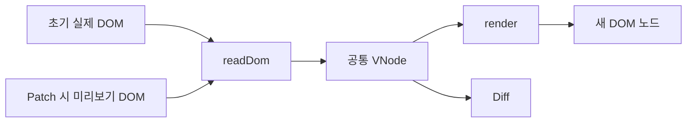

# Virtual DOM 상세 설계

> **상태:** 두 Phase의 VNode 렌더링·이벤트·DOM 프로퍼티를 로컬 구현. 실행 결과는 [검증 계획](../testing.md)에 둔다.
> **관련 요구:** FR-01~02, FR-05, FR-16 · [요구사항](../requirements.md) · [전체 설계](../design.md)

## 1. 범위와 책임

- 최초 로드에는 실제 영역의 샘플 DOM을 읽어 Virtual DOM으로 표현하고, 그 결과로 테스트 영역의 미리보기를 렌더링한다. (FR-01~02)
- 테스트 영역은 HTML 코드 입력창과 결과 미리보기로 구성한다. 코드 수정 중에는 미리보기만 바뀌고 실제 영역은 유지된다. Patch 시점에는 **현재 미리보기 DOM**을 다시 읽는다. (FR-05~06)
- Phase 1 테스트 HTML의 지원 범위는 `div`, `h2`, `p`, `strong`, `ul`, `li`, `span` 요소와 `class`, `title`, `data-*` 속성, 그 안의 텍스트다. `data-*`에는 `data-` 뒤의 이름이 필요하다. 이 목록은 Phase 2 데모의 버튼·입력창을 제한하지 않는다. (D-08~09)
- 입력에는 최상위 요소가 정확히 하나 있어야 한다. 빈 입력이나 최상위 요소 둘 이상은 오류이며, 속성값은 작은따옴표 또는 큰따옴표로 감싼다. (D-10)
- 주석과 들여쓰기용 공백은 Virtual DOM에 담지 않고, 화면에서 단어를 띄우는 공백은 보존한다. 정확한 입력 규칙은 [HTML 입력 설계](html-input.md)를 따른다. (D-11)
- 폼의 현재 값과 이벤트 처리는 Phase 1 비교 범위 밖에 둔다. `value` 같은 HTML 속성과 사용자가 입력한 현재 값은 서로 다른 데이터다. (D-08)

## 2. 입력·출력 계약

| 단계 | 입력 | 출력 |
| --- | --- | --- |
| 최초 DOM 읽기 | 실제 영역의 샘플 DOM | 지원 대상 구조·텍스트·속성을 담은 Virtual DOM |
| 미리보기 렌더링 | Virtual DOM | 테스트 영역에 표시되는 미리보기 DOM |
| 코드 편집 | 사용자가 수정한 HTML 문자열 | 지원 목록을 만족하면 변경된 미리보기 DOM; 실제 영역은 유지 |
| 코드 검증 실패 | 지원하지 않는 요소·속성 또는 프로젝트 문법 위반을 포함한 HTML 문자열 | 오류 표시; 마지막 유효 미리보기와 실제 영역 유지; Patch 차단 |
| Patch 시점 DOM 읽기 | 현재 미리보기 DOM | Diff에 전달할 새 Virtual DOM |

HTML 문자열은 미리보기에 반영하기 전에 검증한다. 최상위 요소 하나, 명시적인 닫는 태그, 짝이 맞는 중첩과 따옴표로 감싼 속성값을 요구하며, 브라우저의 자동 보정으로 이 규칙을 우회하지 않는다. 뒤로가기·앞으로가기에서 코드 입력창과 미리보기를 함께 복원하는 계약은 [History 설계](history.md)를 따른다.

## 3. 데이터 표현과 불변 조건

지원 목록의 요소·속성, 텍스트 및 자식 순서를 표현해야 하며, UI 트리의 최상위에는 요소 하나만 둔다. 주석과 들여쓰기는 담지 않고 의미 있는 공백은 유지한다. 들여쓰기를 제외해도 Diff 결과의 자식 위치가 실제 DOM에서 올바른 노드를 가리키도록 하는 방법은 [Diff·Patch 설계](diff-patch.md)를 따른다.

## 4. 처리 흐름과 다이어그램

`실제 DOM → Virtual DOM → 최초 미리보기`

`HTML 코드 수정 → 미리보기 변경 (실제 영역 유지) → Patch → 미리보기 DOM 읽기 → 새 Virtual DOM → Diff·Patch`

## 5. 경계 사례와 오류 처리

지원 목록 밖의 요소·속성이나 프로젝트 입력 규칙 위반은 미리보기에 반영하지 않고 오류를 표시한다. 마지막 유효 미리보기와 실제 영역을 유지하며, 입력을 고칠 때까지 Patch를 막는다. 따라서 `script`나 `on*` 이벤트 속성도 지원하지 않는다. 주석은 무시한다. Phase 2의 이벤트 연결은 [컴포넌트·Hooks](component-hooks.md)에서 다룬다.

## 6. 선택·대안·한계

렌더링 결과를 직접 편집하는 대신 HTML 코드 입력을 택했다. 텍스트뿐 아니라 태그·속성·자식 구조를 편집하며 Diff의 기본 사례를 확인하기 위해서다. 입력창과 미리보기가 함께 필요하고, 편집한 코드가 미리보기에 반영되는 경로를 설계해야 한다.

## 7. 검증 사례

예시 입력은 지원 범위 안의 요소와 속성만 사용한다.

```html
<div class="cart">
  <h2>장바구니</h2>
  <p class="count">상품 1개</p>
  <ul><li data-sku="apple">사과</li></ul>
</div>
```

- 최초 로드 후 미리보기의 지원 대상 내용이 실제 영역의 샘플과 일치한다. (FR-01~02)
- 텍스트·속성·자식 구조를 코드에서 바꾸면 미리보기만 갱신된다. Patch 뒤 실제 영역에 반영된다. (FR-03~06)
- `<script>` 또는 `onclick`을 입력하면 오류가 보이고 미리보기·실제 영역은 이전 유효 상태를 유지하며 Patch가 차단된다. (FR-06)
- `<p>상품 1개`처럼 닫는 태그가 없거나 태그의 짝이 맞지 않으면 브라우저가 보정한 미리보기를 표시하지 않고 프로젝트 입력 규칙 위반으로 처리한다. (FR-06)
- 빈 입력, `<p>사과</p><p>배</p>`, `<p class=count>사과</p>`는 오류로 처리한다. (FR-06)
- `<p>사과<!-- 메모 --></p>`의 주석은 Virtual DOM에 나타나지 않는다. `<strong>사과</strong> <span>배</span>`의 두 태그 사이 한 칸은 남기되, 코드 들여쓰기만을 위한 공백은 담지 않는다. (FR-01~02)
- 폼의 현재 값과 이벤트 처리는 Phase 1의 Virtual DOM 비교 대상으로 검증하지 않는다. Phase 2의 사용자 클릭·입력 요구는 별도로 검증한다. (FR-17)

## 8. 공통 VNode 구현 계약

**DOM 호환 경계:** 실제 DOM에 추가된 `bis_skin_checked`만 DOM 읽기와 Patch 속성 비교에서 제외한다. DOM에서 삭제하거나 VNode·History에 저장하지 않는다. 사용자 HTML·VNode의 허용 속성 목록은 유지하고 다른 외부 속성 변경도 계속 검사한다.

VNode는 실제 DOM 참조를 담지 않는 JavaScript 객체다. Phase 1 History에는 데이터만 담긴 트리를 저장한다. 기본 렌더러·Patch는 Phase 1 지원 목록을 적용하고 비어 있지 않은 `events`·`domProps`를 거부한다. Phase 2는 `{phase: 2}`로 명시해 두 필드를 DOM에 적용한다. 이벤트 핸들러는 함수이므로 Phase 2 VNode 전체를 JSON 직렬화할 수 있다고 가정하지 않는다.

```js
{ kind: "text", value: "상품 2개" }
{
  kind: "element",
  tag: "p",
  attrs: { class: "count", "data-key": "summary" },
  children: [{ kind: "text", value: "상품 2개" }],
  events: {},   // Phase 2에서만 사용
  domProps: {}  // Phase 2의 input.value 같은 현재 DOM 프로퍼티
}
```

| 경계 | 제안 계약 |
| --- | --- |
| `kind`·`tag` | 요소/텍스트를 구분하고 요소 태그명은 소문자로 표현한다. |
| `attrs`·`children` | HTML 속성은 문자열 맵, 자식은 순서 있는 배열이다. 속성 순서는 비교하지 않는다. |
| `events`·`domProps` | Phase 2 전용이다. 이벤트 함수와 `input.value` 같은 현재 프로퍼티를 담는다. |
| `data-key` | 형제 목록의 식별자다. 빈 문자열·형제 간 중복은 오류, 다른 부모 간 중복은 허용한다. 공백을 trim하지 않는다. |
| Phase 1 HTML 입력 | 지원 문법·오류·공백 규칙은 [HTML 입력 설계](html-input.md)가 소유한다. |

`readDom(root)`는 최초 실제 영역과 Patch 시점의 미리보기에 **같은** 주석·공백 규칙을 적용한다. `render(vnode)`는 새 DOM 노드를 반환한다. 실제 DOM의 들여쓰기 텍스트 노드와 VNode 자식 인덱스 차이는 [Diff·Patch](diff-patch.md)가 이전 VNode에 대응하지 않는 노드만 건너뛰며 해결한다. Phase 2의 `button`·`input`은 컴포넌트가 VNode로 생성하며 Phase 1 HTML 입력 허용 목록에 추가하지 않는다.

Phase 2의 `render(tree, document, {phase: 2})`와 `patch(root, plan, {phase: 2})`는 기본 요소에 `button`·`input`·`label`을 더한다. 속성은 기본 목록과 `id/type/min/max/step/name/for/placeholder/role/tabindex/disabled`, `aria-*`만 허용한다. 이벤트는 소문자 이름과 함수로 연결한다. 현재 프로퍼티는 `input`의 문자열 `value`·불리언 `checked`만 지원하며 `innerHTML`·`onclick` 속성은 거부한다. `validateDomTree`가 DOM 쓰기 전에 지원 범위까지 검사한다.

주석 노드는 읽기에서 제외하되 양옆 텍스트 노드는 합치지 않는다. 예를 들어 `<p>사과<!-- 메모 -->배</p>`의 `children`은 텍스트 둘이고 `<p>사과배</p>`는 하나다. Patch도 주석을 건너뛰면서 이 텍스트 노드 경계를 유지한다. 입력 검사기가 만든 미리보기와 최초 실제 DOM에 같은 기준을 적용한다.



추가 검증: 요소/텍스트/속성/자식 순서, 주석·공백 정규화의 동일성, Phase 2 이벤트와 `domProps`가 DOM에 반영되는지 확인한다. 구체적 테스트 ID는 [검증 계획](../testing.md)에 연결한다.
